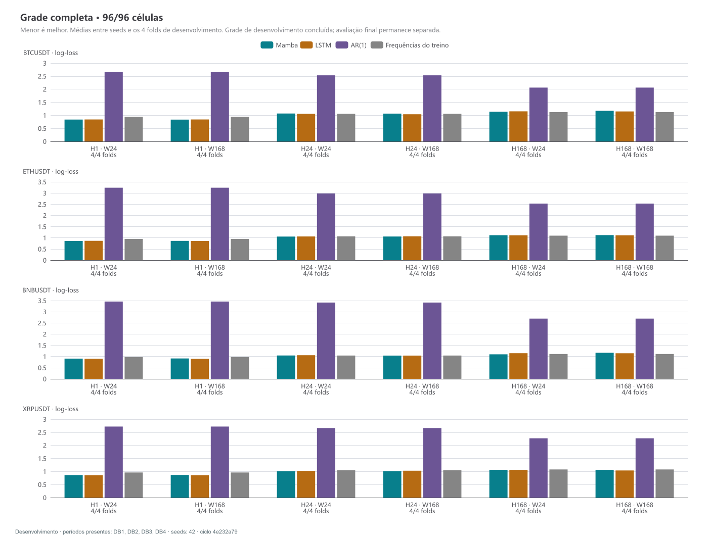

# Ciclo 001 — resultados completos do desenvolvimento

Fechado em 18/10/2026. Ciclo `4e232a796fcda0ea34c3`; dataset `9341610dbb329a858784`; protocolo 2.1. Grade completa: quatro moedas, contextos de 24/168 horas, prazos de 1/24/168 horas, DB1–DB4 de 2023, seed 42. São 96 células, 192 ajustes neurais e 16 ajustes únicos do AR(1). Não houve falha ou repetição de célula de mercado nesta identidade. As duas células iniciais foram reaproveitadas na grade, sem contagem adicional.

**Conclusão:** as redes melhoraram a qualidade probabilística média em relação às frequências de treino e ao AR(1) especificado, mas não em todos os prazos. Não há superioridade demonstrada de Mamba sobre LSTM. A política produziu poucas operações, retornos positivos e negativos, e nenhuma evidência suficiente de rentabilidade consistente. O contexto maior não trouxe benefício uniforme. O prazo semanal merece investigação, pois ambas as redes ficaram piores que a referência constante nesse recorte.

Esses resultados são de desenvolvimento consultado para formular novas hipóteses. Não são avaliação final independente, recomendação de investimento ou certificação de execução real. B1–B4 continuam bloqueados.

## 1. Evidência e população

A coleta auditou 144 arquivos mensais de um minuto, de 2021–2023. Não foram coletados dados de 2024–2025 para este ciclo. Lacunas e minutos interrompidos foram preservados, sem interpolação. O dataset contém 23.444 origens comuns entre partições; **7.908** são origens distintas de teste por combinação: DB1 1.812, DB2 2.016, DB3 2.040 e DB4 2.040. As mesmas origens são usadas entre moedas, contextos e prazos na comparação preditiva. Sobreposição temporal dos rótulos e correlação entre moedas impedem tratá-las como observações independentes.

Treinos expansivos, scalers ajustados apenas no treino e purga pela expiração máxima de 168h foram conferidos. Checkpoints foram escolhidos pela log-loss de validação; nenhum teste de desenvolvimento escolheu retrospectivamente sua época. Todas as recargas reproduziram exatamente as previsões salvas. A auditoria suplementar integral aprovou 96/96 células, com recálculo de métricas e conferência de artefatos, checkpoints, fontes e contabilidade. Os 25 testes Python finais passaram, incluindo os sintéticos CUDA, sem casos ignorados. Uma adulteração deliberada de resumo em cópia temporária foi detectada; os originais foram preservados.

A população operacional é diferente: depende apenas do passado disponível e do calendário, sem usar completude futura para decidir entrar. Somando quatro moedas e quatro folds, antes de repetir modelos/contextos, há 34.344 origens operacionais para H1, 34.036 para H24 e 32.308 para H168; respectivamente 8, 93 e 568 desfechos não observáveis. Eles não foram removidos para melhorar o backtest. As políticas filtradas permaneceram auditáveis; os controles sem filtro têm limitações descritas abaixo.

## 2. Qualidade probabilística

Médias com peso igual por célula/fold, uma seed. Log-loss e Brier: menor é melhor. Acerto balanceado é a média do recall das **três classes**.

| Modelo | Log-loss | Brier | Acerto balanceado |
|---|---:|---:|---:|
| Frequências observadas no treino | 1,038115 | 0,622518 | 33,33% |
| AR(1) probabilístico | 2,768856 | 0,930440 | 34,57% |
| LSTM | 1,009434 | 0,603331 | 39,18% |
| Mamba | 1,010357 | 0,603845 | 38,81% |

O contraste pareado Mamba menos LSTM na log-loss é **+0,000923**, com intervalo de 95% por blocos de 14 dias **[−0,006171; +0,004971]**. O intervalo inclui zero; os blocos de 7 e 28 dias também. Mamba apresentou menor log-loss em 41/96 células. Não há superioridade demonstrada, e ausência de diferença detectada não prova equivalência. Os intervalos condicionam-se aos modelos treinados e a esta seed; não incorporam toda a incerteza de seleção entre ciclos.

Mamba menos AR(1): **−1,758500**, intervalo de 14 dias **[−1,928062; −1,505132]**. A vantagem é frente a este baseline específico, com inovações gaussianas e volatilidade residual histórica fixa por fold. Não significa vencer qualquer modelo estatístico. O diagnóstico mostra forte subestimação da expiração pelo AR(1): probabilidades médias de 5,49%, 3,89% e 3,69% em H1/H24/H168, ante frequências observadas médias de 59,95%, 48,62% e 42,69%. Sua qualificação Monte Carlo passou; convergência numérica não torna suas hipóteses adequadas ao mercado.

| Prazo máximo | Frequências do treino | AR(1) | LSTM | Mamba |
|---|---:|---:|---:|---:|
| 1h | 0,958329 | 3,018582 | 0,866459 | 0,868270 |
| 24h | 1,053834 | 2,898042 | 1,047167 | 1,044955 |
| 168h | 1,102181 | 2,389945 | 1,114676 | 1,117845 |

O ganho médio das redes concentra-se em H1. Em H24 é pequeno; em H168, ambas perdem para a referência constante. A menor log-loss absoluta em H1 não significa que seja o prazo mais rentável: as classes têm distribuições e dificuldades diferentes. Para H168, Mamba/LSTM atribuem em média 30,36%/29,84% à expiração, abaixo dos 42,69% observados. Isso é um diagnóstico agregado de calibração, não prova da causa do erro nem justificativa para recalibrar com o teste.

Por moeda, a diferença Mamba−LSTM é −0,003970 em BNB, +0,006648 em BTC, −0,000195 em ETH e +0,001208 em XRP. Por fold: +0,011296 em DB1, +0,002316 em DB2, −0,010672 em DB3 e +0,000750 em DB4. São descrições sem correção de multiplicidade; não selecionam uma moeda ou trimestre vencedor.

## 3. Mais contexto ajudou?

Contraste abaixo: **log-loss W24 menos W168**. Positivo favorece sete dias de sequência; negativo favorece um dia. Cada linha resume 16 pares moeda/fold, todos preservados.

| Modelo | Prazo | Diferença média | Pares em que W168 foi melhor |
|---|---:|---:|---:|
| LSTM | 1h | +0,001441 | 10/16 |
| LSTM | 24h | +0,005628 | 9/16 |
| LSTM | 168h | +0,006851 | 8/16 |
| Mamba | 1h | −0,002886 | 3/16 |
| Mamba | 24h | +0,000279 | 7/16 |
| Mamba | 168h | −0,026343 | 5/16 |

LSTM melhora na média dos três prazos, com heterogeneidade entre casos. Mamba piora em H1 e especialmente em H168; em H24 a diferença média é pequena. Portanto, **mais contexto disponível não garante melhor previsão**. Os intervalos pareados individuais de 7/14/28 dias estão no [CSV de contexto](ciclo_001_completo/efeito_contexto.csv). Não foi calculada uma média dos limites desses intervalos para fingir um intervalo agregado.

Ambos W recebem o resumo de volatilidade dos últimos sete dias. O contraste mede 1 versus 7 dias de sequência detalhada condicionado a esse resumo comum. AR(1) não depende de W; suas cópias nos dois contextos não são novos ajustes independentes. A piora do Mamba longo não identifica sozinha sobreajuste, capacidade insuficiente ou defeito de memória; isso exige uma ablação controlada.

## 4. Distância das barreiras e duração observada

Valores a seguir são medianas calculadas sobre as 7.908 origens concatenadas por moeda/H, sem repetir modelos ou contextos e sem tirar média de medianas trimestrais. A distância é a alta até a barreira superior, em percentual simples. A barreira inferior é simétrica em log-preço, portanto tem percentual simples ligeiramente diferente.

| Moeda | Alta até limite H1 | H24 | H168 | Duração mediana H168 |
|---|---:|---:|---:|---:|
| BTC | 0,408% | 2,015% | 5,419% | cerca de 5,40 dias |
| ETH | 0,469% | 2,318% | 6,250% | cerca de 5,36 dias |
| BNB | 0,449% | 2,219% | 5,978% | cerca de 5,39 dias |
| XRP | 0,603% | 2,989% | 8,103% | cerca de 6,46 dias |

Assim, o desenho realmente produz limites mais distantes para uma semana, ajustados à volatilidade passada de cada origem. Não é uma faixa com cobertura garantida. A ordem de volatilidade não foi presumida: neste resumo, BNB ficou abaixo de ETH.

Em H1, 57,87%–61,42% das origens expiram sem toque e a duração mediana é 60 minutos. Em H24, a proporção de expiração fica entre 47,04% e 49,90%, com medianas de aproximadamente 22,10–23,93 horas. Em H168, 41,07%–46,36% expiram. As durações se referem aos eventos rotulados, não somente às operações escolhidas pelo modelo. Toques intraminuto têm incerteza de até um minuto, preservada em duas colunas de duração.

H e distância variam juntos por construção. A comparação entre H1 e H168 é entre desenhos operacionais diferentes; não isola o efeito de apenas esperar mais tempo com barreiras idênticas.

Houve seis origens ambíguas em H1 somadas entre moedas, e nenhuma em H24/H168 na população de teste, antes de repetir modelos/contextos. Todas as partições do dataset passaram pelos gates predefinidos. Os limites médios de log-loss por ambiguidade são [1,010351; 1,010367] para Mamba e [1,009430; 1,009441] para LSTM. A sensibilidade econômica superior-primeiro não alterou os resultados anuais das políticas filtradas deste ciclo.

## 5. Utilidade operacional após custos

Compra à vista ou caixa, sem alavancagem, uma posição por estratégia. Custos base: 0,10% de taxa e 0,05% de slippage por lado. Entrada exige probabilidade superior ≥60% e viabilidade nominal após custos. Fração da carteira limita a perda nominal no stop a 1%, limitada a 100% do capital; gaps e execução real podem exceder a perda nominal. Cada estratégia é avaliada separadamente, sem somar retornos ou posições sobrepostas como carteira.

Os retornos anuais abaixo concatenam os quatro folds. Entre parênteses, número total de operações da estratégia. AR(1) permaneceu em caixa em todas as 24 combinações, com retorno zero e nenhuma operação; seus valores não são repetidos nas colunas.

| Moeda | H | LSTM W24 | LSTM W168 | Mamba W24 | Mamba W168 |
|---|---:|---:|---:|---:|---:|
| BNB | 1 | 0,000% (0) | 0,000% (0) | 0,000% (0) | 0,000% (0) |
| BNB | 24 | 0,000% (0) | 0,000% (0) | −1,000% (1) | −0,306% (4) |
| BNB | 168 | −0,744% (2) | −0,452% (3) | −0,158% (2) | −1,498% (10) |
| BTC | 1 | 0,000% (0) | 0,000% (0) | 0,000% (0) | 0,000% (0) |
| BTC | 24 | 0,000% (0) | 0,000% (0) | +0,154% (1) | −0,150% (7) |
| BTC | 168 | 0,000% (0) | 0,000% (0) | 0,000% (0) | −1,697% (2) |
| ETH | 1 | 0,000% (0) | 0,000% (0) | +0,328% (1) | 0,000% (0) |
| ETH | 24 | 0,000% (0) | 0,000% (0) | +0,947% (9) | +2,364% (5) |
| ETH | 168 | 0,000% (0) | 0,000% (0) | −3,195% (7) | +1,851% (2) |
| XRP | 1 | 0,000% (0) | 0,000% (0) | +0,717% (1) | +2,101% (3) |
| XRP | 24 | 0,000% (0) | 0,000% (0) | −0,255% (2) | 0,000% (0) |
| XRP | 168 | 0,000% (0) | +1,024% (1) | +0,556% (4) | +0,154% (2) |

Mamba: nove estratégias positivas, oito negativas e sete sem operação. LSTM: uma positiva, duas negativas e 21 sem operação. Os totais de operações são 63 e 6, respectivamente, **somados entre estratégias sobrepostas, não negócios independentes de uma carteira**. Cada estratégia ativa fez de 1 a 10 operações no ano; é pouca evidência para inferir vantagem persistente. Todos os intervalos anuais de retorno por blocos de 14 dias incluem zero, inclusive quando zero é um dos extremos.

O maior retorno observado do Mamba foi ETH/W168/H24, +2,364%, com cinco operações, drawdown de 1,019% e exposição em 0,467% do tempo. O menor foi ETH/W24/H168, −3,195%, com sete operações, drawdown de 4,056% e exposição de 4,197%. Esses extremos descrevem a grade; não elegem uma configuração para operar. A maior exposição temporal entre estratégias Mamba foi 11,766%. Retornos pequenos e drawdowns pequenos precisam ser lidos junto ao longo tempo em caixa e ao capital efetivamente alocado.

No diagnóstico de sinais, somando as estratégias Mamba por prazo, 36 origens de H1 ultrapassaram 60% de probabilidade, mas 31 reprovaram o teste de custos: restaram cinco operações. Em H24 houve 67 sinais elegíveis e 29 operações; em H168, 141 sinais e 29 operações. A posição já aberta impede executar todos os sinais. Essas contagens repetem origens entre contextos e moedas; não são tamanho amostral independente.

Com custos agravados (taxa 0,20% e slippage 0,10% por lado), preservando sinais e frações, Mamba varia de −3,616% a +1,903%; LSTM de −0,925% a +0,987%. As contagens de estratégias positivas/negativas/sem operação não mudam. Custos maiores reduzem os retornos, sem trocar os parâmetros para favorecer resultados. Todas as 72 trajetórias anuais base e suas sensibilidades de custos/ambiguidade são auditáveis.

### Controles e lacunas

O controle sem filtro entra sistematicamente e atravessa lacunas de DB1: **nenhuma de suas 72 trajetórias anuais completas é auditável**. Não foi composto retorno apenas com os trimestres convenientes. Isso limita a conclusão sobre o valor econômico do filtro frente a esse controle.

Comprar/manter por bloco também não tem percurso integral observável em DB1. Um complemento descritivo posterior ao plano verificou separadamente entrada e saída fixas observadas, sem reconstruir o caminho. Com fechamento/reabertura a cada trimestre e custos por bloco, os retornos compostos das pontas foram BTC +152,383%, ETH +88,237%, BNB +25,139% e XRP +79,728%. **Não são uma posição ininterrupta anual; o drawdown anual permanece indisponível.** Esse complemento não foi aplicado às estratégias de barreira, cuja saída depende do percurso. A exposição de comprar/manter é muito maior que a das políticas filtradas, impedindo inferência simples de superioridade ajustada ao risco. Caixa retorna zero sob a hipótese de ausência de remuneração.

## 6. Treinamento e próximo passo

Mamba tem 20.326 parâmetros e LSTM 13.542. A época selecionada mediana foi 8 no Mamba (mínimo 1, máximo 35) e 11 na LSTM (1–61). A primeira época foi selecionada em 17/96 e 21/96 ajustes. Os tempos de ajuste registrados somam aproximadamente 2,71h e 1,74h, respectivamente; houve tarefas auxiliares concorrentes, portanto isso não é benchmark controlado de velocidade. A recarga exata de um checkpoint não significa identidade bit a bit entre dois treinamentos CUDA distintos.

A diferença mediana entre loss de validação e loss de treino registrada na época selecionada foi negativa nas duas redes. Os períodos e o modo de dropout são diferentes, portanto esse número isolado não diagnostica sobreajuste. A degradação semanal e a ausência de vantagem geral do contexto maior justificam testar uma hipótese de capacidade, não afirmar uma causa já descoberta.

Foi registrada a [proposta delimitada do ciclo 002](../ciclos/ciclo_002_proposto.md): reduzir somente o estado interno do Mamba de 16 para 8 no prazo semanal, preservando as quatro moedas e os dois contextos. É uma ablação de capacidade, com referência, orçamento e critérios definidos. Não foi executada e não constitui a configuração final escolhida. Uma mudança promissora ainda precisará de confirmação com outras seeds de desenvolvimento. Não reduzir o limiar operacional retrospectivamente para fabricar mais operações nem escolher a combinação de maior lucro como vencedora.

## 7. Arquivos para reprodução e análise

- [Resumo e proveniência](ciclo_001_completo/resumo.json): hashes dos artefatos lidos, do agregador, identidade e contrastes globais completos de 7/14/28 dias.
- [Métricas por célula](ciclo_001_completo/metricas_por_celula.csv): todas as 96 células e quatro referências, incluindo limites de ambiguidade.
- [Financeiro anual](ciclo_001_completo/financeiro_anual.csv): 288 linhas, quatro variantes, incluindo indisponíveis, zeros, perdas, operações, risco e intervalo de 14 dias.
- [Barreiras observadas](ciclo_001_completo/barreiras_observadas.csv), [contexto](ciclo_001_completo/efeito_contexto.csv), [probabilidades por classe](ciclo_001_completo/classes_probabilidades.csv) e [treinamentos](ciclo_001_completo/treinamentos.csv).
- [Figuras e manifesto](ciclo_001_completo/figuras/manifesto.json); os três gráficos estão disponíveis em PNG e SVG nessa pasta.
- [Testes finais](../qualificacoes/testes_finais_ciclo_001.json), [teste de adulteração](../qualificacoes/teste_adulteracao_registro_2026-10-18.json) e [condições de execução](../qualificacoes/condicoes_execucao_4e232a796fcda0ea34c3.json).

O agregador `scripts/resumir_ciclo.py` exige a grade completa e a auditoria aprovada, confronta métricas e contabilidade com artefatos de hash verificado, reproduz as médias consolidadas e os retornos compostos e não treina nem escolhe políticas. Checkpoints, previsões por origem, ordens, curvas e snapshots completos continuam em `dados/experimentos/barreiras_4e232a796fcda0ea34c3`, fora do Git. Precisam de backup separado; os CSVs leves não os substituem. O [relatório DB1](ciclo_001_DB1.md) permanece como retrato parcial histórico.
