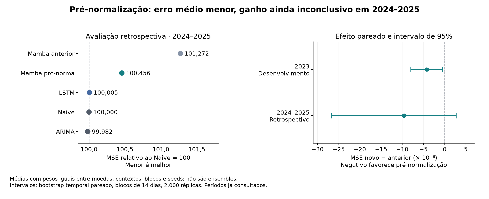

# Pré-normalização do Mamba — resultados e conferência

**Concluído e conferido em 28/10/2026.** A pré-normalização reduziu numericamente o erro médio em relação ao Mamba anterior com penalização corrigida. Na avaliação retrospectiva de 2024–2025, a redução foi de **0,8051% no MSE**, mas o intervalo principal de 95% inclui zero. A mudança aproximou Mamba das referências, sem demonstrar superioridade sobre LSTM ou Naive. A mediana de retorno da política Spot piorou.

## Identidade, escopo e execução

Execução nova: `9e03af2150cbb7b1068d`; comparador direto: `7868a4d847c1410fc681`. LSTM, ARIMA e Naive são herdados da referência `1e7c5ed662fba55ddd25`. Nenhuma dessas outras famílias foi retreinada. Dataset: `d25f6a93a9900725f51e`. Os três ciclos permanecem distintos e preservados; a comparação principal não mistura a nova normalização com a mudança anterior de penalização.

São **384 novos ajustes Mamba auditados**, 192 de desenvolvimento e 192 de avaliação, mais **dois controles de reprodução**, também auditados. Grade: quatro moedas × quatro contextos × oito blocos temporais × três seeds. Os dois pilotos fazem parte dos 384; não são resultados adicionais. O inventário desta execução tem 386 tentativas concluídas, sem tentativas interrompidas ou falhas de treino registradas. As interrupções históricas da extensão de penalização continuam preservadas no ciclo anterior.

O executor iniciou às 05:02:09 UTC; terminou os treinos às 19:32:35 UTC e a consolidação às 19:38:35 UTC em 28/10/2026 — **16:38:35 em São Paulo**, cerca de 14h36 após o início. A conferência posterior terminou às 20:10:35 UTC. O executor concluído não foi chamado novamente para gerar este relatório.

## O que mudou e o que permaneceu igual

A única intervenção planejada foi a posição da LayerNorm nos dois blocos:

- Anterior: `LN(x + Mamba(x))`.
- Nova: `x + Mamba(LN(x))`.

A normalização final, projeção, head, dropout, inicialização e número de parâmetros (20.129) permaneceram iguais. É uma alteração arquitetural experimental, não a correção de um bug comprovado. A normalização interna do bloco não é o scaler dos dados.

Mantiveram-se retornos horários como única entrada; BTC/ETH/BNB/XRP Spot; contextos 24/72/168/336h; previsão do log-retorno terminal em 24h a cada hora; mesmos dados, alvos, origens e divisões temporais, purga de 24h e scalers do treino. Seeds 17/42/2026, AdamW lr 0,0002, batch 64/microbatch 32, clipping 1, FP32, teto 100 épocas e paciência 10. Melhor época escolhida por MSE de validação. A época pode mudar como consequência da intervenção; não foi forçada a coincidir.

A penalização corrigida permanece nos dois lados: A_log/D isentos (2.176 escalares), demais parâmetros com weight decay0,001 (17.953). Isso não reproduz o Adam uniforme do CryptoMamba. A rede herda os módulos anteriores e altera apenas o forward; o treinador difere na fábrica da rede. Testes estruturais e qualificação foram feitos antes do congelamento.

## Conferência e limites da auditoria

A preparação aprovou 31 testes de contrato e oito casos CUDA (pré/pós nos quatro contextos), com duas repetições e recarga exata. Ambiente oficial Mamba-1 CUDA, RTX4050 Laptop. Os dois controles BTC/DB1/seed 42, W24 e W336, repetiram a época histórica; diferenças máximas nas previsões de 8,5683e-9 e 9,1593e-9 ficaram abaixo do limite 1e-5. Variações relativas de MSE de 9,7978e-9 e 2,0973e-9 ficaram abaixo de 1e-4. Não houve identidade bit a bit nos controles.

A conferência posterior independente aprovou:

- Conjunto exato dos 384 ajustes e dois controles, sem duplicatas, além das referências herdadas.
- Identidade, fontes congeladas/atuais, dataset e preservação por hash de **11.243 arquivos** anteriores.
- Populações de validação, teste e operação iguais ao comparador; alvos, timestamps, escalas e configurações dos checkpoints; pesos finitos e mesma estrutura.
- Seleção da melhor época por validação, registros de recarga exata e grupos corretos do otimizador.
- Recálculo de MSE, RMSE, MAE, viés, habilidade e direção; duas publicações com 608 registros cada (192 novos e 416 herdados) e 192 pares diretos por fase.
- Recálculo independente de **60 intervalos** temporais e **10.296 registros de ordens** (890 no desenvolvimento e 9.406 na avaliação, somando cenários base e agravado). O mesmo sinal aparece nos dois cenários: não são 10.296 operações distintas executadas no mercado.
- Sinais diários, preços dos minutos de entrada/saída, quantidades, taxas, slippage, capital e drawdown da simulação. Todas as pontas necessárias estavam observadas nesta execução.

Não houve divergências nesses itens. Isso não prova ausência de qualquer erro possível. A conferência posterior não refez treinamento nem inferência neural; a recarga exata vem dos recibos de cada ajuste, e todos os checkpoints foram lidos na revisão. Os controles têm tolerância numérica explícita. Hashes locais não equivalem a backup externo restaurado em outra máquina.

## Como ler as médias e os intervalos

O MSE é a média do quadrado da diferença entre retorno previsto e observado: menor é melhor, e erros grandes pesam mais. Os resultados são agregados com pesos iguais entre moedas, contextos, blocos e seeds. Calculam-se médias dos **erros** das seeds, sem juntar suas previsões em um ensemble. RMSE abaixo é a raiz do MSE agregado; MAE é a média dos erros absolutos. RMSE e MAE multiplicados por 100 estão na escala de log-retorno × 100, aproximadamente pontos percentuais para variações pequenas; não são taxa de acerto nem retorno de uma operação.

O contraste é MSE novo menos anterior. Valor negativo favorece a pré-normalização. A variação relativa divide esse contraste pelo MSE anterior; redução de 0,8% no MSE não significa ganhar 0,8 ponto percentual de acurácia ou lucro. O índice Naive 100 facilita comparar o tamanho do erro. É razão de MSEs agregados, não a média das habilidades por célula; essas duas agregações não são intercambiáveis.

Intervalos de 95% usam bootstrap pareado de dias UTC em blocos temporais de 14 dias, 2.000 réplicas, sem atravessar os blocos de avaliação; sensibilidades 7/28 dias. As previsões horárias de 24h se sobrepõem, por isso não são tratadas como amostras independentes. O intervalo quantifica a incerteza sob esse procedimento e não toda a seleção retrospectiva de hipóteses. Incluir zero impede afirmar uma melhora consistente com esse teste; não comprova igualdade.

## Desenvolvimento de 2023 — DB1–DB4

| Modelo | MSE | RMSE × 100 | MAE × 100 | Índice MSE, Naive=100 |
| --- | --- | --- | --- | --- |
| Mamba anterior (pós, penalização corrigida) | 0,0008362688 | 2,8918 | 1,7754 | 101,885 |
| Mamba novo (pré) | 0,0008320328 | 2,8845 | 1,7713 | 101,369 |
| LSTM herdada | 0,0008268839 | 2,8756 | 1,7624 | 100,742 |
| Naive herdado | 0,0008207934 | 2,8649 | 1,7570 | 100,000 |
| ARIMA herdado | 0,0008204785 | 2,8644 | 1,7558 | 99,962 |

| Novo menos referência | Variação relativa do MSE | Diferença MSE × 10⁻⁶ | IC95% × 10⁻⁶, 14 dias |
| --- | --- | --- | --- |
| Mamba anterior (pós, penalização corrigida) | -0,5065% | -4,2359 | [-8,0414; -0,5282] |
| LSTM herdada | 0,6227% | 5,1490 | [1,7048; 9,0598] |
| Naive herdado | 1,3693% | 11,2394 | [5,4176; 17,4632] |
| ARIMA herdado | 1,4082% | 11,5544 | [5,6771; 17,7883] |

O MSE caiu 0,5065% frente ao anterior; o intervalo temporal exclui zero, também com 7 e 28 dias. Ainda há erro maior que as três referências. É desenvolvimento, e não deve substituir a fase principal definida antes dos novos treinos.

## Avaliação retrospectiva de 2024–2025 — B1–B4

| Modelo | MSE | RMSE × 100 | MAE × 100 | Índice MSE, Naive=100 |
| --- | --- | --- | --- | --- |
| Mamba anterior (pós, penalização corrigida) | 0,0011913154 | 3,4515 | 2,3212 | 101,272 |
| Mamba novo (pré) | 0,0011817236 | 3,4376 | 2,3113 | 100,456 |
| LSTM herdada | 0,0011764164 | 3,4299 | 2,3057 | 100,005 |
| Naive herdado | 0,0011763538 | 3,4298 | 2,3061 | 100,000 |
| ARIMA herdado | 0,0011761429 | 3,4295 | 2,3053 | 99,982 |

| Novo menos referência | Variação relativa do MSE | Diferença MSE × 10⁻⁶ | IC95% × 10⁻⁶, 14 dias |
| --- | --- | --- | --- |
| Mamba anterior (pós, penalização corrigida) | -0,8051% | -9,5918 | [-26,6815; 2,7349] |
| LSTM herdada | 0,4511% | 5,3072 | [-0,0943; 12,5843] |
| Naive herdado | 0,4565% | 5,3698 | [-2,0642; 16,0893] |
| ARIMA herdado | 0,4745% | 5,5807 | [-1,7912; 15,9423] |

O MSE caiu 0,8051%, mas o intervalo inclui zero. O novo Mamba permanece numericamente 0,4511% pior que LSTM e 0,4565% pior que Naive; os intervalos desses contrastes incluem zero. Não se demonstrou superioridade nem equivalência. O MAE caiu de 2,3212 para 2,3113 na escala de log-retorno × 100: melhora pequena.

Figura também em [PDF](../../../docs/figuras/normalizacao_9e03af2150cbb7b1068d/comparacao.pdf), com manifesto dos dados de origem e arquivos. Na direita, o intervalo de 2024–2025 atravessa a linha zero.

## Sensibilidade e estabilidade

| Fase | Bloco bootstrap | IC95% do efeito pré−pós, MSE × 10⁻⁶ |
| --- | --- | --- |
| desenvolvimento | 7 dias | [-8,8072; -0,7721] |
| desenvolvimento | 14 dias | [-8,0414; -0,5282] |
| desenvolvimento | 28 dias | [-5,0325; -0,9567] |
| avaliacao | 7 dias | [-23,7501; 2,2060] |
| avaliacao | 14 dias | [-26,6815; 2,7349] |
| avaliacao | 28 dias | [-28,1773; 2,4260] |

A conclusão principal não muda com 7, 14 ou 28 dias: os três intervalos retrospectivos incluem zero.

| Fase | Seed | MSE anterior | MSE novo | Variação relativa |
| --- | --- | --- | --- | --- |
| desenvolvimento | 17 | 0,0008312570 | 0,0008332699 | 0,2421% |
| desenvolvimento | 42 | 0,0008414767 | 0,0008304806 | -1,3068% |
| desenvolvimento | 2026 | 0,0008360727 | 0,0008323481 | -0,4455% |
| avaliacao | 17 | 0,0011762958 | 0,0011783378 | 0,1736% |
| avaliacao | 42 | 0,0012052027 | 0,0011766724 | -2,3673% |
| avaliacao | 2026 | 0,0011924478 | 0,0011901606 | -0,1918% |

Em ambas as fases a seed 17 piorou, enquanto 42 e 2026 melhoraram. Na avaliação, o desvio populacional do MSE agregado entre as três seeds caiu de 1,18283e-5 para 6,00448e-6, mas a LSTM herdada teve1,43247e-6. Isso sugere menor dispersão neste conjunto de três inicializações; não estabelece robustez geral. A melhora média é influenciada principalmente pela seed 42.

Dos 192 pares de ajuste,106 melhoraram em 2023 e 90 em 2024–2025. Portanto, na avaliação a maioria dos pares não melhorou, embora a média tenha caído: a magnitude das melhorias e pioras importa, não só sua contagem. Células compartilham períodos e dados; essa contagem não é um teste estatístico de 192 observações independentes.

## Decomposição exploratória da avaliação retrospectiva

| Moeda | MSE anterior | MSE novo | Variação relativa |
| --- | --- | --- | --- |
| BNBUSDT | 0,0008596079 | 0,0008512759 | -0,9693% |
| BTCUSDT | 0,0006203927 | 0,0006133259 | -1,1391% |
| ETHUSDT | 0,0013692909 | 0,0013207726 | -3,5433% |
| XRPUSDT | 0,0019159703 | 0,0019415200 | 1,3335% |

| Contexto (h) | MSE anterior | MSE novo | Variação relativa |
| --- | --- | --- | --- |
| 24 | 0,0011797803 | 0,0011764370 | -0,2834% |
| 72 | 0,0011912451 | 0,0011799663 | -0,9468% |
| 168 | 0,0011938187 | 0,0011773911 | -1,3761% |
| 336 | 0,0012004176 | 0,0011931000 | -0,6096% |

| Bloco | MSE anterior | MSE novo | Variação relativa |
| --- | --- | --- | --- |
| B1 | 0,0009191917 | 0,0008885715 | -3,3312% |
| B2 | 0,0015307857 | 0,0015448529 | 0,9190% |
| B3 | 0,0013448451 | 0,0013290525 | -1,1743% |
| B4 | 0,0009704392 | 0,0009644174 | -0,6205% |

Melhora média em BTC, ETH e BNB, piora em XRP; melhora em B1/B3/B4, piora em B2. Os quatro contextos melhoraram contra suas versões anteriores, mas o menor erro absoluto do novo Mamba ocorreu em 24h e o maior em 336h. Mais contexto não mostrou benefício monotônico. Essas decomposições são secundárias e exploratórias; não escolher uma moeda, contexto ou seed depois do teste para declarar vitória confirmatória.

O acerto balanceado direcional agregado passou de 50,4930% para 50,5568%, enquanto a LSTM ficou em 50,6446%. É um diagnóstico do sinal da regressão, sem inferência de superioridade a partir dessas médias; não são probabilidades calibradas nem log-loss/Brier. O Naive prevê retorno zero: sua acurácia de sinais não é uma baseline aleatória de 50% e não deve ser interpretada como falha equivalente de regressão.

## Simulação Spot: qualidade da previsão e resultado operacional são diferentes

A regra permaneceu fixa: decisão diária às 00:00 UTC, compra às 00:01 quando a previsão ultrapassa o limiar de custos base, saída 24h depois, comprado ou caixa. Capital inicial 10.000 USDT por estratégia. Sem futuros, alavancagem, stop-loss ou take-profit. Custos base por lado: taxa 0,10% e slippage 0,05%; agravados 0,20% e 0,10%, mantendo os mesmos sinais selecionados pelo limiar base. Os resultados por fase encadeiam seus blocos temporais, não reiniciam o capital a cada previsão.

São 48 estratégias separadas por fase (quatro moedas × quatro contextos × três seeds), em dois cenários de custo. A mediana não é uma carteira diversificada, não representa o retorno de todas as estratégias combinadas e não é uma previsão de desempenho futuro.

| Fase | Custos | Mediana anterior | Mediana nova | Mediana das diferenças pareadas | Novas estratégias positivas |
| --- | --- | --- | --- | --- | --- |
| desenvolvimento | base | 0,40% | 0,22% | 2,18 p.p. | 24/48 |
| desenvolvimento | agravado_sinais_base | -0,74% | -1,61% | 1,63 p.p. | 19/48 |
| avaliacao | base | -10,48% | -11,03% | -9,72 p.p. | 13/48 |
| avaliacao | agravado_sinais_base | -28,48% | -33,42% | -7,88 p.p. | 6/48 |

Em 2024–2025, as medianas de retorno base foram −10,48% e −11,03%. A diferença entre essas duas medianas é −0,55 p.p., enquanto a **mediana das 48 diferenças pareadas é −9,72 p.p.** São estatísticas distintas: a ordenação das estratégias muda. A segunda responde diretamente à mudança típica da mesma combinação de moeda/contexto/seed. Com custos agravados, a mediana nova foi −33,42%, contra −28,48% antes; mediana pareada −7,88 p.p. Não foi calculado aqui um teste de significância financeira. O resultado preditivo não justifica afirmar melhora operacional.

## Interpretação para o TCC e próximos passos

Formulação sustentada: sob o protocolo fixado, a pré-normalização reduziu o MSE médio do Mamba em 0,8051% na avaliação retrospectiva, mas o intervalo temporal principal incluiu zero. A dispersão entre as três seeds diminuiu e a distância numérica às referências encolheu, sem demonstrar superioridade sobre LSTM/Naive ou melhoria na política Spot.

A comparação isolada permite avaliar a mudança de arquitetura neste procedimento. Ela não diagnostica a causa interna: não medimos dinâmica de gradientes ou representações para provar que houve melhor otimização. Permanecer perto do Naive significa que estas entradas e configurações não mostraram ganho preditivo convincente além da previsão de retorno zero. Não prova incapacidade universal do Mamba, impossibilidade de prever cripto ou ausência de qualquer estratégia útil.

Registrar como ablação concluída, inclusive resultados desfavoráveis. Não existe obrigação de continuar buscando até o Mamba vencer. Se houver novo ciclo, formular uma hipótese e uma mudança por vez, com configuração, orçamento e autorização próprios. Frequência diária de treinamento, novas entradas e busca de hiperparâmetros continuam apenas alternativas futuras. Não foram iniciadas nesta entrega. Para uma futura confirmação independente, definir previamente períodos não consultados e critérios; reusar B1–B4 permanece retrospectivo.

Desenvolvimento 2023 e avaliação 2024–2025 já eram conhecidos quando a hipótese foi escolhida. O congelamento controla a execução desta comparação, mas não torna os períodos desconhecidos novamente. Os intervalos não corrigem a seleção de hipóteses ao longo do projeto. Esse limite deve constar do artigo.

## Fontes e preservação

- [Protocolo congelado](../../../docs/protocolo_normalizacao_mamba.md), [ADR 0005](../../../docs/adr/0005-proposta-prenormalizacao-mamba.md) e [configuração](../../../configuracoes/normalizacao_mamba_001.json).
- [Desenvolvimento: publicação e resultados](../../../dados/experimentos/normalizacao_9e03af2150cbb7b1068d/analises/desenvolvimento/resumo.json).
- [Avaliação: publicação e resultados](../../../dados/experimentos/normalizacao_9e03af2150cbb7b1068d/analises/avaliacao/resumo.json).
- [Relatório automático preservado](../../../dados/experimentos/normalizacao_9e03af2150cbb7b1068d/relatorio_automatico.md).
- [Conferência independente posterior](../../../registros/revisoes/normalizacao_2026-10-28T200441.557811_0000/resumo.json) e cópia do verificador na mesma pasta.
- [Fechamento](../../../registros/auditorias/9e03af2150cbb7b1068d/fechamento_normalizacao.json), [catálogo](../../../registros/catalogo_estudos.json) e [cronologia](../../../docs/andamento.md).

Documentos anteriores e finais desta revisão são preservados com hashes em `registros/revisoes/normalizacao_2026-10-28T200441.557811_0000/`. Figuras têm manifesto próprio e foram inspecionadas visualmente. Artefatos dos treinamentos e publicações não foram sobrescritos. A conferência de integridade não comprova envio ao GitHub ou restauração externa; esses passos dependem de recibos próprios. A interface web continua com seu escopo documentado no README; esta entrega publica a comparação nos documentos e artefatos científicos.
