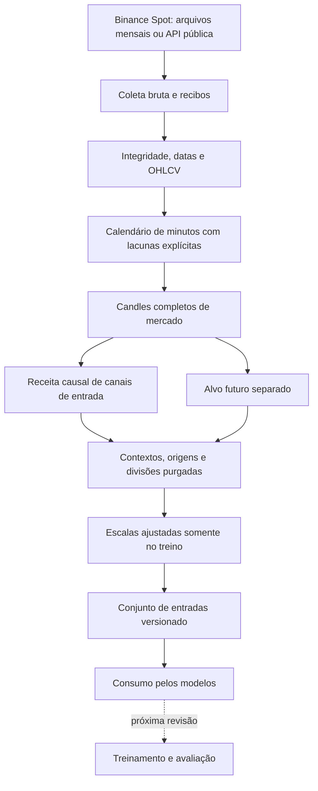

# Arquitetura dos dados de mercado e das entradas

## Extensão temporal do ensemble em 2026

`mercado_futuros/periodo_publico_verificado.py` coleta um período público delimitado, reutilizando parser, verificações e downloads mensais existentes. Mercado novo fica em `dados/mercado/ensemble_2026/<identidade>/<moeda>/`, sem estender ou reescrever as bases de 2020–2025. ZIPs mensais/diários conservam CHECKSUM; API recupera observações oficiais de lacunas documentadas, a cauda ainda não publicada e os minutos necessários à saída final. Não interpola candles nem preenche funding ausente com zero.

A primeira versão `periodo_publico.py` interrompeu corretamente ao encontrar uma lacuna extensa de mark no mensal BTC de junho de 2026. Após a API comprovar todos os minutos, uma continuação técnica preservou a tentativa e qualificou a recuperação por intervalos. Essa revisão altera a coleta, sem alterar os modelos ou as regras operacionais. [Diagnóstico](../registros/ensemble_2026/complementacao.json), [método congelado](protocolo_ensemble_2026.md) e [estado](../registros/ensemble_2026/estado.json). O inventário de exposição foi realizado antes dessa coleta e distingue preços de livro consultados em novembro de resultados de previsões/backtests.

Extensão ADR0036: `codigo/mercado_futuros/multimoeda.py` publica dados por símbolo em `dados/mercado/generalizacao_moedas/`, com dias completos após listagem, complementos oficiais identificados, funding reconciliado e diferenças de volume documentadas. Lacunas de marcação XRP permanecem no dado canônico; envelopes oficiais5m separados são consumidos somente pela camada de risco. [Protocolo](protocolo_generalizacao_moedas.md).

Extensão ADR0034: `codigo/entradas_modelo/padronizacao_diaria.py` aplica escalas por canal ajustadas nos candles únicos de treino; `escalas.json` liga os parâmetros ao congelamento/checkpoints. Alvos e preços do simulador permanecem nas unidades originais.

Esta é a referência de manutenção das camadas de dados, separada do [desenho científico](desenho_ohlcv24.md). Decisão: [ADR 0007](adr/0007-modulos-de-dados.md). Estado e evidências atuais: [registros/dados/estado.json](../registros/dados/estado.json). Nenhum comando deste módulo treina modelos.

## 1. Responsabilidades e sequência



O primeiro módulo responde **o que aconteceu no mercado**. O segundo responde **o que o estudo permitirá que o modelo veja e tente prever**. Alterar uma receita ou contexto não altera nem exige recolher os candles de mercado. As divisões temporais e escalas pertencem à preparação das entradas, nunca à coleta.

| Camada | Arquivos principais | Saída e restrições |
|---|---|---|
| Transporte público | `codigo/mercado_binance/transporte.py` | GET público, timeout, recibos HTTP e tentativas limitadas; sem conta, chaves ou ordens |
| Coleta | `api.py`, `pipeline.baixar_arquivos` | Páginas JSON ou ZIP + CHECKSUM; conserva corpo original e pedido |
| Contrato/validação | `contratos.py`, `validacao.py` | UTC, nomes, 12 campos, unidades, ordenação, duplicatas, geometria e ausências |
| Agregação | `candles.py`, `pipeline.agregar_mercado` | Primeiro O, máximo H, mínimo L, último C, soma V; só aceita intervalos completos |
| Representação | `codigo/entradas_modelo/receitas.py` | Registro de receitas versionadas; canais escolhidos por configuração |
| Alvo | `codigo/entradas_modelo/alvos.py` | Retorno terminal, destino temporal e preço observado futuro; fora dos canais |
| Populações/escalas | `codigo/entradas_modelo/amostras.py` | Contextos causais, purga e estatísticas exclusivamente de treino |
| Consumo | `codigo/entradas_modelo/conjunto.py` | Matriz, origens, partições, escalas, contrato e janelas `[lote, contexto, canais]` |
| Preservação comum | `codigo/infraestrutura/artefatos.py` | Identidade, hashes, dependências, cópia de fontes e publicação completa |

As novas camadas não importam `torch`, treinamento, modelos, portal ou pacotes dos estudos congelados. Essa fronteira também é testada. `run_dados.py` é a entrada de linha de comando; roda na raiz em CPU, com NumPy, pandas e PyArrow nas versões de `requirements.txt`. Não é necessário instalar CUDA para trabalhar apenas com dados.

## 2. Duas formas de obter os mesmos campos

**Histórico extenso:** arquivos mensais oficiais Spot de 1 minuto. O comando `baixar` cria uma coleta nova. O comando `importar` lê ZIPs já disponíveis, confere novamente o CHECKSUM e não escreve na coleta anterior. A base de 2021–2025 foi importada dos arquivos existentes; não houve download repetido dos 240 ZIPs.

**Consulta delimitada:** `/api/v3/klines`, via host público `data-api.binance.vision`. O módulo fixa `interval=1m`, `timeZone=0`, `startTime` inclusivo e `endTime=fim−1ms`. Pagina até cobrir o período ou encontrar resposta vazia; uma página curta, por si só, não encerra a consulta. Limite máximo: 1.000 registros por página; orçamento padrão de 100 páginas. Esgotar o orçamento conserva as respostas e falha sem publicar um conjunto parcial como concluído. Consultas maiores exigem orçamento explícito ou arquivos mensais.

A consulta verifica o horário do servidor e recusa o minuto ainda aberto. O cliente registra status, headers, tamanho, hash e tentativas. Respeita `Retry-After` de 429 dentro de um teto; se o prazo exceder esse teto, encerra. 403, 418 e 451 encerram sem mudar de endpoint para contornar o bloqueio. Erros transitórios de rede/5xx têm no máximo três tentativas. Não há credenciais nem funções de negociação.

Os arquivos Spot passaram a usar **microssegundos em janeiro de 2025**; a API retorna **milissegundos por padrão**. A unidade é declarada pela fonte, não deduzida pela magnitude de um número. Fontes: [arquivos públicos oficiais](https://github.com/binance/binance-public-data), [documentação de klines](https://developers.binance.com/en/docs/catalog/core-trading-spot-trading/api/rest-api/market) e [convenções da API](https://developers.binance.com/en/docs/products/spot/rest-api).

CHECKSUM oficial comprova integridade do ZIP baixado, não a verdade econômica de cada negócio. A API não fornece esse CHECKSUM; seus corpos têm hash local. A concordância entre API e arquivo foi testada em duas amostras de cinco minutos, sem alegar uma segunda fonte independente ou reconciliação completa de todos os negócios.

## 3. Contrato de mercado e qualidade

Todos os intervalos são `[início, fim)`, com fuso explícito. `inicio_utc` é a abertura e `fim_utc` é o instante imediatamente posterior ao encerramento do candle. Exemplo: o candle 00h–01h fica disponível, idealmente, às 01h; não pode servir a uma previsão emitida às 00h. Latência real de publicação/executabilidade pertence à simulação, não é garantida por esse timestamp.

Campos de mercado: `open`, `high`, `low`, `close`, `volume` em unidades do ativo-base; `negocios`, `volume_cotacao`, `compra_base`, `compra_cotacao` também são preservados. A unidade de cotação é USDT nos quatro pares atuais. O campo final ignorado da Binance não vira uma variável de entrada.

Verificações: nome e hash do ZIP, CRC/conteúdo esperado sem extração livre, 12 campos, timestamps inteiros, intervalo, ordenação estrita, duplicatas, OHLC positivo/consistente, volumes e número de negócios não negativos, valores finitos. O calendário esperado é explícito. Uma lacuna não é preenchida nem interpolada.

| Situação | Tratamento |
|---|---|
| Minuto recebido com encerramento correto | `observado=true`, `completo=true` |
| Minuto ausente na fonte | `observado=false`, `completo=false`, valores ausentes |
| Minuto recebido com encerramento antecipado | `observado=true`, `completo=false`; corpo bruto preservado e valores canônicos ausentes |
| Volume zero em minuto válido | Continua sendo observação válida; zero não é ausência |
| Hora com algum minuto indisponível | OHLCV horário inteiro fica ausente; não criar candle parcial aparentemente completo |

`qualidade.json` informa cobertura esperada, recebida, ausente e interrompida por mês/par. Há suporte técnico a divisores inteiros de um dia, como 15/30/60 minutos; só 60 minutos foi processado para a base real desta etapa. Outros candles não foram adotados como novo experimento. Bordas desalinhadas são rejeitadas, nunca cortadas silenciosamente.

## 4. Contrato de entradas

Configurações separadas:

- [mercado_binance_001.json](../configuracoes/mercado_binance_001.json): fonte, quatro pares, datas e local dos ZIPs.
- [entradas_ohlcv24_001.json](../configuracoes/entradas_ohlcv24_001.json): BTC, receita, canais, horizonte, contexto, cadência, divisões e padronização.

A receita implementada `ohlcv_relativo_v1` preserva a decisão anterior: `ln(O/C anterior)`, `ln(H/C anterior)`, `ln(L/C anterior)`, `ln(C/C anterior)` e `ln(1+volume-base)`. São transformações causais motivadas, não uma garantia de desempenho nem exigência da Binance. Volume, máximas e mínimas só entram após o fechamento do candle. O primeiro candle não tem fechamento anterior e não forma uma entrada completa.

O alvo separado é `ln(C[t+24h]/C[t])`. Não entra na matriz de canais. Na configuração atual, a janela tem 168 candles horários e cinco canais. As médias/desvios são ajustados na união de candles únicos usados pelos contextos de treino; não se contam repetidamente as horas compartilhadas entre janelas. Canal constante recebe escala 1. A escala do alvo também usa apenas os alvos de treino. Validação e teste recebem essas mesmas escalas.

As origens são causais e regulares. Uma amostra preditiva exige janela válida, alvo observado e `destino < fim da partição`: a purga impede que o alvo atravesse a fronteira. Contexto de validação/teste pode usar passado anterior à partição; isso é informação disponível, sem reajustar escalas. A população operacional conserva decisões cujo futuro depois ficou indisponível, para não removê-las retrospectivamente pela disponibilidade do resultado. Tratar saída impossível ainda cabe ao módulo de simulação.

O consumidor usa `carregar_conjunto(pasta)`, `conjunto.janelas(indices)` e `conjunto.inverter_alvo(previsao_padronizada)`. O contrato declara ordem/nome/unidade dos canais, dimensão, contexto, horizonte e dtype. Flags, receitas e canais desconhecidos são rejeitados. Para incluir um indicador, implementar uma receita nova, testar causalidade, registrar a hipótese e gerar outro conjunto; não editar um conjunto publicado. O registro de receitas não permite executar fórmulas arbitrárias por configuração.

## 5. Artefatos, manutenção e comandos

```text
python -m comandos.dados importar
python -m comandos.dados agregar dados/mercado/binance_spot/<id>
python -m comandos.dados entradas dados/mercado/candles/<id>
python -m comandos.dados conferir dados/entradas/<id>
python -m unittest discover -s testes/dados -t . -v
```

Download e API são explícitos e separados:

```text
python -m comandos.dados baixar --config configuracoes/mercado_binance_001.json
python -m comandos.dados api BTCUSDT 2025-01-01T00:00Z 2025-01-01T00:05Z --limite 2 --max-paginas 5
```

Não executar `baixar` só porque as entradas mudaram. Para importar um download novo, criar configuração identificada apontando `raiz_brutos_existentes` para a coleta nova. Recibos e respostas de consultas estão em `dados/coletas_binance/<tentativa>/`; minutos em `dados/mercado/binance_spot/<id>/`; candles em `dados/mercado/candles/<id>/`; conjuntos em `dados/entradas/<id>/`.

A identidade considera fonte/configuração/implementação; o manifesto guarda hashes dos resultados, fontes copiadas e dependências. O mesmo pedido com as mesmas fontes reutiliza um artefato conferido sem sobrescrever. Uma versão de código ou receita diferente gera outra identidade. Consultas à API ficam separadas por coleta, pois horário/recibos também fazem parte da proveniência. Uma revisão futura de ZIP oficial não substitui o ZIP histórico: gera coleta e artefatos novos.

Só existe publicação após validar tudo e renomear a pasta temporária. Falhas ficam em `tentativas/` ou na coleta; erros do comando, inclusive antes do início da transformação, ficam em `registros/dados/falhas/`. A conferência da cadeia exige os arquivos de origem presentes; ausência em outra máquina é indisponibilidade, não autorização para regenerar hashes. Metadados/fontes entram no Git; Parquet/NumPy/ZIP/respostas brutas precisam de pacote científico externo. Não há backup remoto comprovado nesta etapa.

## 6. Fronteiras ainda a revisar

| Superfície | Situação e próxima verificação |
|---|---|
| Dados de mercado → entradas | Separada e testada nesta etapa; igualdade com o dataset anterior conferida |
| Entradas → redes | Consumidor modular `codigo/modelos/` conferido em29/10: dimensão/canais/janelas/alvo explícitos. Consultar [arquitetura dos modelos](arquitetura_modelos.md). Redes históricas permanecem intactas |
| Treinamento → configuração | `codigo/estudo_ohlcv/ciclo.py` ainda concentra preparação, execução e publicação com configuração fixa; não foi migrado |
| Baselines | Naive/ARIMA têm consumo separado em `codigo/modelos/`; persistência e previsão filtrada conferidas sem ajustes. Seleção/treinamento continuam pendentes; OHLCV das redes não transforma ARIMA em modelo multivariado |
| Avaliação → simulação | Avaliação OHLCV ainda importa métricas/simulação anteriores; simulação espera array de minutos com seis colunas. Próxima revisão deve tornar esse contrato explícito |
| Portal | Mostra o estudo preliminar; não lê automaticamente estes novos artefatos como resultados de treinamento |

O adaptador `adaptar_ohlcv24` permite comparar a estrutura dos dados com a preparação preservada, mas não redireciona o executor congelado. A referência `92e3eb82e3f6adf99994` permanece preparada e intocada. O novo consumidor de modelos está documentado separadamente; integrar os módulos ao treino ainda exigirá fontes/identidade novas e qualificação antes de treinar. Não afirmar que toda a arquitetura foi migrada ou que o treinamento completo está aprovado por estes testes.
