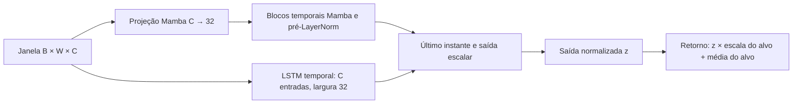

# Consumo dos dados por Mamba, LSTM, Naive e ARIMA

## Ablação linear controlada de 12/11/2026

`codigo/experimentos/ablacao_linear_diaria/modelo.py` constrói a referência A e remove os 12 CMBlock, incluindo suas LayerNorm, antes de treinar L. Preserva nomes, pesos iniciais das projeções e estado RNG; nenhuma herança de pesos treinados. Restam projeções 14→16→32→1 e cabeça 6→1, 824 parâmetros, entrada `[B,6,14]` e saída de retorno simples. A segue com 136.952 parâmetros. A composição restante é afim e fatorada, diferente do ajuste Ridge de 84 coordenadas. [Protocolo](protocolo_ablacao_linear_diaria.md). Não altera modelos ou checkpoints de ciclos anteriores; L não é um novo SSM. Rodada concluída: [resultados e limites](resultados_ablacao_linear_diaria.md); erro próximo sem benefício incremental demonstrado dos ramos nesta receita.

## Variante temporal controlada de12/11/2026

`codigo/modelos/cryptomamba_temporal.py` adapta o núcleo CMamba atribuído a Sepehri et al. e mantém Mamba-1 oficial/scan de referência CUDA. Recebe `[B,14,6]`, projeta cada dia por linear6→14, conserva12blocos/larguras14→16→32→1 e agrega14posições por cabeça14→1. São137.058parâmetros,106a mais que a referência de canais. A preparação z-score/retorno e a ordem dos seis canais não mudam; a transposição acontece após a transformação. [Protocolo fatorial](protocolo_eixo_temporal_diario.md) explicita projeção/cabeça, limites de atribuição e interação com penalização. Prefixos do núcleo são causais; a cabeça utiliza somente os14dias disponíveis. Não altera as classes ou os pesos históricos descritos a seguir.

## Receita efetivamente usada no ensemble de 2024–2026

O [índice dos 12 modelos](../registros/ensemble_2026/modelos_utilizados.json) identifica checkpoints, hashes, épocas selecionadas, scalers, configuração autoritativa, defaults inspecionados e resultados. Os pesos continuam nos estudos originais; o índice não cria modelos novos. [Método de 2026](protocolo_ensemble_2026.md) e [fechamento](../registros/ensemble_2026/fechamento.json). As seções numeradas abaixo descrevem o contrato histórico modular de 29/10, com outra organização dos eixos.

|Componente|Receita executada|
|---|---|
|Fonte|Binance USD-M perpétuo, separado por moeda; candles diários completos UTC|
|Contexto e canais|14 dias; Timestamp, Open, High, Low, Close, Volume; tensor `[lote,6,14]`|
|Representação|OHLC em níveis; volume-base dividido por1e9; Timestamp em segundos Unix do início do candle|
|Padronização|Z-score por canal/moeda, ajustado somente nos candles únicos das janelas de treino; entrada bruta float32, transformação float64, saída float32; sem clipping|
|Alvo|Retorno simples decimal `C_futuro/C_conhecido-1`, horizonte diário; alvo sem padronização; um escalar por janela|
|Preço equivalente|`C_conhecido*(1+retorno)`; não é probabilidade de alta|
|Núcleo|Mamba-1 oficial dentro do CMamba; scan de referência CUDA, FP32 e determinismo, sem fast path/fused silencioso|
|Estágios|14→16→32→1; quatro blocos por estágio, total12; LayerNorm antes do Mamba e soma residual|
|Hiperparâmetros|`d_state=64`, `d_conv=4`, `expand=2`, epsilon LayerNorm1e−5, sem dropout;136.952parâmetros por rede|
|Cabeça|Após `[B,6,1]`, permutar para `[B,1,6]` e aplicar uma camada linear6→1 aprendida|
|Otimizador|Adam, taxa inicial0,01, betas0,9/0,999, epsilon1e−8, `weight_decay=0.001` uniforme, sem isenções|
|Scheduler|StepLR: multiplicar taxa por0,5 ao fim de cada100épocas|
|Perda|Por lote: `sqrt(mean((previsto-real)^2)+1e-8)`, em retorno decimal; sem Huber|
|Orçamento|Lote32, último lote parcial;1000épocas completas; sem early stopping ou clipping de gradientes; embaralhar exemplos, preservar ordem interna|
|Seleção|Menor RMSE global de retorno em validação2024; primeiro checkpoint em empate; não usar lucro de teste para escolher época|
|Ensemble|Três redes por moeda, seeds42/17/2026, média dos preços equivalentes com peso1/3 antes do filtro; controle42 excluído|

**Eixo do scan:** Mamba recebe `[B,L,D]`. Nesta receita, `L=6` são os canais e os14dias são as features iniciais de cada canal. O SSM percorre os seis canais, não14dias como passos recorrentes. Essa organização foi herdada do núcleo público e mantida nos estudos. Não atribuir a esta rede o contrato temporal `[B,tempo,canais]` descrito abaixo. Sondas anteriores de contribuição nula/residual dos ramos também limitam atribuir lucro especificamente ao SSM; ver [roteiro](roteiro_redacao_tcc.md).

Defaults adicionais inspecionados no pacote instalado: `dt_rank=auto` (1/1/2 nos estágios), `dt_min=0.001`, `dt_max=0.1`, `dt_init=random`, `dt_scale=1`, `dt_init_floor=0.0001`, `conv_bias=True`, `bias=False`. São configurações de construção/inicialização, não os valores finais dos pesos. A cabeça agrega canais com pesos aprendidos; isso é diferente da média externa dos três modelos.

Treino até31/12/2023, validação2024, teste retrospectivo2025; avaliação adicional2026 com pesos/scalers fixos e `eval()`/`inference_mode`. A divisão fixa não é walk-forward. Épocas selecionadas podem ser anteriores à1000:

|Moeda|Início do histórico de treino|Seed42|Seed17|Seed2026|
|---|---|---:|---:|---:|
|BTC|01/01/2020|25|14|44|
|ETH|01/01/2020|67|7|164|
|BNB|11/02/2020|80|48|39|
|XRP|07/01/2020|54|43|62|

A política operacional é camada posterior: filtro±0,20%, decisões diárias, continuidade/negociação de deltas até95% do patrimônio liquidável, fechamento em caixa/inversão/fim; posição pode durar mais de24h. Capital10milUSDT por carteira, latência1min, comissão0,05% por lado, slippage provisório0,01% e estresses0,02%/0,03%, funding histórico e sem stop/take. Instrumentos e filtros herdados estão no índice e na [arquitetura operacional](arquitetura_operacoes.md).

## Contrato modular histórico de 29/10/2026

Na extensão inicial ADR0031, a rede diária retornava preço emUSDT; as ablações posteriores mudaram alvo para retorno e padronização, mantendo a estrutura. `codigo/modelos/cryptomamba_diario.py` reutiliza o núcleo de `codigo/experimento_cryptomamba/modelo.py`, sem o adapter temporal da outra adaptação. Não inferir a unidade de saída somente pelo nome da classe; consultar a configuração do ciclo.

Referência de manutenção do módulo `codigo/modelos/`, implementado em 29/10/2026. Complementa a [arquitetura dos dados](arquitetura_dados.md), sem redefinir o [desenho científico](desenho_ohlcv24.md). Evidências em [registros/modelos/estado.json](../registros/modelos/estado.json). Esta etapa verifica contratos e inferência; não treina modelos nem seleciona parâmetros.

## 1. O contrato comum e as diferenças entre famílias

Todos recebem pedidos com as mesmas origens, mesmo destino de 24h e mesmo preço corrente. O pedido não contém o alvo observado nem o preço futuro. O alvo é acessado separadamente pelo futuro codigo/treinamento/avaliador.

| Família | Informação utilizada | Forma | Saída pública |
|---|---|---|---|
| Mamba | Mesmos canais OHLCV transformados/padronizados da LSTM | `[lote, contexto, canais]`; atualmente `[B,168,5]` | Um log-retorno terminal por origem |
| LSTM | Mesmas janelas e canais do Mamba | `[B,168,5]`, ordem temporal crescente | Um log-retorno terminal por origem |
| Naive | Origem/preço atual para identificar a previsão; não estima parâmetros | Pedido de origens | Zero de log-retorno, equivalente a preço terminal igual ao atual |
| ARIMA | Série regular de log-fechamentos, com lacunas explícitas | Vetor univariado até a origem; parâmetros recebidos externamente | Preço logarítmico terminal projetado menos log-preço corrente |

**Comparabilidade não significa entradas idênticas entre todas as famílias.** Mamba e LSTM têm igualdade de informação por janela. ARIMA é referência univariada e utiliza seu histórico filtrado, não uma janela OHLCV de 168×5. O limite de contexto de 168h é das redes; não apresentar o ARIMA como se ele usasse apenas essa semana. Acrescentar variáveis exógenas ou restringir sua memória seria outra decisão científica. A modularização conserva a definição anterior.

## 2. Organização dos arquivos

```text
codigo/mercado_binance/       dados de mercado auditados
codigo/entradas_modelo/       receita, alvo, populações e scalers
codigo/modelos/
  contratos.py        tipos, dimensões, identidade e formato de previsão
  consumo.py          ponte do conjunto preparado para cada família
  mamba.py            arquitetura Mamba-1 temporal oficial
  lstm.py             arquitetura LSTM temporal
  neurais.py          fábrica, inferência, conversão e recarga de pesos
  naive.py            persistência explícita
  arima.py            sistema ARIMA e previsão com parâmetros fornecidos
  conferencia.py     auditoria de todas as janelas reais, sem ajustes
testes/modelos/        contratos, causalidade, baselines e forward CUDA
run_modelos.py        comando exclusivo de conferência
```

Nenhum módulo novo importa executores históricos. Apenas o teste de equivalência lê a rede preservada para comparar o forward com os mesmos pesos. Dados de mercado e entradas não importam o módulo de modelos. Nenhuma dessas camadas contém seleção de época, otimizador ou loop de treinamento.

## 3. Como o consumidor recebe os dados

`carregar_consumo(pasta)` abre o conjunto publicado, verifica sua cadeia de hashes e cria uma cópia defensiva. Confere:

- nomes, ordem e número dos canais em contrato, matriz e escalas;
- matriz `float32`, índice posicional, timestamps regulares com fuso e horizonte;
- alvo `ln(C[t+24h]/C[t])` alinhado ao fechamento terminal correto;
- partições, contextos completos, origens causais e purga;
- consistência de cada linha de partição com o calendário completo.

`solicitar(particao, posicoes)` produz um pedido sem futuro observado. As posições são linhas daquela partição, não índices arbitrários de candles. Repetições, índices negativos, pedido de outro conjunto e metadados modificados são rejeitados. A identidade inclui dados, canais, contexto e escalas, evitando combinar pesos e entradas incompatíveis apenas porque ambos têm cinco colunas.

`lote_neural(pedido)` extrai exatamente os índices `i−W+1 ... i`, inclusive o candle encerrado na origem. Mantém a ordem temporal e dos canais. Nenhuma troca de eixos ocorre. Não materializa de uma vez todas as janelas do histórico: o consumidor pode pedir lotes pequenos.

`alvos_supervisionados(pedido)` é separado e recusa a população operacional, que pode conter destinos ainda indisponíveis. O futuro módulo de treinamento deverá utilizar esse método somente nos conjuntos apropriados. A política de ajustar exclusivamente no treino ainda precisa ser aplicada pelo executor: expor um alvo de validação ao avaliador não autoriza usá-lo no gradiente.

## 4. Redes e unidades da saída



O Mamba percorre o eixo do tempo. A LSTM usa `batch_first=True`, é unidirecional e reinicia o estado por janela; não transporta estado oculto entre lotes. Ambas usam o último instante para produzir um escalar. O Mamba conserva projeção, duas camadas, estado16, convolução4, expansão2, pré-LayerNorm e dropout da referência; a LSTM conserva duas camadas/largura32/dropout. A quantidade de canais passa a vir do contrato. Os parâmetros de arquitetura estão em [modelos_ohlcv24_001.json](../configuracoes/modelos_ohlcv24_001.json); seeds/otimização pertencem à futura orquestração, não à coleta ou ao forward.

Para as redes, `z=(y−média_treino)/escala_treino`; `inferir_normalizado` devolve z, e `prever_neural` devolve y em log-retorno, após uma única inversão. A saída pública tem forma `[B]`, nunca `[B,1]` misturada implicitamente com `[B]`, o que poderia produzir uma matriz de erros por broadcasting. Não converter Naive/ARIMA por essa escala: eles já produzem log-retorno real. Zero normalizado de uma rede significa a média do alvo de treino; **Naive significa zero real**.

Exemplo de interpretação: y=ln(1,02) equivale a +2%; a transformação para apresentação é `100×expm1(y)`, e o preço correspondente é `C[t]×exp(y)`. O alvo continua sendo o retorno terminal; isso não descreve o caminho intradiário nem garante execução de uma operação.

`criar_rede` exige CUDA. Mamba exige a classe oficial `mamba_ssm.modules.mamba_simple.Mamba` e as extensões compiladas; não há substituição silenciosa. Inferência exige `eval()` e desativa gradientes. A recarga confere família, configuração, identidade dos dados, canais e escalas antes de carregar os pesos. O pacote de pesos, sozinho, não comprova treinamento: a futura execução deverá vinculá-lo a tentativas, épocas e recibos.

Referências técnicas: [Mamba-1 oficial na versão instalada](https://github.com/state-spaces/mamba/blob/v2.2.6.post3/mamba_ssm/modules/mamba_simple.py), [LSTM no PyTorch](https://docs.pytorch.org/docs/2.6/generated/torch.nn.LSTM.html).

## 5. ARIMA: passado permitido, filtro e horizonte

O ARIMA recebe log-fechamentos brutos, sem a padronização multivariada da rede. A transformação numérica preservada é `(log(C)−base)×100`, com base no primeiro fechamento observado. A grade mantém NaNs nos candles ausentes: remover essas linhas encurtaria artificialmente o tempo.

`dados_ajuste_arima()` entrega somente o prefixo permitido para um ajuste futuro; não chama `fit`. O último índice permitido é a última origem de treino mais os24 passos do alvo, ainda anterior à fronteira de validação. Assim, pode usar fechamentos que já constituem os destinos dos alvos de treino. Isso conserva o critério da referência. Na base atual, o índice é26.278, correspondente a31/12/2023 às23hUTC como origem do fechamento disponível; nenhuma observação de2024 entra nesse prefixo.

`ParametrosARIMA` exige ordem, nomes/valores, base, identidade dos dados e último índice utilizado no ajuste. A previsão recusa parâmetros declarados como ajustados além do treino ou da origem solicitada. Essa proteção verifica metadados; os futuros recibos de ajuste deverão comprovar sua proveniência. Não pode demonstrar sozinha onde um vetor externo foi estimado.

`prever_arima` usa `filter` com parâmetros fixos e estados filtrados, nunca estados suavizados com futuro. Mesmo em um lote com diversas origens, a projeção de cada origem usa seu estado causal. O avanço é de24 passos horários, não um passo. Há conferência contra `get_forecast(24)` em prefixos sintéticos, para as nove ordens permitidas, incluindo lacuna. ARIMA(0,1,0) retorna zero exatamente, evitando criar direção por erro numérico.

Filtrar atualiza a estimativa do estado à medida que chegam observações; não reestima os parâmetros. Nenhum `fit`, busca entre ordens ou seleção por validação foi executado nesta revisão. A seleção futura continuará limitada aos nove candidatos previstos. Referência: [API de filtragem do statsmodels](https://www.statsmodels.org/stable/generated/statsmodels.tsa.arima.model.ARIMA.filter.html); versão instalada registrada na evidência.

## 6. Uso e verificações

```text
python -m comandos.modelos conferir --entradas dados/entradas/0420879c2afc454c7754
python -m unittest discover -s testes/modelos -t . -v
```

O primeiro comando confere todas as janelas/partições, preparação do prefixo ARIMA e persistência, sem criar redes ou ajustar parâmetros. Gera recibo próprio em `registros/modelos/conferencias/`; falhas ficam na mesma tentativa. Os testes neurais exigem WSL/CUDA e registram skip quando indisponível; skip não vale como aprovação neural. Os testes atuais completos foram executados no ambiente CUDA, sem skips.

Verificações desta revisão:21 testes; igualdade exata de forward com as redes preservadas sob pesos idênticos; recarga exata; formatos com1/2/5 canais e contextos24/168 em fixtures; pesos inalterados e gradientes ausentes após inferência; proteção contra eixo/canal/tipo errado, alvo deslocado, futuro e parâmetros incompatíveis. Os parâmetros continuam20.257 no Mamba e13.473 na LSTM para cinco canais. As marcas de isenção de weight decay do Mamba foram preservadas; aplicar o otimizador corretamente será responsabilidade do módulo de treinamento.

No conjunto real foram conferidas24.751 janelas de treino,8.760 de validação,8.736 de teste e8.760 operacionais. As duas últimas populações se sobrepõem: esses números não representam observações independentes. Nenhuma previsão neural de mercado ou métrica comparativa foi produzida.

## 7. O que permanece pendente

O executor `codigo/estudo_ohlcv/` e a preparação `92e3eb82e3f6adf99994` continuam intactos. Na revisão seguinte de29/10, a [camada de treinamento e avaliação](arquitetura_treinamento.md) foi integrada por identidade própria. Seus ensaios sintéticos são evidências distintas dos testes de forward descritos aqui. A execução de mercado continua dependente de autorização explícita; nenhuma dessas qualificações comprova desempenho no mercado.
