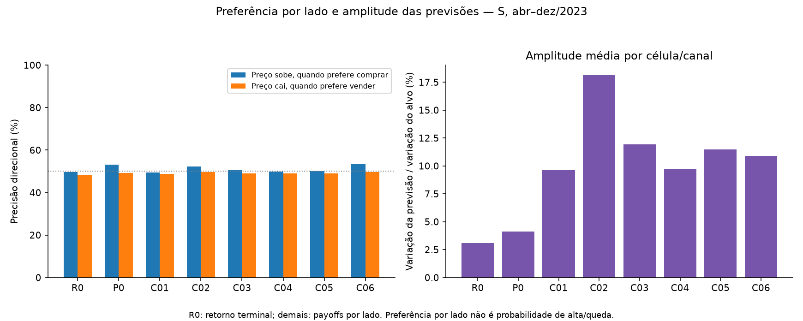
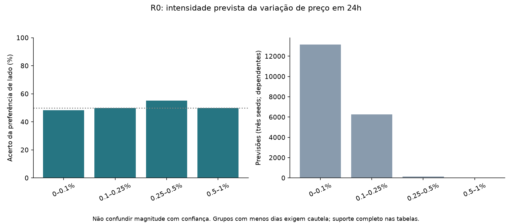
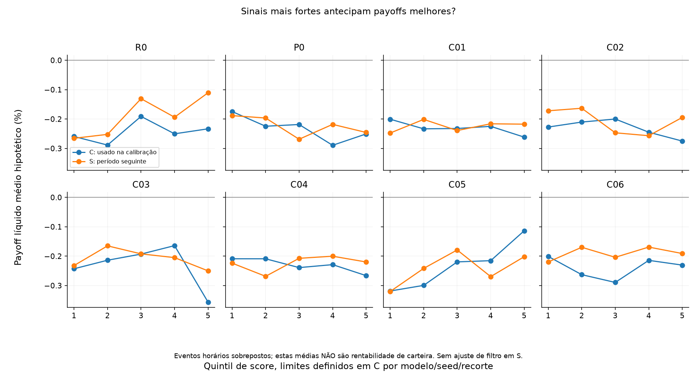
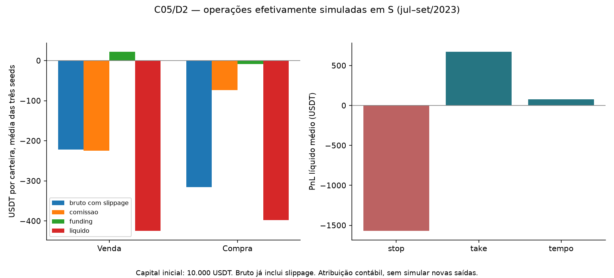

# Diagnóstico das previsões e operações

Concluído em 05/11/2026. Diagnóstico `afa26746c7994ec042ea`, derivado exclusivamente da execução operacional `f0dd11f393b5e26edaf8`. [Estado e evidências](../registros/diagnostico_operacional/estado.json), [configuração](../configuracoes/diagnostico_operacional_001.json), [ADR0029](adr/0029-diagnostico-operacional.md).

## O que esta etapa acrescenta

Investigamos onde as previsões contêm informação, onde falham e como isso se relaciona com as operações. Nenhum modelo foi treinado novamente, nenhuma carteira nova foi simulada e nenhum resultado anterior foi substituído. O objetivo é orientar uma hipótese seguinte; os cortes encontrados aqui não estão aprovados para operação.

Foram lidos 216 arquivos de previsões: 72 ajustes principais, oito receitas, três recortes e três seeds (17/42/2026), nas fases V/C/S. Os dois controles reais ficaram fora das médias. São 467.712 linhas no conjunto diagnóstico; em S, cada receita possui 19.584 previsões correspondentes a **6.528 origens horárias distintas em 272 dias**, repetidas nas três seeds. Isso não equivale a 19.584 dias ou operações independentes. Esta fase não compara os antigos ciclos de oito seeds, LSTM ou Spot.

S corresponde a abril–junho, julho–setembro e outubro–dezembro de 2023, com a purga original. V escolheu checkpoints e C calibrava políticas. Algumas datas de V/C/S se sobrepõem entre recortes: as fases estão separadas em todas as tabelas e não foram somadas como amostras independentes. Estes dados já foram consultados; a análise é exploratória e retrospectiva. Não abrimos a avaliação final de 2024–2025.

## Duas perguntas diferentes

**R0 prevê um log-retorno terminal de 24 horas.** A conversão é `variação = exp(previsão) − 1`; multiplicar por 100 mostra porcentagem. Podemos perguntar se acertou a direção e o tamanho da variação do preço.

**P0 e C01–C06 preveem dois payoffs líquidos:** o resultado percentual de uma compra hipotética e de uma venda hipotética com as barreiras, prazo e custos congelados. Esses números não são probabilidades nem previsões do preço final. Preferir compra significa que a previsão de payoff da compra supera a da venda; as duas ainda podem ser negativas. O teste de direção terminal dessas receitas é um diagnóstico complementar dessa preferência.

| Receita | Entrada / diferença relevante |
|---|---|
| R0 | OHLCV cru, 168h, retorno terminal, Huber |
| P0 | OHLCV cru, 168h, dois payoffs, MSE |
| C01 | OHLC relativo ao fechamento anterior, log1p do volume, padronização no treino |
| C02 | C01 + momentum 24/72/168h |
| C03 | C01 + volatilidade 24/168h |
| C04 | C01 com contexto de 72h |
| C05 | Níveis logarítmicos de OHLC e log1p do volume, padronizados no treino |
| C06 | C01 + volume relativo 24/168h |

As receitas de payoff usam Mamba com 16 estados, dimensão 32 e dois blocos, AdamW e taxa 0,0002; stop dependente da volatilidade passada, take de 1,5 vez a distância do stop e prazo máximo de 24h. Não confundir **contexto da previsão** (72/168h) com **histórico de treinamento** (meses/anos).

## 1. O modelo acerta mais altas ou quedas?

Tabela agrupada por previsão em S, com as três seeds. “Acerto quando indica alta” é a precisão condicionada às previsões de alta; não é o percentual de todas as altas que o modelo encontrou. Para R0 usamos o sinal da saída original. Para os payoffs usamos a preferência entre compra e venda.

| Receita | Acerto geral | Acerto quando indica alta/compra | Acerto quando indica queda/venda | Fração indicando alta/compra | Balanced accuracy |
|---|---:|---:|---:|---:|---:|
| R0 | 50,17% | 50,99% | 49,23% | 53,48% | 50,11% |
| P0 | 49,36% | 53,19% | 49,21% | 3,92% | 50,18% |
| C01 | 48,94% | 49,35% | 48,88% | 12,95% | 49,60% |
| C02 | 50,35% | 52,23% | 49,63% | 27,71% | 50,74% |
| C03 | 49,40% | 50,66% | 49,05% | 21,75% | 49,90% |
| C04 | 49,11% | 49,98% | 48,98% | 12,34% | 49,78% |
| C05 | 49,12% | 50,01% | 48,91% | 18,67% | 49,67% |
| C06 | 50,35% | 53,47% | 49,67% | 17,83% | 50,92% |

O preço subiu em 50,89% das origens. Dizer sempre “alta” alcançaria essa acurácia e balanced accuracy de 50%. Uma referência que escolhe em cada recorte a direção majoritária **do treino** acertou 52,88% em S. Esses comparadores não são carteiras lucrativas demonstradas.

O intervalo exploratório de 95% para a acurácia direta de R0 é **46,56%–53,46%**, reamostrando seeds e blocos de 14 dias. Para a preferência de C06, **47,61%–53,18%**. As sensibilidades de 7/28 dias estão nos recibos. Não há evidência de que o acerto médio esteja consistentemente acima de uma referência simples.

Há uma forte preferência por venda nas receitas de payoff. P0 prefere vender em **96,08%** das previsões, embora o mercado tenha terminado em alta em pouco mais da metade das origens. Seu recall de queda de 96,27% parece alto porque quase sempre prefere vender; seu recall de alta é só 4,09%. Isso explica por que precisão, recall, prevalência e balanced accuracy precisam aparecer juntos.

O ajuste operacional de R0 desconta custos e funding estimado. Ele muda a preferência de lado em **11,88%** das origens, porque muitas previsões são muito pequenas. Essa preferência ajustada acerta 48,79%, distinta dos 50,17% do sinal bruto. As tabelas técnicas e a figura abaixo usam a preferência operacional; o aprofundamento registra separadamente a direção original.

## 2. Previsões maiores são mais confiáveis?

Para R0, agrupamos o **módulo da variação prevista do preço**, convertido do log-retorno. O acerto abaixo usa a direção original do modelo.

| Tamanho previsto da variação em 24h | Previsões | Dias representados | Acerto direcional |
|---|---:|---:|---:|
| Menos de 0,10% | 13.163 | 267 | 50,24% |
| 0,10% a menos de 0,25% | 6.250 | 217 | 49,92% |
| 0,25% a menos de 0,50% | 147 | 53 | 55,10% |
| 0,50% a menos de 1% | 24 | 12 | 50,00% |
| 1% ou mais | 0 | 0 | Não estimável |

Não há melhora monotônica. Na faixa 0,25%–0,50%, todas as previsões eram de alta; a própria frequência de altas desse subconjunto era 55,10%, logo a balanced accuracy é 50%. Essa faixa isolada não demonstra poder de discriminar altas e quedas. A faixa seguinte tem só 24 previsões e não replica o ganho.

A dispersão das previsões R0 equivale em média a apenas **3,09% da dispersão dos retornos observados**, medida dentro de cada modelo/recorte. Para os payoffs, a proporção vai de aproximadamente 4,1% a 18,1%. Isso mostra previsões próximas de médias, mas não prova sozinho falha de implementação: uma esperança condicional pode variar muito menos que cada realização ruidosa. A pergunta útil é se a pequena variação restante ordena oportunidades; a evidência abaixo é fraca.

## 3. O resultado previsto da operação ordena oportunidades?

Dividimos o score em cinco grupos usando limites obtidos **somente das previsões de C, por ajuste**. Aplicamos os mesmos limites ao S seguinte. O quinto grupo representa scores relativamente altos perante C; ele pode conter scores negativos e não necessariamente terá 20% das observações de S.

Todos os quintis agregados de todas as receitas tiveram payoff médio observado negativo em S. Não aparece uma relação crescente e consistente entre score e resultado. Nas cabeças de payoff, as correlações médias por célula entre previsão e alvo são pequenas, aproximadamente −0,032 a +0,044. O resultado sugere pouco sinal útil na ordenação atual; não demonstra impossibilidade de aprender outro desenho.

Também analisamos somente origens em que o score máximo já era positivo. Para R0, o score é a heurística terminal com custos/funding; para os demais, é o payoff líquido previsto. A tabela mostra o resultado unitário hipotético no lado preferido.

| Receita | Origens × seeds com score positivo | Payoff observado médio | IC95% exploratório, blocos de 14 dias |
|---|---:|---:|---:|
| R0 | 2.059 | −0,110% | −0,319% a +0,188% |
| P0 | 2.489 | −0,191% | −0,428% a +0,107% |
| C01 | 7.902 | −0,195% | −0,291% a −0,056% |
| C02 | 11.896 | −0,210% | −0,314% a −0,055% |
| C03 | 10.431 | −0,235% | −0,340% a −0,096% |
| C04 | 8.958 | −0,196% | −0,302% a −0,029% |
| C05 | 12.608 | −0,218% | −0,339% a −0,053% |
| C06 | 9.559 | −0,191% | −0,301% a −0,027% |

**Esses percentuais não são retorno de carteira.** São oportunidades hipotéticas horárias sobrepostas, avaliadas com os alvos preservados, sem restrição de uma posição aberta, arredondamento de quantidade ou dimensionamento por patrimônio. Não somar esses retornos, nem apresentá-los como operações independentes.

### Uma pista positiva que exige cautela

C06, com volume relativo, teve **74 previsões** de payoff superior a 0,5% em S, distribuídas por 56 dias e seis das nove células recorte/seed. Nesse grupo:

- acerto da direção terminal: **66,22%**;
- frequência de payoff líquido positivo: **64,86%**;
- payoff unitário médio: **+0,317%**;
- IC95% exploratório: **−0,254% a +1,833%**, com 1.995 réplicas válidas de 2.000;
- 71 preferências por venda e apenas três por compra;
- 57 das 74 previsões vêm da seed 42; a média dessa seed no grupo é aproximadamente +0,081%, contra valores bem diferentes nas outras seeds;
- em C, o mesmo corte produziu **27 previsões e payoff médio de −0,823%**.

Portanto, guardamos uma hipótese sobre eventos seletivos ligados ao volume, sem chamar o corte de estratégia aprovada. O aprofundamento foi motivado pelos resultados iniciais e está explicitamente identificado como posterior. Pouca cobertura, ausência em algumas células, instabilidade C→S e intervalo que inclui perdas impedem concluir que encontramos lucro replicável. Repetir esse filtro no mesmo S não seria confirmação independente.

## 4. O passado usado para treinar difere do período posterior

Os limites dos três regimes de volatilidade foram aprendidos em T, usando o desvio dos retornos horários das últimas 168h, escalado para 24h. Em S, **94,88% das observações ficaram no tercil inferior de T**; só 0,09% ficaram no superior. Há forte mudança na distribuição. Uma análise de desempenho em “alta volatilidade” teria suporte insuficiente nesse conjunto, e as tabelas marcam grupos pequenos.

As médias dos alvos também mudam. Em D3, o treino apresentava payoff médio de **−0,297% para compra e −0,109% para venda**. No S de outubro–dezembro, os valores passaram para **+0,047% e −0,372%**, respectivamente. A preferência histórica pela venda se tornou desfavorável. Isso é consistente com as saídas pouco variáveis e predominantemente vendidas, mas não prova causalmente que a janela longa de treino seja a responsável.

O diagnóstico por entrada usa o último candle de cada janela e expressa seus valores na escala do suporte de T. Em C05/D2, por exemplo, o volume logarítmico médio em S ficou 0,79 desvio de T abaixo da média de T. Os cálculos dos scalers foram reconferidos e coincidem com o suporte de treino. Mudança de distribuição não é, por si só, erro de normalização.

Uma hipótese justificável é comparar **treino acumulado versus uma janela móvel de 12 meses**, mantendo alvo, contexto, entradas, arquitetura, seeds e política. Reestimar as escalas no novo treino é consequência necessária da alteração da janela. O prazo de 12 meses seria uma escolha prospectiva de engenharia, não um ótimo encontrado neste diagnóstico. Essa comparação ainda não foi iniciada.

## 5. Treinar por mais tempo resolveria?

As receitas C01–C06 selecionaram, em média, checkpoints entre as épocas 3,7 e 6,9; o treinamento continuou por mais dez épocas até a parada. Os registros confirmam atualização e mudança da perda: a perda de treino caiu, enquanto a validação frequentemente piorou após o melhor checkpoint.

Exemplo C02: perda média de treino de 1,076 para 0,809; MSE médio de V de 0,000381 no melhor checkpoint para 0,000461 no último. Esse padrão é compatível com ajuste crescente ao treino sem generalização correspondente. Não há suporte aqui para simplesmente aumentar épocas ou escolher o último checkpoint. R0 e P0 selecionaram épocas mais tardias, em média 14,8 e 12,0.

Em R0, aproximadamente **48,76% do erro quadrático** concentra-se nos 5% de maiores movimentos terminais, medido por célula. Isso explica parte da diferença entre MSE e métricas de acerto: poucos movimentos grandes pesam muito no MSE. É uma descrição posterior da composição do erro, não autorização para retirar esses movimentos da avaliação.

As diferenças de MSE preservadas também permanecem pequenas ou desfavoráveis: R0 ficou 0,260% pior que retorno zero e 0,116% melhor que a média de T; P0 ficou 0,348% melhor que zero, mas 0,233% pior que a média de T. As demais receitas de payoff ficaram piores que ambos. Não comparar numericamente MSE terminal com MSE de payoff como se fossem o mesmo alvo.

## 6. As seeds concordam? Uma previsão diária melhora?

Concordância entre seeds não garante informação útil. P0 teve unanimidade de preferência entre 89,6% e 97,3% das origens de cada recorte, em grande parte por quase sempre preferir venda. C05 caiu para apenas **33,06% de unanimidade em D2**. C06 ficou entre 56,39% e 71,34%; suas acurácias agregadas por seed ficaram próximas de 50,3%, sem uma seed isolada resgatar o desempenho global.

Foram calculados diagnósticos em grades fixas de 1h, 4h, 24h e 48h, com alinhamento UTC. Isso apenas seleciona previsões existentes; não muda candles, treinamento ou o simulador. A grade de 48h evita sobreposição do prazo de realização de aproximadamente 24h, mas ainda não assegura independência estatística.

Na grade diária, todos os payoffs médios por receita continuaram negativos. C06 passou de −0,191% na grade horária para −0,225% na diária; C05, de −0,230% para −0,261%. Esses números usam todas as preferências de lado, inclusive score negativo, e não uma política de entrada. A análise não encontrou motivo para assumir que diminuir a frequência, por si só, resolve o sinal. O efeito sobre giro/custos de uma carteira exigiria outro backtest identificado.

As tabelas também registram mês, hora UTC, tendência passada, regime de volatilidade e média posterior das previsões das três seeds. São descrições para formular hipóteses, sem escolher retrospectivamente o melhor horário ou regime.

## 7. O que aconteceu nas operações realmente executadas pelo backtest?

C05/D2 foi a única receita/recorte cuja política foi aprovada em C e operou em S. As três carteiras começaram com 10.000 USDT e tiveram 89, 116 e 110 operações; **315 registros no conjunto**, parcialmente sobrepostos entre seeds. A média dos retornos foi −8,228%.

| Componente, média das três carteiras | USDT |
|---|---:|
| PnL dos preços de execução, antes de comissão/funding | −537,92 |
| Comissões debitadas | −298,53 |
| Funding líquido | +13,61 |
| Resultado líquido | **−822,84** |

O PnL de preços **já inclui slippage**. A atribuição mostra que comissão agravou a perda, mas não foi sua única origem. Não calculamos uma carteira contrafactual “sem custos”: removê-los poderia mudar dimensionamento, disponibilidade de capital e decisões.

| Lado, agregando registros das três seeds | Operações | Acerto da direção terminal | Operações com lucro líquido | PnL médio por operação |
|---|---:|---:|---:|---:|
| Compra | 82 | 40,24% | 26,83% | −14,56 USDT |
| Venda | 233 | 58,37% | 40,77% | −5,47 USDT |

Portanto, neste recorte **as vendas acertaram mais a direção e perderam menos por operação que as compras**. Sua contribuição total negativa foi um pouco maior por serem mais frequentes. A conclusão “o modelo é pior para prever quedas porque short perdeu” não é sustentada por esses registros.

Das **169 operações que acertaram a direção final, 55 perderam dinheiro**: 32,54%. Vinte saíram pelo stop antes de uma direção terminal favorável; outras 35 chegaram ao prazo final sem lucro líquido. O fechamento de 24h usado na métrica terminal também antecede ligeiramente o fechamento da operação por causa da latência de entrada. Isso torna concreta a diferença entre acertar direção e ganhar com a execução escolhida.

Houve 102 stops, 37 takes e 176 saídas por tempo. As contribuições líquidas, médias por carteira, foram −1.569,92 USDT em stops, +671,87 em takes e +75,21 em saídas por tempo. Não inferir daí que basta remover stops: isso alteraria perdas, duração, capital disponível e trades posteriores. A atribuição descreve o que ocorreu, não o que ocorreria sem proteção.

## 8. Conclusão e próximo passo orientado pelas evidências

O diagnóstico não encontrou uma vantagem operacional robusta escondida em um limiar simples. Encontrou mecanismos úteis: previsões pouco variáveis, preferência histórica por venda, mudança de volatilidade e médias, discriminação fraca entre oportunidades, sinais de perda de generalização durante o treino e diferença relevante entre direção terminal e saída efetiva.

A pista seletiva de C06 será preservada como hipótese de baixa confiança. Uma próxima comparação de janela de treino é mais fundamentada por estes dados que aumentar indiscriminadamente estados/épocas. C06 pode servir como receita de investigação por incluir a informação de volume que motivou a pista, sem ser promovida a vencedora. Outra linha independente é reproduzir fielmente uma referência publicada e testar sua transferência; não misturar essa reprodução com a ablação da janela.

Antes da próxima busca, fornecer ao proponente o diagnóstico por lado, suporte, magnitude, mudança de regime, custos e razões de rejeição, em vez de apenas retorno zero das políticas que ficaram em caixa. O feedback de desenvolvimento deve permanecer separado de períodos reservados. Configurações futuras exigem identidade, orçamento e critérios próprios; não adotamos novo filtro, alvo ou política nesta etapa.

## Método, incerteza e trilha de auditoria

- Métricas de erro comparáveis às publicações usam média de peso igual entre nove células recorte/seed. Taxas condicionais, faixas e intervalos desta análise agrupam previsões, ponderando pelo número de origens. As duas ponderações estão identificadas; não são a mesma estimativa.
- Bootstrap: 2.000 réplicas, seeds amostradas como unidades inteiras, mesmas seeds entre recortes, dias sincronizados entre seeds dentro de cada recorte; blocos temporais não circulares de 14 dias, sensibilidades 7/28. Recortes são estratos fixos, não sorteios de novos regimes. Há apenas três seeds e três períodos de S.
- Intervalos de 95% são exploratórios, sem correção pelo grande número de cortes. Não representam garantia simultânea, nem incorporam toda a incerteza da busca prévia. Réplicas sem eventos condicionais são contadas e excluídas apenas do respectivo intervalo, nunca tratadas como lucro zero.
- Direção exatamente nula ou preço terminal inalterado não entra no denominador da precisão/acurácia binária; cobertura é informada. Houve um único preço inalterado em V, repetido nas seeds. A conferência posterior inicialmente usou o denominador total, detectou a divergência e foi corrigida; incidente e fonte anterior preservados. Não alterou tabelas publicadas ou S.
- Reconferidos 216 arquivos principais de previsões por leitor independente, alvos de preço contra candles, alvos de payoff contra contratos, scalers de T, checkpoint escolhido por V e 1.260 identidades contábeis de carteiras. Resíduo máximo contábil da leitura inicial: 1,31×10⁻¹¹ USDT. Preservados 6.422 arquivos de entrada por hashes antes/depois. Oito testes da implementação passaram; as quatro figuras foram inspecionadas.
- Esta conferência não certifica tarifas históricas, filtros de exchange, execução intraminuto ou liquidação completa Binance. Permanecem as aproximações de funding e do envelope de drawdown do simulador congelado.
- Não há garantia de lucro futuro ou impossibilidade de lucro; há evidência sobre este desenho e estes períodos. Todos os artefatos permanecem locais, sem alegação de backup remoto.

### Onde consultar e reproduzir

| Conteúdo | Local |
|---|---|
| Estado e identidade | `registros/diagnostico_operacional/estado.json`, `execucao.json` |
| Código e testes | `analises/diagnostico_operacional/`, `tests_diagnostico_operacional/` |
| Configuração e autorização delimitada | `configuracoes/diagnostico_operacional_001.json`, ADR0029 |
| Dados derivados por previsão | `dados/diagnosticos/operacional_afa26746c7994ec042ea/observacoes.parquet` |
| Tabelas por faixa, lado, período, seed e frequência | `tabelas.json` na mesma pasta |
| Calibração por cabeça e treinamento | `canais.json`, `treinamento.json` |
| Mudança de distribuição e limites aprendidos | `mudanca_entradas.json`, `cortes_causais.json` |
| Incerteza | `incerteza.json` |
| Operações e reconciliação | `operacoes_herdadas.parquet`, `atribuicao_operacoes.json`, `carteiras_conferidas.json` |
| Integridade e fontes copiadas | `congelamento.json`, `auditoria.json`, `manifesto.json`, `fontes/` |
| Conferência independente e aprofundamento C06 | `registros/diagnostico_operacional/conferencias/96486788ac1a4fc7ba5c/conferencia.json` |
| Incidente do leitor posterior | `registros/diagnostico_operacional/incidentes/conferencia_denominador_001/` |

`python -m analises.diagnostico_operacional` cria uma identidade derivada das fontes/configuração/entradas e recusa sobrescrever uma tentativa existente. Não chamar para repetir esta publicação. A conferência posterior possui recibo próprio; os dados e fontes copiados permitem inspeção sem reexecutar treinos. Arquivos parquet são locais e precisam ser incluídos no pacote de preservação ao transferir de máquina; os manifests permitem verificar sua integridade.
