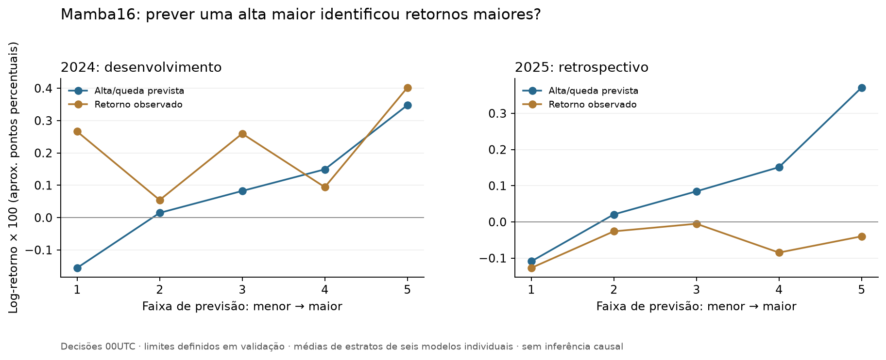

# Informação nas previsões já treinadas

Diagnóstico `18970ab1cd02ea68c1cc`: 53 séries preservadas, sem novos ajustes ou inferência. As estatísticas são descrições retrospectivas e não mudam o critério de seleção dos estudos anteriores.

## Médias dos modelos nas origens diárias

MSE continua avaliando precisão. Correlações medem associação, não amplitude correta ou lucro. Vitórias contam erros absolutos menores que Naive; empates aparecem separados. P95 é o percentil 95 do erro absoluto, não risco financeiro. Grupos de seis e três seeds não são equivalentes; usar Mamba16/três para comparar com LSTM.

| Parte | Grupo | MSE | MAE×100 | P95×100 | Vitória vs Naive | Empates | Pearson | Spearman |
|---|---|---:|---:|---:|---:|---:|---:|---:|
| Validação | Mamba16 (6 seeds) | 0.000760609 | 2.0005 | 5.8286 | 50.96% | 0.00% | 0.0406 | 0.0299 |
| Validação | Mamba16 (3 seeds) | 0.000757639 | 1.9944 | 5.8298 | 51.42% | 0.00% | 0.0720 | 0.0517 |
| Validação | LSTM (3 seeds) | 0.000760880 | 1.9985 | 5.7868 | 49.22% | 0.00% | 0.0997 | 0.0570 |
| Validação | Naive | 0.000764820 | 2.0084 | 5.8599 | 0.00% | 100.00% | indefinida | indefinida |
| Validação | ARIMA | 0.000763224 | 2.0063 | 5.8584 | 50.14% | 0.00% | 0.1352 | 0.0575 |
| Teste | Mamba16 (6 seeds) | 0.000482273 | 1.5792 | 4.5071 | 47.62% | 0.00% | -0.0056 | 0.0014 |
| Teste | Mamba16 (3 seeds) | 0.000483310 | 1.5780 | 4.5369 | 48.26% | 0.00% | 0.0018 | 0.0105 |
| Teste | LSTM (3 seeds) | 0.000479639 | 1.5752 | 4.4508 | 47.25% | 0.00% | 0.0320 | 0.0279 |
| Teste | Naive | 0.000475584 | 1.5654 | 4.5570 | 0.00% | 100.00% | indefinida | indefinida |
| Teste | ARIMA | 0.000475456 | 1.5656 | 4.5921 | 49.45% | 0.00% | 0.0196 | 0.0032 |

## Leitura do diagnóstico atual

Nas origens diárias do teste, a média dos seis Mamba16 teve Spearman de aproximadamente **0,0014** e Pearson de **−0,0056**. O erro absoluto foi menor que o Naive em **47,62%** dos casos; esse indicador não é acurácia direcional. As faixas de previsão não apresentam uma progressão observada clara no teste. São sinais descritivos de informação fraca nessa amostra, não prova de inexistência de previsibilidade ou de erro na coleta.

Essas estatísticas não possuem aqui intervalos de correlação que tratem dependência temporal; não devem receber alegação de significância. A comparação de seis seeds mede estabilidade de ajustes sobre o mesmo histórico, não seis mercados independentes. O MSE diário difere do MSE de todas as origens horárias das tabelas antigas por avaliar uma população distinta, sem invalidar os números originais. A proposta de scheduler não foi modificada depois deste diagnóstico.

## Como interpretar as faixas

Para cada seed, os cortes de 20/40/60/80% vêm somente de suas previsões diárias na validação. Aplicam-se os mesmos cortes ao teste; faixas podem ter tamanhos diferentes ou ficar vazias. Previsão constante forma uma faixa. A figura média não é uma carteira, ensemble ou previsão negociável. Uma curva observada crescente seria evidência descritiva de ordenação; é preciso avaliar estabilidade e incerteza, sem escolher cortes pelo lucro.

## Limites e uso

Resultados completos por seed, trimestre, todas as origens e 00UTC estão no [registro](../registros/diagnosticos_previsoes/atual.json). Sem p-valores de correlação que presumam independência; previsões horárias para 24h se sobrepõem. Não filtrar treinamento pela magnitude do retorno futuro. Cortes aqui são diagnósticos, sem nova regra operacional. A escolha da hipótese de scheduler antecede este diagnóstico; não se muda o protocolo após ver estas curvas. 2024/2025 já foram consultados; não são holdout novo. Os estudos CryptoMamba permanecem no histórico, fora desta comparação de 53 séries.
