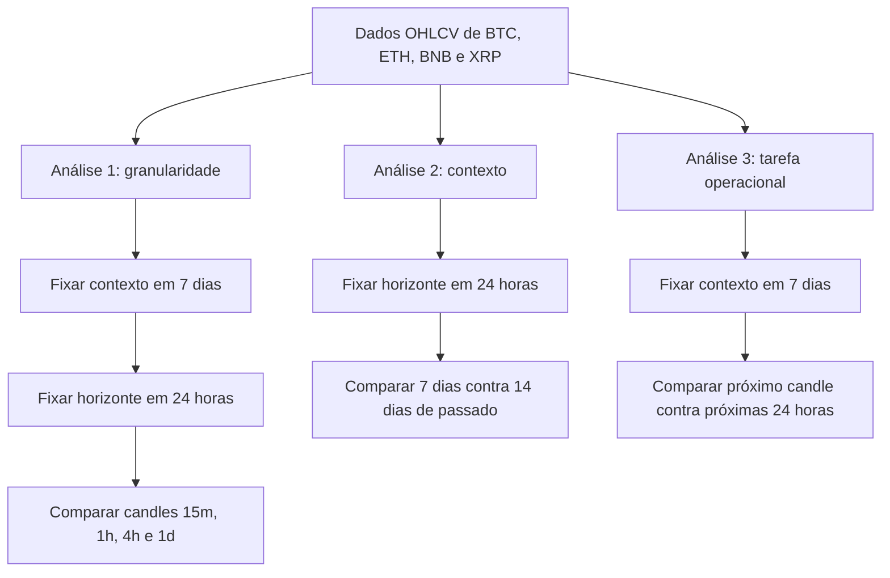
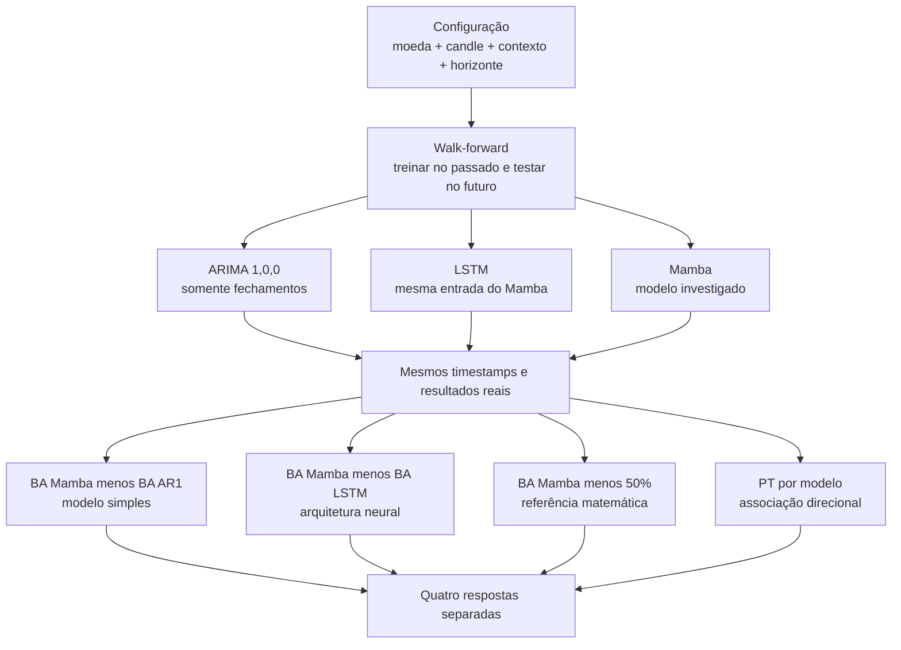

# Entrega 1 — mapa visual do estudo

## Objetivo

Descobrir **em quais condições** o Mamba consegue prever a direção futura de BTC, ETH, BNB e XRP acima do AR(1), da LSTM e do patamar matemático de 50% de balanced accuracy, com evidência direcional pelo teste PT.

> O estudo não procura apenas um número final. Ele procura saber onde a previsão funciona: em qual moeda, candle, quantidade de contexto e horizonte futuro.

## O que cada dimensão significa

| Dimensão | Explicação simples | Valores |
|---|---|---|
| **Moeda** | ativo que está sendo previsto | BTC, ETH, BNB e XRP |
| **Candle** | nível de detalhe usado para representar o passado | 15m, 1h, 4h e 1d |
| **Contexto** | quantidade de passado entregue ao modelo | 7 e 14 dias |
| **Horizonte** | distância entre a previsão e o resultado futuro | próximo candle e próximas 24h |

Exemplo: `ETH + candles de 1h + contexto de 7 dias + horizonte de 24h` é uma configuração. Ela não será misturada com a configuração de BTC ou com a previsão do próximo candle.

## Comparações planejadas

Nas análises 1 e 2, um fator é alterado por vez. A análise 3 compara tarefas de frequências diferentes: prever o próximo candle gera mais previsões que prever uma vez por dia. Ela mostra utilidade em cenários curtos e longos, mas a diferença não será atribuída somente ao horizonte.

## Como cada configuração será avaliada

## Critério de leitura

| Verificação | O que responde |
|---|---|
| `BA Mamba > BA AR(1)` | o modelo supera o comparador estatístico escolhido em BA observada? |
| `BA Mamba > BA LSTM` | o modelo supera uma rede sequencial com as mesmas entradas em BA observada? |
| `BA Mamba > 50%` | o modelo fica acima do patamar de não discriminação, com ambas as classes reais? |
| PT positivo com `p < 0,05` | existe evidência de associação direcional favorável? |
| Ganho em vários folds | o resultado se mantém em diferentes períodos? |

As quatro comparações centrais respondem a perguntas diferentes. O random walk sem deriva, traduzido para este alvo binário, coincide com 50% de BA quando há duas classes; não é uma evidência independente adicional. PT não testa superioridade frente ao AR(1) ou à LSTM e BA acima de 50% não é um p-valor. A estabilidade temporal ajuda a interpretar o resultado. Um resultado favorável em BTC não se transfere automaticamente a ETH, BNB ou XRP, nem do próximo candle para 24 horas.

## Como aparecerá no trabalho

Serão mostradas **quatro matrizes alinhadas**: `Mamba versus AR(1)`, `Mamba versus LSTM`, `Mamba versus 50%` e `PT` por modelo. A variação entre folds ficará em tabelas de detalhe. Também serão produzidas tabelas separadas:

1. **Moeda × candle**, para previsão das próximas 24 horas.
2. **Contexto de 7 × 14 dias**, sem misturar os resultados.
3. **Próximo candle × próximas 24 horas**, deixando claro que são horizontes e frequências diferentes.

O processo será: coletar e auditar dados → montar cada configuração sem vazamento temporal → executar walk-forward → calcular AR(1), LSTM e Mamba nos mesmos testes → preencher as tabelas → comparar estabilidade entre folds.

“Melhor previsão” significa capacidade direcional fora da amostra. Não significa automaticamente “melhor estratégia de trading”, pois esta entrega não inclui custos, slippage nem gestão de risco.
