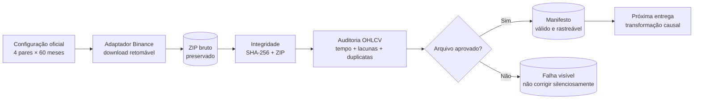
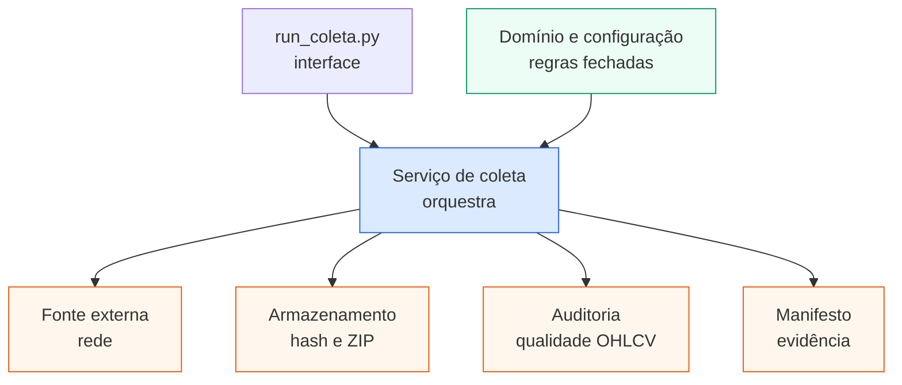

# Entrega 2 — camada de dados em uma imagem

## Ideia central

> Primeiro provamos de onde o dado veio e se ele está íntegro. Só depois o dado pode entrar no experimento.

## As camadas não se misturam

## Explicação de 30 segundos para o professor

1. A configuração congela **o que deve existir**: 240 arquivos planejados.
2. A fonte cuida somente de **obter** esses arquivos.
3. A auditoria verifica **se podemos confiar** neles.
4. O manifesto deixa uma **prova reproduzível** de cada decisão.
5. Mamba e baseline só recebem dados aprovados; eles não fazem parte da coleta.
