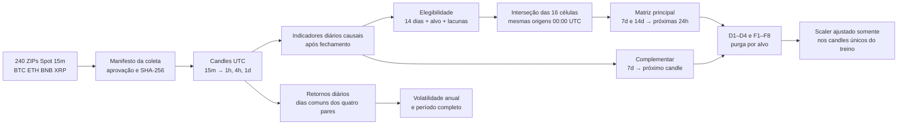

# Entrega 3 — visão para apresentação

**Exemplo de alinhamento:** às 00:00 UTC de um dia elegível, o fechamento recém-concluído é `C_t`. A entrada termina em `t`; o rótulo principal compara `C_t` com `C_(t+24h)`. Os quatro candles de entrada representam o mesmo período de calendário em resoluções diferentes, e a grade comum impede comparar populações de dias distintas.

**Números para a reunião:** 240 ZIPs auditados; 24 com somente lacunas e checksum válido; 1.661 origens diárias comuns; nenhum fold vazio; 1.811 retornos diários comuns. O desvio diário do período completo foi BTC 3,05%, ETH 4,13%, BNB 4,26% e XRP 5,13%. Essa ordem muda nos recortes anuais. Veja [resultados da execução oficial](resultados_execucao_oficial.md). Resultados preditivos só surgem nas entregas posteriores.
