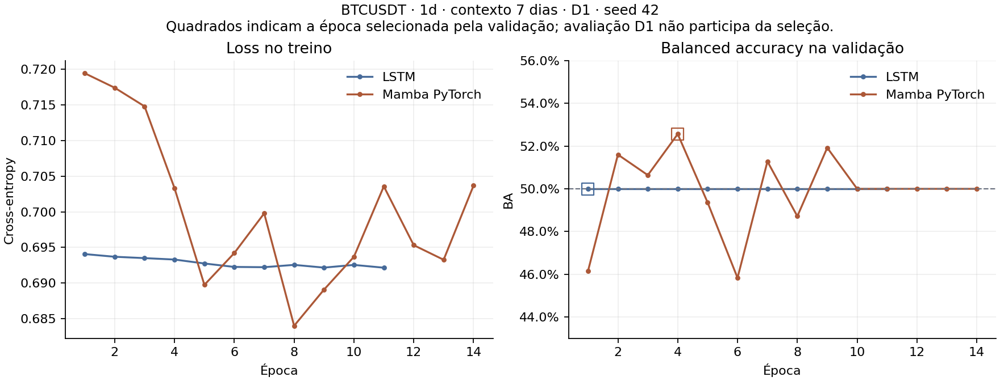

# Piloto pareado BTCUSDT / D1 — LSTM e Mamba em CPU

**Execução:** 13/10/2026, 16:00:00–16:00:13 UTC (13:00 no horário de Brasília).
**Identidade:** `481b79d054b046fe6b70`.
**Estado:** treinamento concluído e artefatos auditados. Piloto funcional das Entregas 4 e 5 no backend PyTorch/CPU; não é avaliação final nem seleção de configuração.

O usuário autorizou expressamente o treinamento pelo agente. Foi executada uma única configuração, definida antes de consultar seus resultados. Não houve busca de seeds, limiar, épocas ou arquitetura para melhorar a avaliação D1.

## 1. Configuração e dados

| Item | Valor executado |
|---|---|
| Dataset | `daeec76f001afb50a8fe`, sem nova coleta ou processamento |
| Par e resolução | BTCUSDT / 1d |
| Contexto e horizonte | 7 candles diários → próximas 24 horas |
| Entradas | Cinco features OHLCV; StandardScaler compartilhado |
| Fold e seed | D1 / 42 |
| Mamba | Backend `pytorch`; duas camadas, largura 32, estado 16, convolução 4, expansão 2, dropout 0,1, último passo |
| LSTM | Duas camadas unidirecionais, largura 32, dropout entre camadas 0,1, último passo |
| Treinamento | AdamW, taxa 0,0002, weight decay 0,001, batch/microbatch 32, cross-entropy sem pesos, clipping 1 |
| Seleção da época | Maior BA de validação; empate conserva a primeira; paciência 10, máximo 100 épocas |
| Decisão binária | Alta somente se probabilidade > 0,5; AR(1): retorno previsto > 0 |

| Bloco | Intervalo de origens do protocolo (UTC; fim exclusivo) | Exemplos após purga e qualidade | Não alta / alta |
|---|---|---:|---:|
| Treino | 01/01/2021 → 01/10/2022 | 495 | 258 / 237 |
| Validação | 01/10/2022 → 01/01/2023 | 91 | 52 / 39 |
| Avaliação de desenvolvimento | 01/01/2023 → 01/04/2023 | 82 | 41 / 41 |

O primeiro exemplo de treino elegível tem origem em 23/01/2021. O scaler foi ajustado nos **525 candles únicos** das janelas de treino. O último alvo observado na avaliação termina em 24/03/2023; lacunas e regras de elegibilidade explicam por que nem todos os dias do trimestre entram. Os três modelos foram comparados nas mesmas 82 origens e rótulos. Nenhum fold F1–F8 foi treinado ou avaliado.

## 2. Ambiente efetivamente utilizado

- Windows 11; Python 3.13.14; PyTorch 2.9.1+cpu; seis threads PyTorch.
- NumPy 2.2.6; pandas 2.3.3; scikit-learn 1.7.2; PyArrow 23.0.1.
- CUDA indisponível; GPU identificada no Windows: **AMD Radeon RX 6600**. Ela não foi usada neste piloto.
- O caminho WSL `~/.venvs/cc` não existe neste computador; PyTorch e `mamba_ssm` também não estão instalados no Python do Ubuntu verificado.
- A receita CUDA preservada no repositório não descreve o ambiente atual. Mamba oficial/CUDA não foi validado. O fallback PyTorch é uma implementação admitida pelo projeto, mas não há alegação de equivalência numérica entre backends.

## 3. Treinamento e checkpoints

| Modelo | Parâmetros | Épocas executadas | Época escolhida | BA de validação escolhida | Treino + avaliação |
|---|---:|---:|---:|---:|---:|
| LSTM | 13.506 | 11 | 1 | 50,00% | 1,05 s |
| Mamba PyTorch | 20.290 | 14 | 4 | 52,56% | 4,59 s |

Os tempos são os campos medidos pelo treinador, após a criação do modelo; não incluem toda a leitura, auditoria e preparação. A execução pareada completa durou aproximadamente 13,51 s. São medidas de uma janela diária curta, não estimativas suficientes para a grade de 15 minutos com 672 ou 1.344 passos. Memória RAM de CPU não foi medida; o campo de memória CUDA é nulo.

A LSTM manteve BA de validação em 50% nas 11 épocas, embora sua loss de treino tenha variado. O protocolo conservou a época 1. O Mamba atingiu sua maior BA de validação na época 4 e parou após dez épocas sem superá-la. Os checkpoints escolhidos foram recarregados antes da avaliação, sem escolher épocas pelo resultado de teste.



## 4. Resultados de validação e avaliação

| Bloco | Modelo | BA | Accuracy | F1 macro | Recall não alta | Recall alta |
|---|---|---:|---:|---:|---:|---:|
| Validação | AR(1) | 51,60% | 58,24% | 0,4119 | 98,08% | 5,13% |
| Validação | LSTM | 50,00% | 57,14% | 0,3636 | 100,00% | 0,00% |
| Validação | Mamba | 52,56% | 51,65% | 0,5164 | 46,15% | 58,97% |
| Avaliação D1 | AR(1) | 46,34% | 46,34% | 0,3167 | 92,68% | 0,00% |
| Avaliação D1 | LSTM | 50,00% | 50,00% | 0,3333 | 100,00% | 0,00% |
| Avaliação D1 | Mamba | 41,46% | 41,46% | 0,3242 | 4,88% | 78,05% |

### Matrizes de confusão da avaliação D1

| Modelo | Não alta → não alta | Não alta → alta | Alta → não alta | Alta → alta |
|---|---:|---:|---:|---:|
| AR(1) | 38 | 3 | 41 | 0 |
| LSTM | 41 | 0 | 41 | 0 |
| Mamba | 2 | 39 | 9 | 32 |

- A LSTM previu **não alta em todos os 82 casos**. Sua BA de 50% reflete ausência de discriminação entre classes nesta configuração.
- O Mamba previu alta em **71 dos 82 casos**: acertou 32 das 41 altas, mas apenas 2 das 41 não altas. Seu resultado ficou abaixo das duas baselines.
- O AR(1) reproduziu as classes previstas no piloto histórico D1. Seus coeficientes foram ajustados no treino; não houve ajuste na validação ou avaliação.

### Quatro leituras separadas da avaliação

| Comparação | Resultado | Interpretação |
|---|---:|---|
| BA Mamba − BA AR(1) | −4,88 p.p. | Mamba abaixo da baseline estatística nesta célula |
| BA Mamba − BA LSTM | −8,54 p.p. | Mamba abaixo da baseline neural nesta célula |
| BA Mamba − 50% | −8,54 p.p. | Resultado abaixo da referência de BA |
| PT Mamba | z = −2,2821; p = 0,0225 | Estatística negativa; não é associação direcional favorável |
| PT LSTM | Indisponível | Previsão constante; não se fabrica p-valor |
| PT AR(1) | z = −1,7755; p = 0,0758 | Sem evidência favorável neste teste exploratório |

O lag 1 das classes previstas pelo Mamba foi aproximadamente **0,728**, contra −0,087 nos rótulos reais (observações consecutivas disponíveis). Essa dependência limita a inferência do PT clássico. O p-valor do Mamba não demonstra superioridade; além de exploratório, sua estatística tem sinal negativo. Não inverter previsões ou escolher novo limiar a partir desse resultado.

## 5. Auditorias concluídas

- 18 testes da infraestrutura aprovados antes da execução, sem treinamento nesses testes.
- Manifesto, hashes, contagens, timestamps, purga, classes e ajuste do scaler conferidos.
- `run_avaliacao.py` recalculou métricas, diferenças e PT a partir dos parquets, sem divergências.
- Os dois checkpoints foram carregados novamente em uma verificação independente, sem novo treinamento. As probabilidades de validação e avaliação reproduziram **exatamente** as gravadas: maior diferença absoluta 0.
- Verificada a seleção da primeira época de maior BA de validação. Dez tensores da LSTM e 28 do Mamba diferem de sua inicialização; os checkpoints contêm pesos efetivamente atualizados.
- Resultados D2–D4 ausentes são identificados como ausência na consolidação, não como zero nem como desenvolvimento completo.

## 6. Artefatos e reprodução

```text
configuracoes/treino_piloto_cpu.json
dados/experimentos/pareado_481b79d054b046fe6b70/
dados/experimentos/aceite_piloto_cpu_481b79d054b046fe6b70/resumo.json
dados/experimentos/aceite_piloto_cpu_481b79d054b046fe6b70/metricas_por_fold.csv
dados/experimentos/aceite_piloto_cpu_481b79d054b046fe6b70/verificacao_checkpoints.json
dados/experimentos/piloto_cpu_20261013.log
```

A pasta pareada preserva configuração, ambiente, snapshot das fontes, cópia do protocolo executado, scaler, históricos, checkpoints e seis parquets de previsões. O log de console apresentou caracteres acentuados substituídos na saída do Windows; JSONs e documentação foram lidos em UTF-8 e os valores numéricos não foram afetados.

| Identidade preservada | SHA-256 |
|---|---|
| Manifesto do dataset | `5c813f1d9f29fe78724c63d718d5c9dae062028984f5d5a2f50acb1967bb00ed` |
| Código executado | `3648c9fe6c07cda69e37096462805bc6e073d03b9f4d6ed032050c7c46b1f2da` |
| Protocolo executado | `b71cba42dce397b244353cf0504a0301bff24f84fe6ba5a506bc2e38be7adb62` |

O estado editorial da documentação foi atualizado depois da execução. A cópia do protocolo e o snapshot dentro do experimento preservam o estado efetivamente usado; não foram alterados para acompanhar esta atualização. Reexecutar a CLI após alterações no protocolo/código pode gerar outra identidade, portanto não é necessário repetir treinamento para auditar este resultado.

## 7. Aceite e continuidade

**Aceite funcional do piloto em CPU concluído:** dados, treino, seleção/recarga de checkpoint, previsões, auditoria e consolidação funcionaram para BTCUSDT/1d/D1. O resultado preditivo foi desfavorável ao Mamba; isso não constitui, por si só, falha de implementação.

**Pendência específica:** qualificar o backend oficial em um ambiente CUDA compatível antes de executar a grade WSL prevista. A máquina atual, com GPU AMD e sem esse ambiente, não satisfaz esse requisito. Não se declara essa validação concluída nem se substitui silenciosamente o backend da grade.

Nas próximas entregas, completar os folds e a grade de desenvolvimento de acordo com o protocolo. As hipóteses de contexto, resolução e entradas permanecem abertas. Uma moeda, um fold e uma seed não permitem concluir sobre toda a arquitetura, as outras moedas, a reserva 2024–2025 ou rentabilidade.

## 8. Revisão posterior — 13/10/2026

O [diagnóstico posterior](../../../historico/analises/2026-10-13_diagnostico_mamba.md), feito com os checkpoints existentes e sem novo treino, encontrou BA de treino de 49,68% para o Mamba, mudança das distribuições de entrada entre os blocos e uma diferença concreta na inicialização de `dt_proj.bias` do fallback em relação à referência oficial. Nenhuma dessas observações isolou a causa da BA de teste. O piloto foi arquivado como **em revisão científica**; seu aceite funcional não certifica equivalência entre implementações. A qualificação dessa diferença precede a ampliação da grade. Os resultados e artefatos originais deste relatório foram preservados no [histórico](../../../historico/experimentos/pareado_481b79d054b046fe6b70/README.md).
