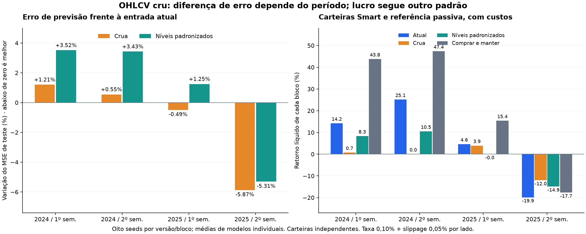

# Entradas relativas, cruas e níveis padronizados

Execução `76f6c437e70eaaa605ad`. Oito seeds por versão/bloco; quatro blocos,64ajustes novos+2controles e32referências MSE herdadas.

[Protocolo](protocolo_entradas_niveis.md), [estado](../registros/entradas_niveis/estado.json).

## Médias das oito seeds por bloco

| Bloco | Parte | Atual MSE | Crua MSE | Níveis padronizados MSE |
|---|---|---:|---:|---:|
| B1 | validacao | 0.0004902856 | 0.0004829695 | 0.0004755522 |
| B1 | teste | 0.0007282770 | 0.0007370560 | 0.0007538854 |
| B2 | validacao | 0.0005728364 | 0.0005695012 | 0.0005637781 |
| B2 | teste | 0.0007225947 | 0.0007265668 | 0.0007473749 |
| B3 | validacao | 0.0006032542 | 0.0006118555 | 0.0006285818 |
| B3 | teste | 0.0005934036 | 0.0005905105 | 0.0006008048 |
| B4 | validacao | 0.0003938712 | 0.0004089005 | 0.0004037976 |
| B4 | teste | 0.0004299033 | 0.0004046596 | 0.0004070954 |

## Médias com peso igual entre os quatro blocos

| Parte | Variante | MSE | RMSE×100 | MAE×100 | Habilidade Naive |
|---|---|---:|---:|---:|---:|
| validacao | atual | 0.0005150618 | 2.2621 | 1.6341 | +1.186% |
| validacao | crua | 0.0005183067 | 2.2699 | 1.6351 | +0.564% |
| validacao | niveis_padronizados | 0.0005179274 | 2.2679 | 1.6372 | +0.637% |
| teste | atual | 0.0006185446 | 2.4739 | 1.7887 | -1.518% |
| teste | crua | 0.0006146982 | 2.4630 | 1.7805 | -0.887% |
| teste | niveis_padronizados | 0.0006272901 | 2.4869 | 1.8056 | -2.953% |

## Contrastes predefinidos de teste

| Contraste | Diferença MSE | IC98,333% principal | Interpretação |
|---|---:|---|---|
| crua_menos_atual | -3.846424975e-06 | [-1.4694647142589576e-05, 6.26758151591911e-06] | inconclusivo |
| niveis_padronizados_menos_atual | 8.745481403e-06 | [-7.940046060175639e-06, 2.8263334973567554e-05] | inconclusivo |
| crua_menos_niveis_padronizados | -1.259190638e-05 | [-2.6389028440722705e-05, -2.8019662280540813e-06] | melhora |

## Smart com custos base: média de oito carteiras independentes

| Bloco | Atual | Crua | Níveis padronizados |
|---|---:|---:|---:|
| B1 | +14.19% | +0.73% | +8.32% |
| B2 | +25.11% | +0.00% | +10.48% |
| B3 | +4.62% | +3.91% | -0.01% |
| B4 | -19.87% | -12.02% | -14.88% |

Todos os resultados por seed, dispersões, decisões, sensibilidades7/28, custos, risco e referências operacionais estão na publicação estruturada. Controles reais não entram nas médias.

Retrospectivo2024/2025; oito seeds não garantem certeza.
Três contrastes fixos; IC98,333% principal Bonferroni,14dias; sensibilidades7/28.
Mesmas origens, alvo e cinco canais; sem timestamp, indicadores ou novas buscas.
Comparação de entradas sob receita fixa; não demonstra desempenho ótimo de cada representação.
Médias de modelos individuais, não ensemble; carteiras independentes por bloco.
Não há retomada automática após falha nem repetição até passar/lucrar.

## Interpretação e conferência posterior em03/11/2026

**A entrada crua não demonstrou ganho conclusivo sobre a representação atual.** O MSE médio caiu0,622%, enquanto os níveis padronizados pioraram1,414%. O contraste crua−níveis padronizados foi favorável em2,007%, com intervalo principal corrigido inteiramente negativo e a mesma direção nas sensibilidades7/28dias. Isso é evidência condicional à receita e aos períodos; não demonstra que normalização seja universalmente prejudicial. Nenhuma representação superou o Naive de retornozero no MSE agregado.

A execução terminou em03/11/2026 às08h59 de Brasília. A fila e o executor estão encerrados.64ajustes principais novos,2controles reais e32referências herdadas formam96modelos principais para comparação; controles não entram nas médias.4blocos com8seeds por versão, não apenas8modelos no total.

A revisão posterior de leitura conferiu95fontes,2.305arquivos publicados e9.632arquivos preservados. Métricas dos96modelos,seleção/checkpoints e recibos de recarga exata foram verificados; três contrastes com2.000réplicas em7/14/28dias foram recalculados independentemente e600carteiras tiveram saldos/custos/risco reconstruídos. Não houve novo treino,inferência ou simulação. [Recibo](../registros/entradas_niveis/entrega/20261103/conferencia.json), [análise estruturada](../registros/entradas_niveis/entrega/20261103/analise.json). O relatório automático anterior está preservado nessa entrega.

### Incerteza e consistência temporal

Intervalos abaixo expressam a diferença de MSE como porcentagem do MSE da referência publicada, sem redefinir o bootstrap como razão. IC98,333% principal,14dias,ajuste de três contrastes predefinidos.

| Comparação | Diferença relativa | IC corrigido | Conclusão |
|---|---:|---|---|
| crua_menos_atual | -0.622% | [-2.376%; +1.013%] | inconclusivo |
| niveis_padronizados_menos_atual | +1.414% | [-1.284%; +4.569%] | inconclusivo |
| crua_menos_niveis_padronizados | -2.007% | [-4.207%; -0.447%] | melhora |

| Bloco de teste | Crua frente à atual | Seeds cruas com menor MSE | Níveis padronizados frente à atual |
|---|---:|---:|---:|
| B1 | +1.205% | 0/8 | +3.516% |
| B2 | +0.550% | 1/8 | +3.429% |
| B3 | -0.488% | 3/8 | +1.247% |
| B4 | -5.872% | 8/8 | -5.305% |

A crua piorou em2024 e melhorou em2025. O ganho agregado é dominado por B4: sem esse bloco, a diferença média dos outros três tem sinal desfavorável à crua. Isso é diagnóstico de concentração, não uma nova análise seletiva substituindo os quatro blocos. Na média dos quatro blocos por seed,a crua ficou melhor que A em5/8 e melhor que C em8/8; entre os32pareamentos bloco/seed ficou melhor que C em28/32. Sementes não substituem replicação temporal.

### Precisão e comportamento das previsões

Naive tem MSE agregado0,0006092954; atual0,0006185446,crua0,0006146982 e níveis padronizados0,0006272901. Erros médios acima do Naive em1,518%,0,887% e2,953%,respectivamente. Acerto direcional balanceado de teste:49,28%,50,22% e50,56%. São estatísticas descritivas; sem teste adicional de superioridade direcional.

O desvio entre seeds do MSE agregado por seed caiu de5,7433e−6 na atual para1,1923e−6 na crua (cerca79%); níveis padronizados7,3561e−6. Menor dispersão não equivale a melhor sinal: a crua tem previsões de amplitude muito pequena,sobretudo em2025. Não são literalmente constantes,mas sua variabilidade temporal é muito inferior à observada.

| Bloco | Desvio previsão atual×100 | Desvio previsão crua×100 | Desvio alvo×100 |
|---|---:|---:|---:|
| B1 | 0.1389 | 0.0815 | 2.6896 |
| B2 | 0.1619 | 0.0896 | 2.6669 |
| B3 | 0.3465 | 0.0189 | 2.4280 |
| B4 | 0.3496 | 0.0118 | 2.0069 |

Valores×100 são log-retorno multiplicado por100,aproximadamente pontos percentuais para movimentos pequenos. Em B4,a crua teve desvio temporal médio0,0001182 contra0,0200689 do alvo,cerca170vezes menor. A decomposição MSE=var(alvo)+(média_prev−média_alvo)²+var(prev)−2cov foi conferida e consta da análise. Em B4,a referência atual tem previsões mais dispersas e covariância média desfavorável; a crua reduz esses componentes. Isso ajuda a explicar a redução do erro,sem provar que aprendeu a antecipar movimentos nem atribuir causalmente o mecanismo a uma camada da rede.

### Carteiras,custos e referências

Custos base por lado: comissão0,10% e slippage0,05%; mesma política/calendário/filtros. Cada carteira começa com10.000USDT; os quatro semestres são independentes. Não somar nem compor os retornos como uma série contínua.

| Bloco | Smart atual | Smart crua | Smart níveis padronizados | Comprar/manter |
|---|---:|---:|---:|---:|
| B1 | +14.19% | +0.73% | +8.32% | +43.76% |
| B2 | +25.11% | +0.00% | +10.48% | +47.35% |
| B3 | +4.62% | +3.91% | -0.01% | +15.37% |
| B4 | -19.87% | -12.02% | -14.88% | -17.69% |

| Bloco | Exposição Smart atual | Exposição Smart crua | DD atual | DD crua |
|---|---:|---:|---:|---:|
| B1 | 43.69% | 0.71% | 13.65% | 0.23% |
| B2 | 46.00% | 0.00% | 14.52% | 0.00% |
| B3 | 68.88% | 25.68% | 26.02% | 7.97% |
| B4 | 53.07% | 45.60% | 29.93% | 19.62% |

A crua ficou praticamente em caixa em B1 e inteiramente em caixa em B2 nas decisões diárias Smart. Em B2,nenhuma das oito seeds emitiu previsão positiva às00UTC. Em B4,ficou exposta e perdeu12,02% em média,ainda que menos que a atual e comprar/manter. Menor perda/drawdown com exposição diferente não identifica superioridade de timing.

Na política diária24,a crua não fez compras nos32modelos: retorno0 em todos os blocos e cenários. Esse resultado é permanência em caixa, não demonstra capacidade de negociar lucrativamente. Na Smart,os sinais pequenos repetidos ainda podem acumular BTC.

Custos não explicam o resultado principal: em B4,a Smart crua passou de−11,87% no ideal para−12,02% no base e−12,17% no agravado. Em B1/B2/B3,a entrada atual teve maior retorno Smart que as candidatas no cenário base,mas também outra exposição; em B4 perdeu mais. Oito carteiras não são oito mercados independentes.

### Decisão interpretativa

Manter a entrada atual como referência de continuidade. Preservar o resultado de que B superou C neste desenho,sem promover B sobre A por uma redução média inconclusiva. A experiência confirma que entrada totalmente crua é tecnicamente treinável nesta implementação; não demonstra lucro robusto ou que as transformações atuais sejam dispensáveis em qualquer regime. Também não reproduz CryptoMamba original,que tem arquitetura,tarefa,frequência e pré-processamento distintos.

A hipótese de volume relativo continua apenas uma possibilidade discutida,fora deste orçamento. Nenhum novo treinamento,ajuste de política,indicador,grade de normalizações ou promoção automática foi iniciado nesta revisão.
