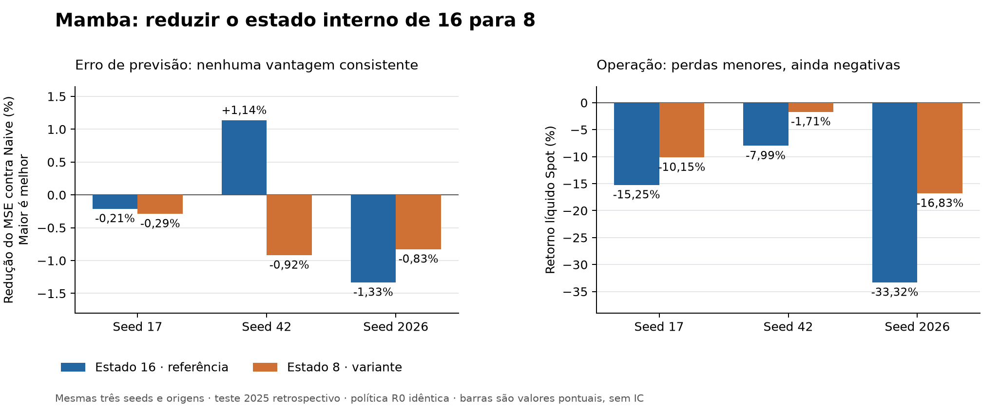

# Mamba estado16 versus estado8 — resultados da extensão

Fechamento em29/10/2026. A extensão terminou às16:19:57UTC (13:19:57 de Brasília). Conferência posterior aprovada, sem novos treinamentos. Este é o relatório desta extensão; a cronologia permanece em [andamento](andamento.md).

## 1. Identidade e separação das rodadas

| Elemento | Referência R0 | Extensão |
|---|---|---|
| Execução | `ab5baf3eab3a2e66d8b2` | `dcf4b0ed9012f7247bce` |
| Objetivo | Estabelecer referência OHLCV | Investigar somente d_state16→8 |
| Protocolo congelado | [Cópia R0](../dados/experimentos/ohlcv_modular_ab5baf3eab3a2e66d8b2/protocolo.md) | [Cópia da extensão](../dados/experimentos/estado_mamba_dcf4b0ed9012f7247bce/protocolo.md) |
| Configuração congelada | [R0](../dados/experimentos/ohlcv_modular_ab5baf3eab3a2e66d8b2/fontes/configuracoes/treinamento_ohlcv24_001.json) | [Estado8](../dados/experimentos/estado_mamba_dcf4b0ed9012f7247bce/fontes/configuracoes/mamba_estado8_001.json) |
| Novos ajustes | 6 redes principais +2 controles; Naive e9 candidatos ARIMA | 6 Mamba estado8; demais resultados herdados |
| Seeds principais | 17,42,2026 | 17,42,2026,7,123,31415 |
| Parâmetros Mamba | 20.257 | 17.185 |
| Pesos/previsões | `ohlcv_modular_<id>/celulas/` | `estado_mamba_<id>/celulas/` |
| Publicação | [Resultados R0](../dados/experimentos/ohlcv_modular_ab5baf3eab3a2e66d8b2/publicacoes/tentativa_001/resultados.json) | [Resultados extensão](../dados/experimentos/estado_mamba_dcf4b0ed9012f7247bce/publicacoes/tentativa_001/resultados.json) |
| Estado/recibos | [treinamento](../registros/treinamento/estado.json) | [estado_mamba](../registros/estado_mamba/estado.json) |

O arquivo [desenho OHLCV](desenho_ohlcv24.md) é vivo; as cópias acima preservam o método de cada execução. A classe oficial/ponte Mamba é compartilhada e não foi modificada: argumentos de arquitetura e pesos são vinculados a cada execução. Os checkpoints foram inspecionados em CPU: duas matrizes A_log64×16 na referência e64×8 na extensão, com contagens de parâmetros compatíveis. Não são apenas rótulos diferentes para os mesmos pesos.

O conjunto `dados/entradas/0420879c2afc454c7754` é compartilhado intencionalmente: mesmos canais, janelas, alvos, origens, escalas e divisões. A comparação usa BTC/1h/contexto168h→24h, treino2021–2023, validação2024 e teste2025 retrospectivo. Não há motivo para duplicar os dados ou recoletar a Binance para mudar a arquitetura.

LSTM/Naive/ARIMA aparecem como informações e referências herdadas; não foram ajustados novamente. A publicação da extensão contém14 resultados identificados: **6 novos +8 herdados** (3 Mamba16,3 LSTM,Naive,ARIMA). Blocos desses modelos na configuração não representam execução adicional. Os dois controles reais de R0 também não são seis seeds adicionais. A extensão não fez repetição completa de uma seed no mercado, conforme orçamento explícito; teve controle sintético e recarga exata por ajuste.

## 2. Resultado preditivo principal: três seeds pareadas

Comparação previamente delimitada nas mesmas seeds17/42/2026 e mesmas origens. As médias são de perdas dos modelos separados, não ensemble.

| Grupo | MSE validação ↓ | MSE teste ↓ | Habilidade contra Naive no teste ↑ |
|---|---:|---:|---:|
| Mamba16,3 seeds | 0,000719164 | 0,000495890 | −0,135% |
| Mamba8,mesmas3 | 0,000720855 | 0,000498582 | −0,679% |
| Mamba8,6 seeds (descritivo) | 0,000720546 | 0,000498745 | −0,712% |
| LSTM herdada,3 seeds | 0,000719446 | 0,000498010 | −0,563% |
| Naive herdado | 0,000721862 | 0,000495221 | 0% |
| ARIMA herdado | 0,000721588 | 0,000494622 | +0,121% |

Reduzir o estado aumentou o MSE pareado em0,235% na validação e0,543% no teste. O RMSE×100 do teste passou de2,2269 para2,2329; MAE×100 de1,5889 para1,5926. São pontos de log-retorno, aproximação de pontos percentuais para pequenas variações. As diferenças são pequenas; não representam porcentagens de acerto ou de lucro.

Diferença MSE8−MSE16 no teste:2,69183×10⁻⁶. IC95% principal, blocos14 dias: [−5,22404×10⁻⁶;11,58798×10⁻⁶]. As sensibilidades7/28 também incluem zero. Não há evidência de superioridade da variante, nem uma demonstração estatística forte de inferioridade universal. A hipótese de melhora não foi sustentada nesta rodada. Os intervalos são condicionais aos modelos ajustados; os períodos já consultados permanecem retrospectivos.

## 3. Seeds, direção e estabilidade

| Seed | Habilidade Mamba16 | Habilidade Mamba8 | Positivas Mamba8 | Época Mamba8 |
|---|---:|---:|---:|---:|
| 17 | −0,211% | −0,289% | 92,59% | 8 |
| 42 | +1,139% | −0,919% | 92,50% | 4 |
| 2026 | −1,333% | −0,828% | 91,93% | 1 |
| 7 | Não ajustada | −1,233% | 97,70% | 12 |
| 123 | Não ajustada | −0,626% | 88,30% | 11 |
| 31415 | Não ajustada | −0,375% | 93,91% | 9 |

Todas as seis seeds da variante ficaram abaixo do Naive no MSE do teste. Não preencher seeds ausentes de R0 ou selecionar a melhor candidata depois de observar o teste. Mesma seed em arquiteturas com dimensões diferentes não implica pesos iniciais idênticos; o desenho controla a semente e o procedimento, não igualdade de todos os tensores.

Nas três seeds pareadas, o desvio-padrão do MSE caiu de6,13×10⁻⁶ para1,69×10⁻⁶. Há menor dispersão nesta amostra, porém em torno de um desempenho médio pior. A variante com seis seeds teve acerto direcional médio51,10% e balanceado49,88%; prever sempre alta teria51,42% no teste. Frequência de previsão positiva não é probabilidade ou confiança. O padrão predominantemente comprador não demonstra boa discriminação de direção.

Habilidade trimestral pareada do Mamba8: −0,54%,+0,31%,+0,06%,−1,89%. Para Mamba16: +0,62%,+3,12%,−0,16%,−3,47%. Menor capacidade não gerou melhora uniforme entre períodos. Esses recortes são diagnósticos, não seleção de trechos favoráveis.

## 4. Operação sob a mesma política R0

Spot comprado/caixa, decisão00UTC, latência1min, encerramento24h depois, capital10.000USDT, taxa0,10%/slippage0,05% por lado. A mesma aproximação contábil e mesma política de giro foram mantidas nas duas variantes. As auditorias Binance e de manutenção de posição são separadas; não misturar esses cenários nesta atribuição ao estado interno.

| Seed | Operações16→8 | Retorno líquido16 | Retorno líquido8 | Drawdown16→8 |
|---|---:|---:|---:|---:|
| 17 | 37→8 | −15,25% | −10,15% | 25,12%→20,35% |
| 42 | 33→34 | −7,99% | −1,71% | 21,71%→18,94% |
| 2026 | 138→43 | −33,32% | −16,83% | 43,93%→29,04% |
| 7 | —→109 | — | −18,90% | —→31,87% |
| 123 | —→67 | — | −29,69% | —→37,13% |
| 31415 | —→13 | — | −9,87% | —→15,67% |

A média aritmética dos retornos pareados melhorou de−18,85% para−9,56% (+9,29 pontos percentuais). Não representa uma carteira combinada. A média bruta, com os mesmos sinais de cada modelo e custos zerados, foi de−0,94% para−1,50%. A média de operações caiu de69,3 para28,3. A melhora líquida está associada em parte à menor rotatividade/exposição, não a melhora média do erro ou do retorno bruto. A seed42 teve número de operações semelhante e melhor seleção realizada nessa trajetória, mostrando que nem toda diferença vem da contagem de entradas.

Todas as seis candidatas perderam dinheiro com custos base. Na média descritiva das seis, retorno−14,52%; a melhor foi42 com−1,71% e a pior123 com−29,69%. A seed123 teve erro preditivo menor que42, mas retorno operacional muito pior. Logo o ranking de MSE não determina o ranking econômico. Não foram publicados intervalos de incerteza dos retornos operacionais; não atribuir significância financeira a essas diferenças pontuais.

## 5. Conferência e conclusão

A [conferência posterior](../registros/estado_mamba/conferencias/c041b9a06cdc4a99a3d10f3faa6cf0e2/conclusao.json) verificou fontes/cópias/protocolos, seis ajustes e oito heranças, hashes de checkpoints e publicação, estado interno e dimensões dos pesos, escolha de época, recarga atestada, origens/escalas/alvos, métricas, médias e todos os contrastes bootstrap. Também refez sinais, horários, preços de execução nos minutos, quantidades, custos e capital. Não fez novo fit ou recarga preditiva CUDA; a recarga foi comprovada pelo executor. O drawdown continua atestado pela publicação original, sem recálculo independente nesta conferência.

Conclusão: reduzir o estado de16 para8 diminuiu parâmetros e dispersão entre seeds, mas não trouxe melhora preditiva consistente. Houve menor perda líquida nas três seeds pareadas sob a política fixa, ainda negativa; isso não comprova vantagem econômica utilizável. R0 continua como referência identificada, e a variante como tentativa concluída válida, sem substituição retroativa ou seleção de seed.

A investigação não identifica o estado ótimo nem um limite de previsibilidade. Antes de outra rodada, delimitar uma hipótese única e distinguir melhoria preditiva de revisão operacional. A mudança de distribuição de canais e o giro diário são questões identificadas, mas não foram testadas causalmente pela alteração de estado. Nenhum próximo experimento está automaticamente autorizado por esse fechamento.
