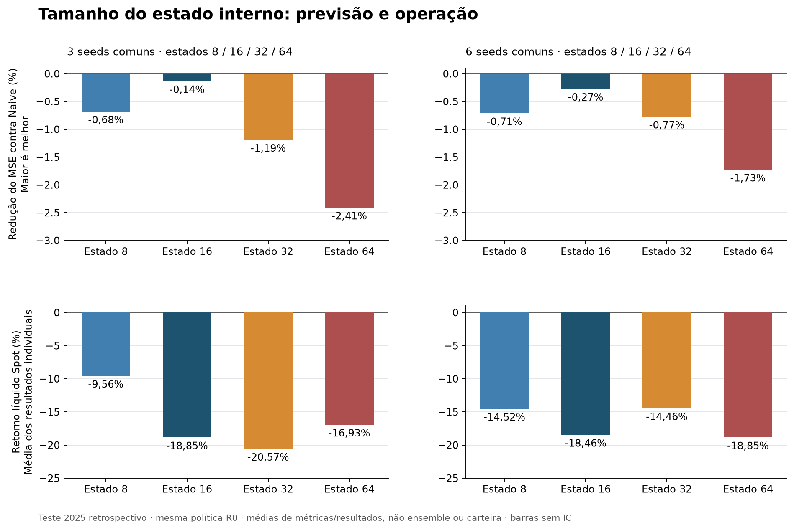

# Estados internos8/16/32/64 — comparação em seis seeds

**Investigação encerrada.** O pesquisador escolheu16como referência para próximas hipóteses em29/10/2026, conforme [ADR0012](adr/0012-referencia16-e-proxima-hipotese.md). O [índice de fechamento](../registros/investigacoes/estados_internos_001/fechamento.json) separa este bloco dos próximos estudos, preservando as execuções e os números abaixo. Essa escolha não demonstra ótimo universal ou superioridade operacional.

Atualização em29/10/2026 após completar o estado16. Todos os estados agora têm as mesmas seis seeds. O quadro anterior foi preservado em [snapshot documental](../registros/complemento_estado16/documentos_antes/docs/resultados_estados32_64.md) e sua [consolidação original](../registros/estados_ampliados/comparacao_atual.json) permanece intacta. O [relatório estado8](resultados_estado_mamba.md) continua como fechamento específico daquela extensão.

## Identidade e desenho

| Estado | Execução | Seeds | Parâmetros |
|---|---|---|---:|
| 8 | `dcf4b0ed9012f7247bce` | 17,42,2026,7,123,31415 | 17.185 |
| 16 | R0 `ab5baf3eab3a2e66d8b2` + complemento `cc0b166fe42a3ed1678d` | 17,42,2026 herdadas;7,123,31415 novas | 20.257 |
| 32 | `23c2ba54349bcc1b0ee1` | 17,42,2026,7,123,31415 | 26.401 |
| 64 | `42cb667ea43df563e3ac` | 17,42,2026,7,123,31415 | 38.689 |

Mesmas entradas OHLCV transformadas, dataset/escalas, BTC/1h, contexto168h, alvo log-retorno terminal24h, treino2021–2023/validação2024/teste2025, origens/purga, pré-LayerNorm, largura32/duas camadas, AdamW e seleção por menor MSE de validação. Somente d_state difere entre arquiteturas; também muda o número de parâmetros. A mesma seed não produz tensores idênticos em dimensões diferentes.

As médias são aritméticas das métricas por seed, inclusive RMSE; não ensemble, carteira combinada ou raiz do MSE médio. Cada seed mantém seu próprio checkpoint selecionado exclusivamente na validação. O complemento executou somente três novos ajustes reais, sem refazer as três seeds R0. Nenhum resultado negativo foi descartado.

A sequência32→64 foi congelada antes do primeiro treino32 e encerrada/conferida às19:01:21UTC de29/10. O complemento16 foi decidido depois da consulta a esses resultados, sob [protocolo próprio](protocolo_complemento_estado16.md). Os períodos2024/2025 são retrospectivos; completar seeds não cria confirmação independente.

## Como ler

MSE, RMSE e MAE: menor é melhor. Habilidade =1−MSE_modelo/MSE_Naive: positiva indica menor erro que prever retorno zero; negativa indica erro maior. MAE/RMSE×100 são pontos de log-retorno, aproximadamente pontos percentuais para variações pequenas, não probabilidades. Acerto balanceado dá o mesmo peso às duas direções e50% é referência de discriminação fraca. Precisão do preço terminal e resultado de uma operação são eixos distintos.

## Média das três seeds originais:17/42/2026

| Estado | MSE validação ↓ | MSE teste ↓ | Habilidade validação | Habilidade teste | MAE teste×100 ↓ | RMSE teste×100 ↓ |
|---|---:|---:|---:|---:|---:|---:|
| 8 | 0,000720855 | 0,000498582 | +0,140% | -0,679% | 1,5926 | 2,2329 |
| 16 | 0,000719164 | 0,000495890 | +0,374% | -0,135% | 1,5889 | 2,2268 |
| 32 | 0,000719675 | 0,000501114 | +0,303% | -1,190% | 1,5970 | 2,2386 |
| 64 | 0,000717444 | 0,000507149 | +0,612% | -2,409% | 1,6036 | 2,2519 |

| Estado | Acerto direção | Acerto balanceado | Desvio MSE entre seeds (×10⁻⁶) | Seeds com MSE menor que Naive |
|---|---:|---:|---:|---:|
| 8 | +51,08% | +49,88% | 1,69 | 0/3 |
| 16 | +51,58% | +50,62% | 6,13 | 1/3 |
| 32 | +51,40% | +50,07% | 2,85 | 0/3 |
| 64 | +50,53% | +49,70% | 11,18 | 0/3 |

## Média das seis seeds:17/42/2026/7/123/31415

| Estado | MSE validação ↓ | MSE teste ↓ | Habilidade validação | Habilidade teste | MAE teste×100 ↓ | RMSE teste×100 ↓ |
|---|---:|---:|---:|---:|---:|---:|
| 8 | 0,000720546 | 0,000498745 | +0,182% | -0,712% | 1,5922 | 2,2333 |
| 16 | 0,000719838 | 0,000496570 | +0,280% | -0,272% | 1,5894 | 2,2284 |
| 32 | 0,000721137 | 0,000499044 | +0,101% | -0,772% | 1,5927 | 2,2339 |
| 64 | 0,000719912 | 0,000503767 | +0,270% | -1,726% | 1,5994 | 2,2444 |

| Estado | Acerto direção | Acerto balanceado | Desvio MSE entre seeds (×10⁻⁶) | Seeds com MSE menor que Naive |
|---|---:|---:|---:|---:|
| 8 | +51,10% | +49,88% | 1,75 | 0/6 |
| 16 | +51,41% | +50,31% | 4,10 | 2/6 |
| 32 | +51,16% | +50,02% | 3,07 | 1/6 |
| 64 | +50,74% | +49,74% | 8,49 | 0/6 |

## Interpretação da média completa

Ordem do menor para o maior MSE médio nas seis seeds: **estado16, estado8, estado32, estado64**. Essa é a ordem observada nesta população, não uma escolha confirmatória de configuração ótima.

O estado16 passou de habilidade -0,135% nas três seeds originais para -0,272% nas seis. A mudança da média decorre exclusivamente das três seeds acrescentadas; os resultados originais não mudaram. Dispersão MSE do16 nas seis seeds: 4,10×10⁻⁶.

Estado16 contra8: -0,436% de variação do MSE; o intervalo temporal14 dias inclui zero, portanto a diferença é inconclusiva.

Estado16 contra32: -0,496% de variação do MSE; o intervalo temporal14 dias inclui zero, portanto a diferença é inconclusiva.

Estado16 contra64: -1,429% de variação do MSE; o intervalo temporal14 dias exclui zero; interpretar o sentido observado junto dos limites exploratórios.

Referências herdadas, sem novo ajuste: Naive MSE=0,000495221; ARIMA MSE=0,000494622; LSTM média de três seeds MSE=0,000498010. LSTM não tem seis seeds e não deve ser apresentada como comparação pareada de seis.

Todas as médias dos quatro estados têm MSE maior que Naive.

Todas as médias líquidas Spot permanecem negativas.

## Incerteza pareada

Todos os pares foram calculados a partir das perdas alinhadas por origem, primeiro fazendo a média nas mesmas seeds. Bootstrap circular em dias7/14/28,2.000 réplicas, principal14. São contrastes exploratórios condicionais aos modelos; sem correção global para multiplicidade/seleção adaptativa. As seeds não são amostras independentes do mercado. Inconclusão não comprova igualdade. Os ICs são de diferença de MSE, não de retorno financeiro.

| Grupo | Contraste | Variação do MSE | IC14 da diferença de MSE | Inclui zero? |
|---|---|---:|---|---|
| 3 | estado16 contra estado8 | -0,540% | [-1.1587982e-05; 5.2240419e-06] | Sim |
| 3 | estado32 contra estado8 | 0,508% | [-2.2568393e-06; 7.8504536e-06] | Sim |
| 3 | estado64 contra estado8 | 1,718% | [3.2930045e-07; 1.8518237e-05] | Não |
| 3 | estado32 contra estado16 | 1,053% | [1.9321319e-07; 1.1059925e-05] | Não |
| 3 | estado64 contra estado16 | 2,270% | [4.5585282e-06; 1.9350638e-05] | Não |
| 3 | estado64 contra estado32 | 1,204% | [-9.6167701e-07; 1.3678044e-05] | Sim |
| 6 | estado16 contra estado8 | -0,436% | [-6.4374179e-06; 1.5069251e-06] | Sim |
| 6 | estado32 contra estado8 | 0,060% | [-7.5943104e-07; 1.4883464e-06] | Sim |
| 6 | estado64 contra estado8 | 1,007% | [1.3740746e-06; 9.591405e-06] | Não |
| 6 | estado32 contra estado16 | 0,498% | [-4.9137802e-07; 5.9467979e-06] | Sim |
| 6 | estado64 contra estado16 | 1,449% | [3.4028562e-06; 1.1639046e-05] | Não |
| 6 | estado64 contra estado32 | 0,946% | [1.3915613e-06; 8.9815729e-06] | Não |

## Simulação Spot

Política R0 preservada: comprado/caixa, decisões00UTC, entrada um minuto depois, saída24h depois, capital10.000USDT, taxa0,10%/slippage0,05% por lado. Cenário agravado:0,20%/0,10%. Bruto usa os mesmos sinais da regra base com custos zerados; não busca limiar novo. Não é futuros nem reprodução de uma conta Binance. Sensibilidades posteriores de custos e manutenção de posição ficaram separadas.

Retorno e drawdown são médias dos resultados individuais, não retorno/risco de uma carteira média. Não se estimou IC de retorno nem significância financeira.

### 3 seeds

| Estado | Bruto | Líquido base | Agravado | Drawdown médio | Operações médias | Seeds lucrativas |
|---|---:|---:|---:|---:|---:|---:|
| 8 | -1,50% | -9,56% | -16,80% | 22,78% | 28,3 | 0/3 |
| 16 | -0,94% | -18,85% | -32,25% | 30,25% | 69,3 | 0/3 |
| 32 | +8,10% | -20,57% | -36,89% | 29,50% | 101,3 | 0/3 |
| 64 | -6,00% | -16,93% | -26,44% | 25,48% | 41,7 | 0/3 |

### 6 seeds

| Estado | Bruto | Líquido base | Agravado | Drawdown médio | Operações médias | Seeds lucrativas |
|---|---:|---:|---:|---:|---:|---:|
| 8 | -2,06% | -14,52% | -24,62% | 25,50% | 45,7 | 0/6 |
| 16 | -3,34% | -18,46% | -30,13% | 28,33% | 58,0 | 0/6 |
| 32 | +1,15% | -14,46% | -23,80% | 21,09% | 55,7 | 1/6 |
| 64 | -5,89% | -18,85% | -27,90% | 27,29% | 57,5 | 1/6 |

## Estado16 por seed: rastreabilidade

| Seed | Origem | MSE validação | MSE teste | Época selecionada | Retorno líquido Spot |
|---|---|---:|---:|---:|---:|
| 17 | R0 preservada | 0,000718189 | 0,000496267 | 13 | -15,25% |
| 42 | R0 preservada | 0,000719487 | 0,000489581 | 12 | -7,99% |
| 2026 | R0 preservada | 0,000719816 | 0,000501822 | 9 | -33,32% |
| 7 | complemento novo | 0,000719567 | 0,000498167 | 12 | -24,49% |
| 123 | complemento novo | 0,000721403 | 0,000498364 | 11 | -22,30% |
| 31415 | complemento novo | 0,000720565 | 0,000495219 | 9 | -7,43% |

Comparação estado16/seis seeds contra Naive: diferença de MSE=1.3490094e-06, IC14=[-6.268714e-06; 9.3097215e-06]. O intervalo inclui zero; não há ganho preditivo demonstrado contra Naive. As sensibilidades7/28 também incluem zero. A média numericamente pior não comprova inferioridade estatística.

## Complexidade e períodos

| Estado | Parâmetros | Tempo médio3 seeds | Tempo médio6 seeds | Épocas médias6 seeds |
|---|---:|---:|---:|---:|
| 8 | 17185 | 125s | 154s | 17,5 |
| 16 | 20257 | 218s | 200s | 21,0 |
| 32 | 26401 | 170s | 155s | 16,5 |
| 64 | 38689 | 196s | 178s | 19,2 |

Tempos incluem quantidades diferentes de épocas e não são benchmark puro por época/kernel. As execuções ocorreram em momentos distintos, no mesmo ambiente qualificado.

| Estado / habilidade contra Naive nas seis seeds | Trimestre1 | Trimestre2 | Trimestre3 | Trimestre4 |
|---|---:|---:|---:|---:|
| 8 | -0,52% | +0,83% | -0,07% | -2,35% |
| 16 | +0,19% | +2,29% | +0,08% | -2,89% |
| 32 | -0,70% | +1,11% | -0,31% | -2,41% |
| 64 | -1,23% | +0,06% | -0,67% | -4,12% |

Não selecionar somente trimestres/seed favoráveis.

## Evidências e limites

O complemento `cc0b166fe42a3ed1678d` contém três ajustes novos e26 heranças. [Autorização](../registros/complemento_estado16/autorizacao.json), [estado](../registros/complemento_estado16/estado.json), [conferência](../registros/complemento_estado16/conferencias/4365008389e54ec992ebba57337141b4/conclusao.json) e [consolidação verificável](../registros/complemento_estado16/comparacao_atual.json) vinculam fontes, checkpoints, previsões, médias, contrastes e simulação. A falha de integração do verificador, corrigida antes do congelamento/mercado, está em [ocorrências](../registros/complemento_estado16/ocorrencias_preparacao.json); qualificação anterior e nova foram preservadas.

R0 e32/64/8 continuam intactos, incluindo protocolos e publicações originais. Auditoria posterior confere hashes, cobertura, checkpoints/capacidade, seleção e métricas; recarga preditiva e simulação são atestadas pelo executor/publicação. O complemento teve reprodução sintética e recarga exata, sem repetição completa real adicional. Não comprova backup remoto ou aceite acadêmico.

O conjunto continua uma divisão temporal fixa de exploração, não walk-forward. Um teste retrospectivo conhecido e seis seeds não estabelecem configuração ótima universal nem execução economicamente útil. Próxima alteração requer hipótese/orçamento/identidade e autorização próprios.
