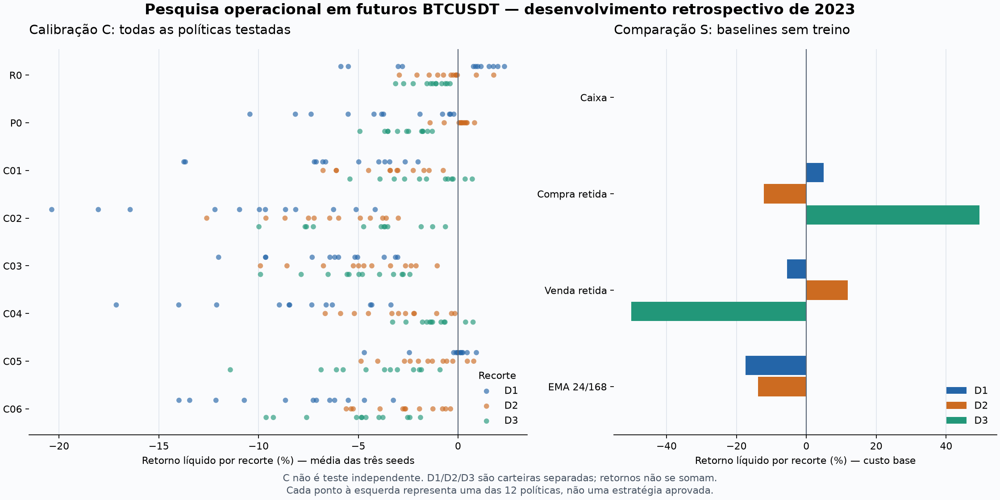

# Pesquisa operacional em futuros — resultado da sessão de 05/11/2026

**Encerrada e auditada, sem finalista.** A execução `f0dd11f393b5e26edaf8` concluiu oito receitas, 72 ajustes principais, dois controles reais e 1.260 carteiras. Nenhuma receita cumpriu os critérios de avanço. O reforço com oito seeds e a avaliação retrospectiva de 2024–2025 **não foram acionados**; não são etapas executadas nem pendências de processo. Não houve ajuste de mercado interrompido, repetição automática ou ampliação do orçamento para buscar lucro.

Esta linha investiga conjuntamente previsão e política no futuro BTCUSDT. Não substitui os objetivos, dados ou conclusões das linhas acadêmicas e operacionais anteriores. O [desenho congelado](desenho_operacional_futuros.md), inclusive a seção 11, registra as regras anteriores ao primeiro treino. A indicação de qualificação no cabeçalho desse documento pertence à versão congelada; o [estado atual](../registros/operacional_futuros/estado.json) e este relatório registram o fechamento posterior.

## Cobertura e cronologia

O goal foi autorizado às 06:05:40 UTC, com prazo máximo até 18:05:40 UTC e reserva de 30 minutos para fechamento. Após implementação e qualificação, o coordenador iniciou às 06:31:16 UTC. A execução encerrou normalmente às 09:17:57 UTC. Auditorias e documentação foram produzidas em seguida, dentro do prazo. O limite era de até 12 horas, não uma obrigação de continuar depois de esgotar as receitas e reprovar todas as candidatas.

| Item | Efetivamente concluído |
|---|---:|
| Receitas | 8: R0, P0 e seis propostas Astra |
| Recortes de desenvolvimento | 3, com pesos e escalas reestimados |
| Seeds principais por receita/recorte | 3: 42, 17 e 2026 |
| Ajustes principais | 8 × 3 × 3 = 72 |
| Controles reais adicionais, fora das médias | 2: R0/D1/42 e P0/D1/42 |
| Carteiras de calibração C | 864: 12 políticas × 3 seeds × 3 recortes × 8 receitas |
| Carteiras de comparação S | 360: 5 cenários × 3 seeds × 3 recortes × 8 receitas |
| Baselines operacionais | 36: 4 regras × 3 recortes × 3 custos |
| Total de carteiras | 1.260, com cobertura exata conferida |
| Consultas Astra | 7: uma qualificação técnica e seis propostas |
| Reforço/final | Não acionados por inelegibilidade |

O teto condicional de 185 ajustes e 3.620 carteiras não foi consumido integralmente. Os 111 ajustes e 2.360 avaliações restantes dependiam de aprovação anterior. Não foram treinadas oito seeds nesta sessão, nem LSTM/ARIMA. Os modelos e backtests históricos não foram reexecutados.

## O que foi comparado

Todas as redes usam Mamba oficial CUDA, candles de uma hora do futuro BTCUSDT, arquitetura base com estado 16, AdamW, taxa constante 0,0002, contexto de 168 horas salvo C04, e escolha do checkpoint pelo MSE real de validação. A referência foi treinada novamente neste executor e mercado; não é uma herança de pesos do estudo Spot.

| Receita | Alvo e alteração |
|---|---|
| R0 | OHLCV cru; log-retorno terminal em 24h; perda 2×Huber no alvo padronizado |
| P0 | OHLCV cru; dois payoffs líquidos hipotéticos, compra e venda, com stop/take/expiração; perda MSE |
| C01 | P0 com OHLC relativo ao fechamento anterior e log1p(volume), padronizados em T |
| C02 | C01 + retornos passados de 24/72/168h |
| C03 | C01 + volatilidades passadas de 24/168h |
| C04 | C01 com contexto reduzido de 168h para 72h |
| C05 | C01 com logaritmos dos níveis OHLC e log1p(volume), padronizados em T |
| C06 | C01 + volume relativo de 24/168h |

As seis propostas alteraram um fator em relação ao pai identificado. R0 versus P0 é uma comparação de abordagens: mudam alvo, dimensão da saída e perda, não apenas um parâmetro. As barreiras de P0/C01–C06 permaneceram iguais: distância do stop determinada pela volatilidade passada, piso logarítmico de 0,5% e take com distância 1,5 vez a do stop. Não houve busca de alavancagem nem alteração de custos para favorecer candidatos.

## Separação temporal e regra de avanço

| Recorte | Treino T | Validação V | Calibração C | Comparação S |
|---|---|---|---|---|
| D1 | jan/2021–set/2022 | out–dez/2022 | jan–mar/2023 | abr–jun/2023 |
| D2 | jan/2021–dez/2022 | jan–mar/2023 | abr–jun/2023 | jul–set/2023 |
| D3 | jan/2021–mar/2023 | abr–jun/2023 | jul–set/2023 | out–dez/2023 |

T ajusta pesos e escalas; V escolhe época; C escolhe uma política conjunta para as três seeds; S mede essa decisão posteriormente. Origem e suporte comum de 336h, janelas causais e purga de 1.442 minutos foram conferidos. Os alvos/escalas são iguais entre receitas da mesma tarefa; a dimensão da entrada acompanha os canais. Nenhum checkpoint treinado no futuro foi aplicado ao passado.

C compara 12 políticas: limiar adicional de 0/10/20 pontos-base, risco nominal no stop de 0,5%/1% do patrimônio e cadência de decisão de 1h/4h. A aprovação exige atividade mínima em cada seed, crescimento médio positivo e Calmar definido, sem insolvência/saída prudencial. Entre as aprovadas, escolhe a maior mediana de Calmar, com desempates congelados. Se nenhuma passa, a carteira de S fica em caixa.

Para avançar, a receita precisa cumprir os critérios S completos, inclusive atividade mínima nos cinco cenários, crescimento positivo base e com slippage dobrado e ao menos dois recortes positivos. O reforço acrescentaria cinco seeds, até oito, e exigiria estabilidade adicional. Esses critérios não foram relaxados após observar perdas. S foi usado pela busca adaptativa e **não é teste final independente**. Os anos 2023–2025 já tinham sido consultados no projeto; nenhuma parte desta rodada é anunciada como holdout intocado.

## Resultado preditivo

Médias iguais entre os nove ajustes principais de cada receita. MSE mede erro quadrático; MAE mede erro absoluto. A coluna de habilidade é `100 × (1 − média MSE / média MSE_zero)`: positiva significa menor erro que prever zero para **o mesmo alvo**. Não comparar diretamente o MSE terminal de R0 ao MSE de payoff dos outros modelos, pois são problemas distintos.

| Receita | MSE médio | MAE médio | Habilidade contra zero |
|---|---:|---:|---:|
| R0 | 0,000405617 | 0,0135378 | −0,260% |
| P0 | 0,000251357 | 0,0125888 | +0,348% |
| C01 | 0,000253170 | 0,0127133 | −0,371% |
| C02 | 0,000261096 | 0,0128892 | −3,513% |
| C03 | 0,000256356 | 0,0127989 | −1,633% |
| C04 | 0,000253453 | 0,0127307 | −0,483% |
| C05 | 0,000257585 | 0,0128110 | −2,121% |
| C06 | 0,000252829 | 0,0126741 | −0,235% |

P0 apresentou pequena melhora frente a payoff zero, sem uma estratégia aprovada. Em um diagnóstico posterior, sem alteração dos critérios, prever sempre a média do payoff observada em T obteve MSE 0,000250774: P0 ficou aproximadamente 0,233% pior que esse controle constante. Logo, o ganho frente a zero não demonstra que a rede identificou oportunidades negociáveis. Esse controle de média é exclusivamente preditivo; não foi introduzido como uma nova simulação de trading.

Há variação entre seeds. Por exemplo, C06 tem MSE médio por seed de 0,000250577 (17), 0,000254374 (42) e 0,000253537 (2026). Selecionar somente a seed 17 esconderia o resultado da receita. Os [valores por seed e recorte](../registros/operacional_futuros/conferencias/previsoes_final.json) preservam todas as observações, RMSE e os dois controles constantes.

## Resultado operacional e o caso C05

Das 24 calibrações receita/recorte, **23 rejeitaram todas as políticas**. Somente C05/D2 selecionou uma política: limiar adicional zero, risco nominal de 0,5% e decisão horária. Sua média líquida em C foi +0,467%, com drawdown médio de 4,677%. Havia duas políticas elegíveis nesse recorte; foi respeitado o ranking por mediana Calmar, não simplesmente o maior retorno.

Na comparação posterior de jul–set/2023, a política perdeu nas três seeds:

| Seed C05/D2 | Retorno líquido | Drawdown máximo | Calmar | Operações |
|---|---:|---:|---:|---:|
| 42 | −9,756% | 10,063% | −3,324 | 89 |
| 17 | −8,615% | 9,414% | −3,192 | 116 |
| 2026 | −6,314% | 6,621% | −3,443 | 110 |
| Média | **−8,228%** | **8,700%** | **−3,320** | **105** |

C05 ficou em caixa nos outros dois recortes. Portanto, a média principal das nove células é −2,743% de retorno e 2,900% de drawdown; **não é um retorno composto de nove meses**. Mostrar apenas essa média diluiria a perda do trimestre ativo. Neste agregador, o Calmar da coorte permanece indefinido quando existem carteiras em caixa; não substituir os valores indefinidos por zero ou infinito. A mediana de retorno zero também não elimina a perda média.

| Receita/cenário, médias sobre os três recortes e três seeds | Retorno líquido | Drawdown médio |
|---|---:|---:|
| R0, P0, C01–C04 e C06 | 0,000% | 0,000% |
| C05 bilateral, custo base | −2,743% | 2,900% |
| C05 bilateral, slippage 2× | −3,648% | 3,804% |
| C05 bilateral, slippage 3× | −4,898% | 5,000% |
| C05 somente compras | −1,361% | 1,752% |
| C05 somente vendas | −1,484% | 1,740% |

Zeros nas demais receitas significam **não operar após reprovação em C**, e não perfeita previsão ou superioridade operacional. Em C, 158 das 288 combinações política/recorte tiveram pelo menos 20 operações em cada seed; somente duas delas apresentaram crescimento médio positivo. Assim, a rejeição não se explica apenas pela frequência mínima: a maioria das combinações suficientemente ativas perdeu.

No trimestre ativo de C05, cada carteira começou com 10.000 USDT. A contribuição líquida média foi −397,98 USDT nas compras e −424,86 USDT nas vendas, total −822,84 USDT. As comissões foram 298,53 USDT e o funding contribuiu +13,61 USDT. Ambos os lados perderam. Retirar o outro lado muda disponibilidade de capital e oportunidades: os backtests somente comprado/vendido não precisam somar exatamente a carteira bilateral.

No trimestre ativo, o retorno foi −10,944% com slippage 2× e −14,695% com 3×, contra −8,228% na base. Slippage altera fills e dimensionamento causal conforme o protocolo; não é um desconto aplicado depois a uma sequência imutável de posições. O resultado não sustenta uso real da receita.

## Baselines operacionais

Mesmos recortes S e convenções de custos. São regras determinísticas, sem seeds de treinamento. Cada recorte reinicia com 10.000 USDT. A compra/venda retida abre até 95% do capital e mantém a posição, sem escolher pontos de entrada pelo futuro.

| Baseline, custo base | Abr–jun/2023 | Jul–set/2023 | Out–dez/2023 | Retorno médio | DD médio | Calmar mediano |
|---|---:|---:|---:|---:|---:|---:|
| Caixa/Naive operacional | 0,00% | 0,00% | 0,00% | 0,00% | 0,00% | Indefinido |
| Compra retida | +4,95% | −12,20% | +49,58% | +14,11% | 17,15% | +1,072 |
| Venda retida | −5,46% | +11,84% | −50,07% | −14,56% | 29,52% | −1,044 |
| Tendência EMA24/168 | −17,46% | −13,79% | −0,16% | −10,47% | 25,59% | −1,718 |

O maior drawdown entre os recortes foi 21,47% na compra retida, 61,22% na venda retida e 31,25% na tendência. As médias não representam uma única carteira contínua. O Calmar é calculado com CAGR e drawdown de cada recorte; sua anualização em trimestres pode gerar valores elevados, por isso é acompanhado dos retornos reais e perdas máximas.

Na média dos recortes, a compra retida retornou +14,00%/+13,86% sob slippage 2×/3×, e a tendência −11,70%/−13,47%. A alta de BTC em parte de 2023 beneficiou a exposição comprada. Isso não prova capacidade de prever altas e quedas. Em jul–set, vender e manter lucrou +11,84%, enquanto as vendas selecionadas por C05 perderam: direção geral do mercado, momento de entrada, stops e custos são fatores diferentes.

A figura mostra todas as 12 políticas em C por recorte, inclusive perdas. Cada ponto é a média das três seeds; pontos positivos de calibração não são lucro fora da amostra. As barras à direita são baselines S, não resultados dos modelos. A imagem foi inspecionada após a geração.

## Incerteza e alcance da conclusão

O bootstrap pareado de seeds e blocos de dias, 2.000 repetições, encontrou para C05−R0 uma diferença média de retorno com IC95% **[−4,146; −0,738] pontos percentuais**, usando blocos de 14 dias. Sensibilidades: 7 dias [−4,527; −0,555] e 28 dias [−3,736; −0,515]. O intervalo de diferença de drawdown médio, 14 dias, foi [+1,562; +4,452] pontos percentuais. O Calmar não tem intervalo válido quando a referência está em caixa.

Esses intervalos são condicionais às receitas, políticas e recortes observados. Não corrigem integralmente a seleção adaptativa, não quantificam todos os regimes futuros e usam somente três seeds. Para receitas que ficaram integralmente em caixa, o intervalo de diferença operacional [0;0] descreve curvas idênticas, não certeza sobre previsibilidade. As oito seeds previstas eram uma etapa de reforço condicional, não uma garantia estatística.

**Conclusão sustentada:** esta busca limitada não demonstrou uma combinação Mamba/política elegível para avançar. C05 teve uma oportunidade de avaliação ativa e perdeu consistentemente entre as três seeds; as demais não justificaram operar pela calibração definida. Não se conclui que Mamba nunca possa funcionar, nem que o melhor modelo possível tenha sido encontrado.

## Auditorias, limitações e próximos passos

- Qualificação anterior ao mercado: 50 testes WSL/CUDA, sem skips, reprodução sintética das duas famílias e recarga exata. Os dois controles reais selecionaram as mesmas épocas; diferenças máximas de previsão aproximadamente 5,29×10⁻⁹ e 1,98×10⁻⁹, abaixo da tolerância congelada de 10⁻⁵. Controles excluídos das médias.
- Publicação posterior recalculou MSE, hashes dos checkpoints/previsões, ledgers, preenchimentos e primeira barreira das 1.260 carteiras. Auditoria adicional reconstruiu 103.107.572 pontos de patrimônio, com resíduo máximo 3,64×10⁻¹² USDT. Foram 848 carteiras ativas no conjunto C/S/baselines; não confundir essa contagem com 848 estratégias aprovadas.
- Conferidas cobertura exata, seleção por menor MSE V, dimensões, origens, purga, igualdade dos alvos/escalas entre tarefas iguais, 66 fontes atuais e suas cópias, 189 arquivos históricos protegidos e 400 arquivos dos dois datasets. Não houve mudança de fontes durante a rodada.
- O verificador geral do catálogo falhou inicialmente por esperar o campo legado `fontes` em layouts recentes Astra. O recibo foi preservado. O leitor editorial foi corrigido, passou em nove testes de organização e publicou [nova conferência do catálogo](../registros/revisoes/catalogo_2026-11-05T093251.586773Z/resumo.json). Para layouts recentes, esse verificador cobre vínculos e hash do congelamento; a auditoria científica completa desta rodada é a publicação própria acima. Nenhuma fonte de experimento encerrado foi alterada para corrigir o catálogo.
- Dois incidentes sintéticos anteriores ao mercado foram preservados: unidade temporal de fixture pandas3 e exigência bitwise excessiva entre treinos CUDA. Foram corrigidos/qualificados antes do congelamento. Não houve falha de ajuste real.
- Foi identificado posteriormente um caso de borda no contador de crescimento do avaliador: `valor or -inf` trata zero como ausência. As fontes congeladas não foram alteradas. A conferência independente usou a regra literal e confirmou os oito vereditos; **não mudou elegibilidade nesta execução**. Corrigir a expressão e acrescentar caso misto zero/positivo antes de uma nova identidade de executor.
- O proponente recebeu apenas resumos permitidos de S, incluindo rejeições; não recebeu diagnósticos detalhados de C. Como sete receitas ficaram em caixa e C05 concentrou a atividade em um recorte, o retorno informativo para a busca foi limitado. Uma futura revisão deveria qualificar uma projeção segura de diagnósticos de C/treino para o proponente, sem abrir o final ou alterar retroativamente esta rodada.
- O motor usa comissão de 5 pontos-base por lado, slippage base de 5 pontos-base por lado, funding histórico e execução/marcação de um minuto. Limites de quantidade/tick e buffer de margem são convenções de pesquisa, **não certificação da liquidação ou dos filtros históricos Binance**. Funding sem markPrice exato usa aproximação adversa sinalizada. O drawdown usa envelope conservador intraminuto; pode superestimar a excursão antes de um stop, pois OHLC não revela a ordem exata de todos os ticks.
- O objetivo operacional, o uso de payoff, a seleção de políticas e a busca adaptativa devem aparecer como extensão identificada no TCC. Não rebatizar estudos passados nem apresentar este ciclo como confirmação independente. A recomendação é consolidar resultados e redigir; qualquer busca posterior precisa de nova hipótese e identidade. Não promover C05, reduzir custos ficticiamente ou escolher uma seed favorável.

## Evidências e reprodução da leitura

- [Ponteiro da execução](../registros/operacional_futuros/execucao.json) e [estado](../registros/operacional_futuros/estado.json).
- [Publicação auditada](../dados/experimentos/operacional_futuros_f0dd11f393b5e26edaf8/publicacao/manifesto.json), com `comparacao.json`, `carteiras.json`, `incerteza.json` e `auditoria_independente.json` na mesma pasta.
- [Cobertura e integridade](../registros/operacional_futuros/conferencias/cobertura_integridade_final.json), [contratos/checkpoints](../registros/operacional_futuros/conferencias/contratos_final.json), [calibração](../registros/operacional_futuros/conferencias/calibracao_final.json), [elegibilidade](../registros/operacional_futuros/conferencias/elegibilidade_final.json) e [curvas](../registros/operacional_futuros/conferencias/curvas_final.json).
- [Diagnóstico preditivo por seed](../registros/operacional_futuros/conferencias/previsoes_final.json) e [proveniência da figura](../registros/operacional_futuros/conferencias/figuras_final.json).
- Leitores posteriores: `analises/auditoria_operacional_futuros.py` e `analises/figuras_operacional_futuros.py`. Não chamar novamente o executor para reproduzir tabelas de um ciclo encerrado; novos recibos precisam de destino próprio.

Checkpoints, previsões, curvas e ledgers volumosos estão preservados localmente nos caminhos das identidades. Parte desses arquivos é ignorada pelo Git, com hashes nos manifestos. Esta sessão não fez commit, push ou cópia externa; preservação local e conferência de integridade não equivalem a backup fora do notebook.
