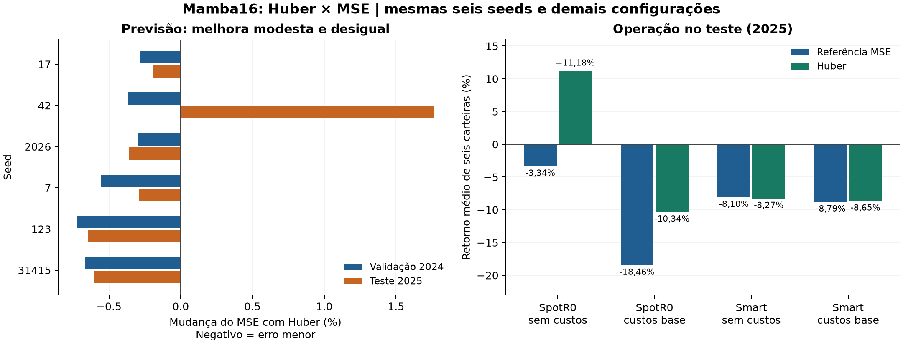

# Mamba16: MSE versus perda Huber

Execução `ed8e55ff978b2742c200`: seis novos ajustes,53referências herdadas e54carteiras Smart secundárias. [Protocolo](protocolo_perda_huber.md), [estado](../registros/perda_huber/estado.json).

## Comparação preditiva

Médias aritméticas de métricas de modelos individuais, não ensemble. A referência é Mamba16/AdamW/MSE com taxa constante0,0002. Dados, arquitetura, otimizador, taxa e critério de parada iguais; somente a perda de treinamento mudou para 2×Huber(delta1 padronizado). Seleção de checkpoint e primário continuam MSE global de validação em retorno real.

| Parte | Modelo | Seeds | MSE | RMSE×100 | MAE×100 | Habilidade Naive |
|---|---|---:|---:|---:|---:|---:|
| validacao | huber_seis | 6 | 0.0007163599 | 2.6765 | 1.9430 | +0.762% |
| validacao | mamba16_seis | 6 | 0.0007198378 | 2.6830 | 1.9493 | +0.280% |
| validacao | huber_tres | 3 | 0.0007168863 | 2.6775 | 1.9442 | +0.689% |
| validacao | mamba16_tres | 3 | 0.0007191640 | 2.6817 | 1.9477 | +0.374% |
| validacao | lstm_tres | 3 | 0.0007194461 | 2.6822 | 1.9477 | +0.335% |
| validacao | naive | 1 | 0.0007218625 | 2.6867 | 1.9523 | +0.000% |
| validacao | arima | 1 | 0.0007215880 | 2.6862 | 1.9515 | +0.038% |
| teste | huber_seis | 6 | 0.0004962804 | 2.2277 | 1.5877 | -0.214% |
| teste | mamba16_seis | 6 | 0.0004965701 | 2.2284 | 1.5894 | -0.272% |
| teste | huber_tres | 3 | 0.0004978543 | 2.2313 | 1.5900 | -0.532% |
| teste | mamba16_tres | 3 | 0.0004958901 | 2.2268 | 1.5889 | -0.135% |
| teste | lstm_tres | 3 | 0.0004980096 | 2.2316 | 1.5931 | -0.563% |
| teste | naive | 1 | 0.0004952210 | 2.2254 | 1.5864 | +0.000% |
| teste | arima | 1 | 0.0004946217 | 2.2240 | 1.5854 | +0.121% |

## Critério primário e incerteza

| Parte | Diferença MSE huber−constante | IC95%14dias |
|---|---:|---|
| validacao | -3.477886442e-06 | [-7.220174278099466e-06, 2.932450502246494e-08] |
| teste | -2.896994945e-07 | [-2.112910415560167e-06, 1.7580494209874611e-06] |

O critério primário não foi atendido: não há evidência suficiente pelo critério fixado para substituir a referência.
Não selecionar variante/seed/época pelo teste ou pelo lucro. A taxa permaneceu constante. Huber muda a estimativa favorecida pela perda e a dinâmica de gradientes; melhorar MAE ou lucro e piorar MSE é um compromisso, não vitória no critério principal.

## Todas as seeds e diagnóstico diário

| Seed | MSE validação | MSE teste | P95 erro×100 | Vitórias vs Naive | Spearman00UTC | Smart base teste |
|---|---:|---:|---:|---:|---:|---:|
| 17 | 0.0007161683 | 0.0004953111 | 4.3719 | 48.35% | 0.0308 | -8.40% |
| 42 | 0.0007168363 | 0.0004982363 | 4.4755 | 47.25% | 0.0605 | -9.05% |
| 2026 | 0.0007176542 | 0.0005000157 | 4.5206 | 46.15% | 0.0835 | -8.94% |
| 7 | 0.0007155621 | 0.0004967239 | 4.4422 | 47.80% | 0.0129 | -9.48% |
| 123 | 0.0007161640 | 0.0004951513 | 4.3968 | 46.70% | 0.1115 | -7.26% |
| 31415 | 0.0007157743 | 0.0004922439 | 4.3875 | 49.45% | 0.0364 | -8.77% |

## Carteira Smart: média de seis modelos

| Parte | Custos | Política | Retorno | Queda máxima média | Exposição |
|---|---|---|---:|---:|
| validacao | ideal | smart | +97.85% | 31.64% | 89.48% |
| validacao | base | smart | +96.37% | 31.68% | 89.48% |
| validacao | agravado | smart | +94.92% | 31.71% | 89.48% |
| teste | ideal | smart | -8.27% | 35.80% | 96.44% |
| teste | ideal | smart_constante | -9.20% | 35.81% | 96.26% |
| teste | base | smart | -8.65% | 35.80% | 96.44% |
| teste | base | smart_constante | -9.47% | 35.81% | 96.26% |
| teste | agravado | smart | -9.02% | 35.81% | 96.44% |
| teste | agravado | smart_constante | -9.74% | 35.82% | 96.26% |

Comparar com o [backtest anterior](resultados_backtest_carteira.md), no mesmo calendário e regras. Smart2% não é stop. Os resultados SpotR0, com contabilidade histórica própria, estão na publicação estruturada e não substituem as carteiras retidas.

## Evidências e limitações

Taxa constante, contrato da perda e seleção/parada por MSE foram conferidos, assim como métricas e lançamentos das54carteiras. Recarga exata e capacidade20.257 verificadas; nenhum resultado anterior foi sobrescrito. MSE de todas as origens horárias não é o MSE do subconjunto00UTC. Vitórias contra Naive são de erro absoluto, não acerto direcional. Os diagnósticos descritivos não alteram o primário: [diagnóstico das previsões anteriores](diagnostico_previsoes.md). Resultados por trimestre, faixas causais de previsão, correlações e erros estão na publicação.

2024 participou da seleção de checkpoints;2025 já foi consultado. Estudo exploratório retrospectivo, sem novo holdout ou walk-forward. Mais seeds não eliminam seleção adaptativa. Sem garantia de lucro/fills reais/backup externo; nenhuma promoção ou hipótese seguinte é automática. [Registros e publicação](../registros/perda_huber/estado.json).

## Interpretação independente em 03/11/2026

Conferência posterior de leitura: 76 fontes atuais/copiadas, 350 arquivos publicados, 5.533 anteriores preservados, métricas das 59 séries e intervalos por blocos recalculados; saldos/comissões das 54 carteiras reconstruídos dos lançamentos. Nenhum treinamento, inferência ou nova simulação. Recarga exata é evidência da execução congelada, não repetição nesta revisão. [Recibo e comparação detalhada](../registros/perda_huber/entrega/20261103/conferencia.json), [código](../registros/perda_huber/entrega/20261103/conferir.py). Relatório automático anterior preservado junto dessa entrega.

**Leitura principal:** Huber apresentou melhora numérica modesta, com seis seeds melhores na validação e cinco no teste, mas não satisfez o critério de incerteza fixado. Manter a referência MSE oficial; conservar Huber como candidata para avaliação temporal ampliada, sem iniciar outra rodada ou promover por lucro.

| Parte | Mudança do MSE médio | IC95%14dias relativo ao MSE da referência |
|---|---:|---|
| validacao | -0,483% | [-1,003%; 0,004%] |
| teste | -0,058% | [-0,426%; 0,354%] |

Os intervalos7/14/28dias incluem zero nas duas partes. A validação ficou próxima do limite fixado, sem motivo para arredondar ou flexibilizar a regra. O bootstrap é temporal e condicional às redes ajustadas; não incorpora integralmente nova inicialização/seleção entre hipóteses. A dispersão do MSE entre seeds no teste caiu de4,10×10⁻⁶ para2,70×10⁻⁶ (cerca34%); isso é estabilidade entre seis ajustes, não certeza de maior precisão em qualquer dia. No teste, melhorou em dois dos quatro trimestres, sendo o terceiro praticamente empate.

### Diagnóstico das decisões diárias no teste

| Métrica, média das seis seeds às00UTC | Referência MSE | Huber |
|---|---:|---:|
| MSE | 0,000482273 | 0,000480195 |
| MAE×100 | 1,5792 | 1,5751 |
| P95 do erro absoluto×100 | 4,5071 | 4,4324 |
| Spearman | 0,0014 | 0,0559 |
| Erro menor que Naive | 47,62 | 47,62 |
| Previsões positivas | 88,23 | 96,66 |

364origens por seed. RMSE/MAE/P95×100 são em log-retorno multiplicado por100, aproximadamente pontos percentuais de variação para erros pequenos, não taxa de acerto. P95 é calculado por seed e depois promediado. Na população horária, o P95 ficou praticamente igual e levemente maior com Huber; a melhora diária não autoriza afirmar que todos os extremos melhoraram.

Huber indicou alta em96,66% das decisões diárias, enquanto houve alta em50,27%. Isso é frequência de sinais positivos, não probabilidade/confiança. Acurácia balanceada horária de50,26%, frente50,31% da referência, não mostra salto na identificação das duas direções. A Huber reduziu pouco o erro médio, mas o modelo ainda se mantém próximo de uma pequena previsão positiva. A associação diária melhorou deSpearman0,0014 para0,0559, continuando fraca. Em preço derivado, RMSE de teste2177,99→2178,04USDT, praticamente igual; MAE1583,07→1581,74USDT. Métricas em dólares reponderam os erros pelo nível de preço e pela exponenciação, não sendo idênticas ao MSE de log-retorno.

### Operação: comparar Huber com referência dentro de cada motor

| Política e custos no teste | Referência | Huber |
|---|---:|---:|
| SpotR0 sem custos, mesmos sinais | -3,34% | 11,18% |
| SpotR0 base | -18,46% | -10,34% |
| SpotR0 agravado | -30,13% | -26,38% |
| Smart ideal | -8,10% | -8,27% |
| Smart base | -8,79% | -8,65% |
| Smart agravado | -9,49% | -9,02% |

SpotR0 encerra após24h; Smart retém e ajusta posição, podendo mantê-la além do horizonte do alvo. Os motores têm convenções de contabilidade próprias preservadas; não isolar o efeito da política comparando motores diferentes. Todos os valores são médias de seis carteiras individuais, não ensemble ou operações de uma conta. Custos base: comissão0,10%/lado e slippage0,05%/lado; agravados0,20%/0,10%; filtros/execução são hipóteses de simulação. Sem futuros, alavancagem, stop/take ou evidência de fills reais.

No SpotR0 base, a perda caiu18,46%→10,34%, melhora8,13p.p. e capital8153,63→8966,43USDT para10.000iniciais. As seis seeds melhoraram frente às correspondentes, mas só duas ficaram positivas. Entradas planejadas58,0→70,83 e custos observados1677,42→2228,66USDT; não foi melhora por operar menos. O bruto passou−3,34%→+11,18%, com sinais mantidos do cenário base; custos e trajetória composta tornaram a média negativa. O drawdown médio piorou28,33%→29,11%, e a dispersão de retorno entre seeds10,13→13,08p.p. Um bruto positivo não comprova vantagem líquida executável.

| Smart base no teste | Referência | Huber |
|---|---:|---:|
| Capital final médio (USDT) | 9120,54 | 9135,07 |
| Queda máxima média (%) | 34,43 | 35,80 |
| Exposição média (%) | 89,40 | 96,44 |
| Ordens executadas | 254,2 | 145,5 |
| Giro / capital inicial | 4,91 | 2,64 |
| Desvio do retorno entre seeds (p.p.) | 1,57 | 0,77 |
| Seeds lucrativas | 0 | 0 |

Na Smart, a melhora líquida de0,145p.p. equivale a14,52USDT por10.000iniciais, com maior queda/exposição. Comissão+slippage médios caíram73,63→39,56USDT. No cenário sem custos Huber foi um pouco pior; o ganho líquido base é compatível com menor giro/custo, sem comprovar melhor timing. Nenhuma seed foi lucrativa. A previsão constante específica da Huber perdeu9,47%, frente8,65% da variável: contribuição descritiva de0,82p.p., sem confirmação estatística nova ou mudança do primário. Comprar/manter perdeu5,80%; caixa ficou0%.

Em2024, desenvolvimento/seleção, Smart base melhorou+81,45%→+96,37%, mas comprar/manter rendeu+118,69%. A exposição subiu75,92%→89,48%; parte do ganho é compatível com maior participação no mercado altista, não prova isolada de habilidade preditiva. Em2025 a Huber ficou exposta96,44% e continuou negativa.

### Opinião e continuidade

O sinal mais favorável da rodada está na estabilidade entre seeds e na melhora pequena de validação/associação, não em lucro demonstrado. A melhora do teste foi muito pequena e não uniforme entre trimestres. Manter MSE como referência de continuidade e Huber como candidata para comparação temporal ampliada, conforme etapa futura já prevista; não abandonar a hipótese como inútil nem anunciar configuração vencedora. Não escolher seed lucrativa, aumentar repetições até obter significância ou ajustar custos/delta pelo teste.2024/2025 são retrospectivos e não voltam a ser holdout intocado. Nenhum novo treinamento foi iniciado nesta análise.

