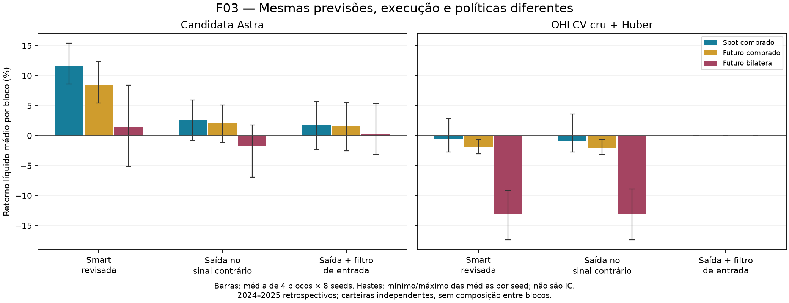

# F03 — Auditoria e resultados da revisão operacional

Execução `6c1a00a9967e2617b8b1`, concluída/conferida em 04/11/2026. **1.200 carteiras, zero treinamentos, mesmas 64 séries de previsões.** [Protocolo congelado](protocolo_revisao_operacional.md), [ADR0026](adr/0026-revisao-execucao-operacional.md), [estado](../registros/revisao_operacional/estado.json), [publicação](../dados/experimentos/revisao_operacional_6c1a00a9967e2617b8b1/publicacao/resultados.json).

## Conclusão

A revisão melhorou a correção e a auditabilidade da execução, mas não revelou uma estratégia claramente superior. A candidata Astra com Smart revisada preservou retorno positivo no Spot; permitir shorts reduziu bastante esse retorno. A saída integral no sinal contrário reduziu drawdown e exposição, porém também reduziu lucro. O ganho bilateral filtrado de+0,32% ficou negativo com custos maiores. O modelo cru+Huber continuou fraco; o filtro zerou suas operações, não melhorou sua capacidade de previsão.

Não houve alteração de MSE/MAE, pesos, treinamento ou seleção de seeds. O estudo anterior continua preservado. Não foi encontrada uma falha contábil que explique os prejuízos anteriores como meros erros de soma.

## O que foi corrigido e o que é hipótese

| Item | Tratamento |
|---|---|
| Comissão Spot | Compra desconta BTC recebido; venda desconta USDT. A F02 usava comissão equivalente em USDT. |
| Reversão futura | Fecha via reduceOnly, depois avalia margem para abrir a outra direção, inclusive se a quantidade nova for menor. |
| Pequenas reduções | ReduceOnly dispensa mínimo de abertura; Spot continua sujeito a lote/mínimo e pode deixar resíduo. |
| Arredondamento | Truncamento decimal e controle de precisão para não vender mais BTC do que há ou perder um lote por erro de ponto flutuante. |
| Dados/funding | Sinais causais, preços específicos por mercado, funding histórico no timestamp e posição mantida antes da execução. |
| Auditoria | Reconciliação independente da conta e das fórmulas de decisão; recálculo posterior de risco minuto a minuto. |
| Política direcional | Hipótese nova: fechar ao sinal contrário. Não é exigência da Binance nem conserto de previsão. |
| Filtro | Hipótese fixa: bloquear entradas/aumentos fracos, permitindo saída no sinal contrário; não otimizado pelo lucro. |

Auditoria dos ledgers F02: 528 reversões, 320 para posições menores/iguais; **nenhuma dessas 320 estava sem margem 1x**. A falha potencial do teste antigo de margem não se materializou nessas carteiras. Duas carteiras bilaterais terminaram com posição abaixo do mínimo antigo; F03 trata encerramentos via reduceOnly. [Diagnóstico do pai](../registros/revisao_operacional/diagnostico_pai.json).

## Como ler os números

Cada carteira começa com 10.000 USDT. São quatro blocos independentes de aproximadamente seis meses, com 181/183/180/183 dias, e oito seeds por modelo. Primeiro se calcula a média das seeds em cada bloco, depois a média igual dos quatro blocos. **+11,61% é retorno médio por bloco; não é retorno anual, nem acumulado de 2024–2025.** As médias não são uma carteira ensemble. Oito seeds não são oito mercados independentes.

Políticas: Smart ajusta gradualmente; direcional fecha toda a posição ao sinal contrário e pode abrir proporcionalmente a nova; filtrada faz o mesmo, mas exige previsão em módulo acima de≈0,30% para abrir/aumentar.2% é escala de intensidade, não stop loss. A Smart bilateral preserva a fórmula antiga, que altera também a redução de compras; a política direcional torna essa regra de saída comum aos dois braços.

Taxas base por lado:0,10% Spot / 0,05% futuros, mais 0,05% de derrapagem adversa. Funding histórico adicional em futuros. Estresse aumenta a derrapagem para 0,15%. Entradas até 1x e alvo 95% do patrimônio; sem alavancagem multiplicada. Resultados são avaliações retrospectivas, após exposição prévia aos períodos.

## Retorno líquido médio — cenário base

| Modelo | Política | Spot | Futuro comprado | Futuro bilateral |
| --- | --- | --- | --- | --- |
| Astra | Smart revisada | +11,61% | +8,44% | +1,46% |
| Astra | Saída no sinal contrário | +2,68% | +2,11% | -1,71% |
| Astra | Saída + filtro de entrada | +1,87% | +1,60% | +0,32% |
| Crua + Huber | Smart revisada | -0,52% | -1,97% | -13,12% |
| Crua + Huber | Saída no sinal contrário | -0,82% | -2,00% | -13,15% |
| Crua + Huber | Saída + filtro de entrada | +0,00% | +0,00% | +0,00% |

Comprar/manter 95% sem modelo: **Spot +21,11%, drawdown médio 28,90%; futuro comprado +15,97%, drawdown 30,09%**. Caixa/Naive de retorno zero:0%, sem ordens. A carteira passiva teve retorno maior e risco maior; isso não constitui comparação ajustada por risco/exposição nem prova que Smart tenha alfa.

## Risco e sensibilidade dos resultados Astra

| Política Astra | Mercado | Base | Custos maiores | Drawdown médio | Exposição média | Ordens médias |
| --- | --- | --- | --- | --- | --- | --- |
| Smart revisada | Spot comprado | +11,61% | +11,13% | 23,15% | 69,09% | 137,06 |
| Smart revisada | Futuro comprado | +8,44% | +8,02% | 23,04% | 66,74% | 88,50 |
| Smart revisada | Futuro bilateral | +1,46% | +0,80% | 24,12% | 63,04% | 106,38 |
| Saída no sinal contrário | Spot comprado | +2,68% | +1,40% | 15,97% | 33,35% | 133,00 |
| Saída no sinal contrário | Futuro comprado | +2,11% | +0,88% | 15,47% | 31,50% | 107,22 |
| Saída no sinal contrário | Futuro bilateral | -1,71% | -3,31% | 19,56% | 39,53% | 167,06 |
| Saída + filtro de entrada | Spot comprado | +1,87% | +1,14% | 11,70% | 21,73% | 33,12 |
| Saída + filtro de entrada | Futuro comprado | +1,60% | +0,90% | 11,57% | 21,12% | 31,69 |
| Saída + filtro de entrada | Futuro bilateral | +0,32% | -0,50% | 13,39% | 24,07% | 37,84 |

Drawdown é a maior queda do pico calculada em cada carteira usando fechamentos de minuto e pontos de execução; a tabela mostra a média dessas máximas, não o pior caso global nem resolução por tick. O envelope de margem usa também extremos intraminuto. Exposição é nocional absoluto/patrimônio ao longo dos minutos. Número de ordens inclui fechamento final e duas ordens em uma reversão; não confundir com quantidade de trades completos.

No Spot, sair no sinal contrário levou+11,61%→+2,68%, com drawdown23,15%→15,97%. O filtro reduziu mais o risco (11,70%), mas o retorno caiu para+1,87%. A alteração direcional foi pior que Smart nas médias das **oito seeds**, tanto no Spot quanto no futuro comprado. Isso não implica que Smart vencerá em outro mercado/período.

Nos futuros bilaterais, o filtro melhorou a média frente à direcional sem filtro em 2,03 pp e em 6/8 médias de seeds, mas o nível absoluto é frágil:+0,32% no cenário base e−0,50% no estresse. Não é evidência suficiente de estratégia lucrativa. Na crua+Huber,0% filtrado significa **zero ordens em todas as 32 carteiras**, equivalente a ficar em caixa.

## Estabilidade

| Política Astra | Mercado | Faixa das médias por seed | Seeds com média positiva | Carteiras positivas |
| --- | --- | --- | --- | --- |
| Smart revisada | Spot comprado | +8,57% a +15,40% | 8/8 | 23/32 |
| Smart revisada | Futuro bilateral | -5,11% a +8,41% | 7/8 | 18/32 |
| Saída no sinal contrário | Spot comprado | -0,79% a +5,92% | 6/8 | 18/32 |
| Saída no sinal contrário | Futuro bilateral | -6,93% a +1,78% | 2/8 | 16/32 |
| Saída + filtro de entrada | Spot comprado | -2,31% a +5,67% | 5/8 | 15/32 |
| Saída + filtro de entrada | Futuro bilateral | -3,12% a +5,40% | 4/8 | 15/32 |

| Astra Spot | B1/2024-S1 | B2/2024-S2 | B3/2025-S1 | B4/2025-S2 |
| --- | --- | --- | --- | --- |
| Smart revisada | +34,29% | +20,00% | +10,17% | -18,01% |
| Saída no sinal contrário | +9,76% | -0,12% | +12,81% | -11,72% |
| Saída + filtro de entrada | +3,53% | -0,20% | +12,57% | -8,42% |

O B4 foi negativo em todas as médias de política Astra acima. Seeds positivas no agregado não eliminam perdas por regime. Faixas são descritivas, não intervalos de confiança. Comparações múltiplas e períodos já consultados impedem tratar esta rodada como confirmação independente.

## Compras versus shorts: atribuição contábil

| Modelo | Política bilateral | Contribuição comprada | Contribuição vendida | Total |
| --- | --- | --- | --- | --- |
| Astra | Smart revisada | +4,78% | -3,32% | +1,46% |
| Astra | Saída no sinal contrário | +2,09% | -3,80% | -1,71% |
| Astra | Saída + filtro de entrada | +1,61% | -1,28% | +0,32% |
| Crua + Huber | Smart revisada | -2,01% | -11,12% | -13,12% |
| Crua + Huber | Saída no sinal contrário | -2,00% | -11,15% | -13,15% |
| Crua + Huber | Saída + filtro de entrada | +0,00% | +0,00% | +0,00% |

Contribuições em pontos percentuais sobre o capital inicial. Na política direcional Astra, a parte comprada contribuiu+2,09pp e shorts−3,80pp: total−1,71%. O short perdeu≈3,62pp em movimento de preço, pagou≈0,45pp em comissão/derrapagem e recebeu≈0,27pp de funding. Portanto, **não foi o funding que causou essa perda vendida**.

Essa atribuição não é uma métrica de precisão nem experimento causal isolado da habilidade de prever quedas. Tamanho/duração, intensidade das previsões, regime e patrimônio afetam a carteira. A política direcional eliminou a diferença arbitrária de regra de saída comprada; ainda assim, short prejudicou o resultado nesse histórico. O diagnóstico anterior de sinais também mostrou pouca discriminação direcional e movimentos adversos maiores que favoráveis após vários sinais negativos.

## Efeito da revisão técnica mantendo Smart

| Modelo | Mercado | F02 | F03 Smart | Diferença |
| --- | --- | --- | --- | --- |
| Astra | Spot comprado | +11,52% | +11,61% | 0,10 pp |
| Astra | Futuro comprado | +8,52% | +8,44% | -0,08 pp |
| Astra | Futuro bilateral | +1,46% | +1,46% | 0,00 pp |
| Crua + Huber | Spot comprado | -1,29% | -0,52% | 0,77 pp |
| Crua + Huber | Futuro comprado | -1,97% | -1,97% | 0,00 pp |
| Crua + Huber | Futuro bilateral | -13,08% | -13,12% | -0,05 pp |

F02 usa seu cenário por_mercado; F03 usa base, com mesmas taxas nominais/slippage. Há um pacote de mudanças de execução/filtros/ativo da comissão, portanto não atribuir todo delta a uma correção só. A revisão não criou uma mudança radical no ranking. Modelos e previsões são idênticos.

## Verificação, preservação e limites

- 27 testes sintéticos do módulo e 9 cenários adicionais qualificaram o reconstrutor de risco.
- As 1.200 carteiras possuem auditoria individual; a conferência posterior refez saldo, funding, retorno, drawdown e exposição, com cobertura exata e diferença máxima de retorno de4.77e-15 em unidade decimal (arredondamento numérico).
- Nenhuma recusa de saldo/margem/tamanho e nenhuma violação do envelope prudencial. Isso **não certifica liquidação real**. Resíduos Spot ficam marcados e discriminados; futuros encerraram sem resíduo.
- **37.390 arquivos anteriores íntegros**, fontes/receitas congeladas e fechamentos antigos preservados. Ledgers/curvas estão locais com hashes; não foi criado backup externo nem feito commit/push.
- Diagnóstico de volume posterior: maior quantidade por carteira/minuto representou 7,33% do volume Spot e 1,06% do futuro; P95≈0,33%/0,061%.29 ocorrências Spot acima de 5% entre 28.888 ocorrências (incluem diferentes seeds/políticas, não são eventos independentes). Nenhuma acima do volume total do minuto. Isso não comprova liquidez no instante, preenchimento integral ou derrapagem real; falta livro de ofertas.
- Filtros mínimos usados 10/100 USDT são conservadores, distintos do snapshot oficial corrente 5/50 USDT. Não há reconstrução completa de todos os filtros/tarifas/limites históricos da conta; podem ser excluídas pequenas ordens válidas. Mínimo aproximado pelo preço conhecido, não pela média exata da exchange.
- Sem stops/takes, fila de execução, falhas de conexão, impostos, comissão BNB ou liquidação oficial por níveis de manutenção. Acrescentar esses elementos é novo desenho identificado; não chamar a presente simulação de perfeita ou promessa de lucro real.

[Conferência completa](../registros/revisao_operacional/conferencias/2026-11-04T165017.695029_0000/conferencia.json), [manifesto](../registros/revisao_operacional/conferencias/2026-11-04T165017.695029_0000/manifesto.json), [fontes oficiais e premissas](protocolo_revisao_operacional.md#fontes-oficiais-consultadas).

## Decisão recomendada para o TCC

Manter a camada F03 como referência de execução auditada, preservando as políticas como escolhas explicitamente identificadas. Não promover saída integral/filtro como vencedores: houve troca entre retorno e risco, e a vantagem bilateral não resistiu bem aos custos. Concluir a análise operacional com caixa/comprar-manter e limitações; não ajustar sucessivamente o backtest até lucrar. Para evidência futura, congelar modelo/política e acompanhar novos dados sem retuning, antes de qualquer alegação operacional. A conclusão científica sobre sensibilidade à política, custos e regime é válida mesmo sem superioridade de lucro.
