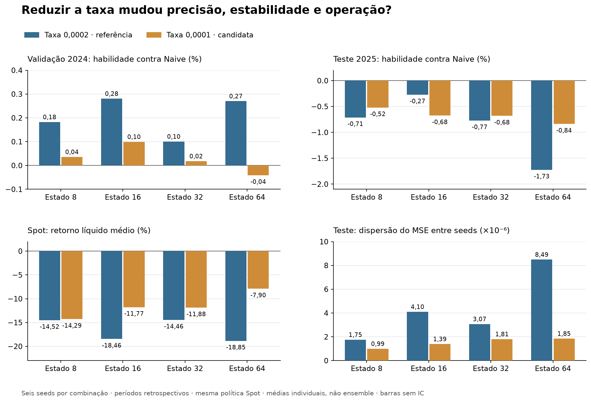

# Taxa de aprendizado:0,0002 versus0,0001 nos quatro estados

Execução `1af0a64e83d472ac533e`,24novos ajustes e29heranças. Estados8/16/32/64, mesmas seis seeds17/42/2026/7/123/31415. Dados/receita/política iguais dentro de cada par, alterando somente a taxa base. O [protocolo](protocolo_taxa_aprendizado.md) foi congelado antes do primeiro ajuste. A investigação anterior dos estados permanece [separada](resultados_estados32_64.md).

## Previsão: médias aritméticas de seis seeds

RMSE é a média dos RMSE individuais. Não ensemble/carteira. Habilidade negativa significa MSE maior que Naive.

### validacao

| Estado | Taxa | MSE ↓ | MAE×100 ↓ | RMSE×100 ↓ | Habilidade Naive | MSE00UTC ↓ |
|---|---|---:|---:|---:|---:|---:|
| 8 | 0,0002 | 0,000720546 | 1,9516 | 2,6843 | +0,182% | 0,000761274 |
| 8 | 0,0001 | 0,000721604 | 1,9525 | 2,6863 | +0,036% | 0,000761888 |
| 16 | 0,0002 | 0,000719838 | 1,9493 | 2,6830 | +0,280% | 0,000760609 |
| 16 | 0,0001 | 0,000721145 | 1,9522 | 2,6854 | +0,099% | 0,000763109 |
| 32 | 0,0002 | 0,000721137 | 1,9530 | 2,6854 | +0,101% | 0,000762239 |
| 32 | 0,0001 | 0,000721733 | 1,9533 | 2,6865 | +0,018% | 0,000763047 |
| 64 | 0,0002 | 0,000719912 | 1,9502 | 2,6831 | +0,270% | 0,000763315 |
| 64 | 0,0001 | 0,000722161 | 1,9548 | 2,6873 | -0,041% | 0,000766353 |

### teste

| Estado | Taxa | MSE ↓ | MAE×100 ↓ | RMSE×100 ↓ | Habilidade Naive | MSE00UTC ↓ |
|---|---|---:|---:|---:|---:|---:|
| 8 | 0,0002 | 0,000498745 | 1,5922 | 2,2333 | -0,712% | 0,000481463 |
| 8 | 0,0001 | 0,000497800 | 1,5908 | 2,2311 | -0,521% | 0,000480282 |
| 16 | 0,0002 | 0,000496570 | 1,5894 | 2,2284 | -0,272% | 0,000482273 |
| 16 | 0,0001 | 0,000498570 | 1,5918 | 2,2329 | -0,676% | 0,000480731 |
| 32 | 0,0002 | 0,000499044 | 1,5927 | 2,2339 | -0,772% | 0,000481765 |
| 32 | 0,0001 | 0,000498599 | 1,5912 | 2,2329 | -0,682% | 0,000479610 |
| 64 | 0,0002 | 0,000503767 | 1,5994 | 2,2444 | -1,726% | 0,000489006 |
| 64 | 0,0001 | 0,000499372 | 1,5934 | 2,2347 | -0,838% | 0,000479864 |

## Efeito da taxa e incerteza

Diferença=candidata0,0001−referência0,0002. Negativo favorece a redução. Quatro efeitos de validação formam a família primária; IC98,75% por Bonferroni mantém erro familiar nominal5%, sem corrigir toda seleção histórica/checkpoints. Teste é secundário retrospectivo, não escolhe taxa/seed.

| Parte | Estado | Variação MSE | IC95%14dias | IC98,75%14dias |
|---|---|---:|---|---|
| validacao | 8 | 0,147% | [-6.1901692e-07;2.7979006e-06] | [-1.0401188e-06;3.2769122e-06] |
| validacao | 16 | 0,182% | [-2.6016865e-06;5.4521534e-06] | [-3.7745289e-06;6.3494437e-06] |
| validacao | 32 | 0,083% | [-1.5074469e-06;2.7054047e-06] | [-2.0760741e-06;3.401052e-06] |
| validacao | 64 | 0,312% | [-2.2016016e-06;6.7417853e-06] | [-3.5195016e-06;8.0448287e-06] |
| teste | 8 | -0,190% | [-2.4856124e-06;5.0268439e-07] | [-2.8922327e-06;8.1383138e-07] |
| teste | 16 | 0,403% | [-2.0506784e-06;6.4349596e-06] | [-3.0981496e-06;7.5686157e-06] |
| teste | 32 | -0,089% | [-2.0906776e-06;1.2379304e-06] | [-2.5479469e-06;1.6205574e-06] |
| teste | 64 | -0,872% | [-9.9184633e-06;1.9141351e-07] | [-1.1567839e-05;1.1722295e-06] |

Critério previamente definido de evidência favorável em validação (média menor e IC98,75%14dias inteiramente negativo):

- Estado8: não atendido; não há evidência suficiente nesse procedimento para substituir a referência.

- Estado16: não atendido; não há evidência suficiente nesse procedimento para substituir a referência.

- Estado32: não atendido; não há evidência suficiente nesse procedimento para substituir a referência.

- Estado64: não atendido; não há evidência suficiente nesse procedimento para substituir a referência.

Esse resultado não promove automaticamente outra taxa/estado. Não interpretar inconclusão como igualdade ou IC exploratório como confirmação independente.

## Spot: resultados individuais médios

Mesma política R0 e sinais definidos antes do teste; custos base0,10%/slippage0,05% por lado. Bruto preserva os sinais. Drawdown médio não é risco de carteira média.

| Estado | Taxa | Bruto | Líquido base | Agravado | Drawdown base | Operações médias |
|---|---|---:|---:|---:|---:|---:|
| 8 | 0,0002 | -2,057% | -14,523% | -24,623% | +25,500% | 45,7 |
| 8 | 0,0001 | -6,104% | -14,292% | -21,147% | +18,472% | 32,2 |
| 16 | 0,0002 | -3,344% | -18,464% | -30,134% | +28,325% | 58,0 |
| 16 | 0,0001 | -0,166% | -11,774% | -20,850% | +22,067% | 40,8 |
| 32 | 0,0002 | +1,149% | -14,456% | -23,800% | +21,088% | 55,7 |
| 32 | 0,0001 | -3,762% | -11,879% | -18,901% | +17,089% | 29,8 |
| 64 | 0,0002 | -5,892% | -18,852% | -27,902% | +27,289% | 57,5 |
| 64 | 0,0001 | -1,068% | -7,903% | -13,741% | +17,797% | 25,2 |

## Seeds individuais

| Estado | Seed | MSE teste0,0002 | MSE teste0,0001 | MSE validação0,0002 | MSE validação0,0001 |
|---|---|---:|---:|---:|---:|
| 8 | 17 | 0,000496653 | 0,000496749 | 0,000720308 | 0,000721726 |
| 8 | 42 | 0,000499772 | 0,000497584 | 0,000722926 | 0,000722597 |
| 8 | 2026 | 0,000499321 | 0,000499663 | 0,000719330 | 0,000722315 |
| 8 | 7 | 0,000501329 | 0,000497268 | 0,000720815 | 0,000720964 |
| 8 | 123 | 0,000498319 | 0,000497722 | 0,000720399 | 0,000721332 |
| 8 | 31415 | 0,000497079 | 0,000497813 | 0,000719498 | 0,000720689 |
| 16 | 17 | 0,000496267 | 0,000497001 | 0,000718189 | 0,000720391 |
| 16 | 42 | 0,000489581 | 0,000500507 | 0,000719487 | 0,000721729 |
| 16 | 2026 | 0,000501822 | 0,000497521 | 0,000719816 | 0,000721530 |
| 16 | 7 | 0,000498167 | 0,000498262 | 0,000719567 | 0,000720737 |
| 16 | 123 | 0,000498364 | 0,000500002 | 0,000721403 | 0,000720955 |
| 16 | 31415 | 0,000495219 | 0,000498123 | 0,000720565 | 0,000721529 |
| 32 | 17 | 0,000504398 | 0,000497335 | 0,000716265 | 0,000719774 |
| 32 | 42 | 0,000499418 | 0,000499374 | 0,000722082 | 0,000722817 |
| 32 | 2026 | 0,000499525 | 0,000498943 | 0,000720678 | 0,000721845 |
| 32 | 7 | 0,000497857 | 0,000501691 | 0,000725478 | 0,000722715 |
| 32 | 123 | 0,000495101 | 0,000496893 | 0,000721250 | 0,000721863 |
| 32 | 31415 | 0,000497968 | 0,000497356 | 0,000721067 | 0,000721383 |
| 64 | 17 | 0,000520059 | 0,000500045 | 0,000711215 | 0,000719473 |
| 64 | 42 | 0,000500850 | 0,000500147 | 0,000722594 | 0,000723538 |
| 64 | 2026 | 0,000500538 | 0,000497958 | 0,000718522 | 0,000720080 |
| 64 | 7 | 0,000505538 | 0,000502414 | 0,000723151 | 0,000721990 |
| 64 | 123 | 0,000496878 | 0,000497858 | 0,000722731 | 0,000724154 |
| 64 | 31415 | 0,000498737 | 0,000497809 | 0,000721260 | 0,000723732 |

## Evidências e limites

[Conferência](../registros/taxa_aprendizado/conferencias/82f988b3caf946cd9042e6ca4e9ef9a2/conclusao.json), [comparação posterior](../registros/taxa_aprendizado/analises/d19f433a7aef4bf09dabf115288ab594/comparacao.json), [estado](../registros/taxa_aprendizado/estado.json) e [catálogo](../registros/catalogo_estudos.json). As publicações53resultados identificam cada tentativa e se ela foi nova/herdada. Fontes,checkpoint,seleção por validação,recarga exata e métricas foram preservados e conferidos. O pós-processamento não treinou modelos; referências/qualificações não são novos ajustes de mercado.

Mamba oficial/CUDA, mesmas entradas/escalas/origens e divisão fixa;2024/2025 já consultados. Não é walk-forward nem novo holdout. Repetição sintética e recarga exata não substituem repetição completa de mercado, excluída do orçamento24. Reduzir taxa afeta a trajetória e o decay efetivo AdamW; não é prova isolada de mecanismo causal. MSE não garante lucro; simulação não certifica execução Binance/ordens/livro. Sem backup externo comprovado.

## Análise do fechamento e recomendação

Revisão posterior à publicação:24/24ajustes concluídos, sem interrupções registradas e com uma tentativa concluída por célula. Treinos encerrados em29/10 às23:46:49UTC (20:46:49 de Brasília); pós-conferência final às23:51:48UTC (20:51:48). Esta revisão leu os53resultados, refez métricas por origem, conferiu fontes/manifestos e preservação, sem treinar ou reexecutar inferência CUDA. Dimensões/checkpoints e recarga são atestados pela conferência anterior preservada.

**Decisão recomendada: manter a referência16/lr0,0002.** A redução de taxa não satisfez o critério primário em nenhum dos quatro estados: o MSE médio de validação aumentou em todos e os ICs principais incluem zero. Isso não comprova que0,0001 seja universalmente pior; significa que este experimento não demonstrou benefício suficiente para substituir a referência. Teste/Spot não mudam retrospectivamente esse critério.

### Estabilidade entre seeds

Desvio-padrão do MSE de teste entre seis seeds, em unidades×10⁻⁶. Valores menores indicam menor dispersão observada; não foi realizado teste formal de igualdade de variâncias.

| Estado | Desvio taxa0,0002 | Desvio taxa0,0001 | Seeds com MSE de validação menor | Seeds com MSE de teste menor |
|---|---:|---:|---:|---:|
| 8 | 1,75 | 0,99 | 1/6 | 3/6 |
| 16 | 4,10 | 1,39 | 1/6 | 1/6 |
| 32 | 3,07 | 1,81 | 1/6 | 4/6 |
| 64 | 8,49 | 1,85 | 1/6 | 5/6 |

Todos os estados tiveram menor dispersão na taxa menor; cada estado teve melhora da validação em somente uma das seis seeds. No teste,8/32/64 reduziram a média de erro;16 aumentou. Nenhum dos24novos ajustes teve MSE de teste menor que Naive. O acerto balanceado médio das candidatas ficou entre49,70% e50,05%, sem evidência de discriminação direcional forte.

O estado64 concentrou aproximadamente75,9% da redução somada de MSE na seed17, que tinha o pior erro da receita antiga. O estado16 concentrou aproximadamente91,1% do aumento somado na seed42, que era muito favorável na receita antiga. Esse diagnóstico de concentração é posterior; todas as seeds continuam no resultado principal e não se descarta uma seed para melhorar a conclusão. No64 o IC95% com28dias fica ligeiramente abaixo de zero, mas o principal14dias e o IC98,75% incluem zero: não escolher a sensibilidade favorável depois de observar os dados.

### Operação, exposição e custos

A média líquida melhorou nos quatro estados, embora as médias de validação tenham piorado. A regra de execução é a mesma; previsões diferentes selecionaram outros dias e menos entradas. No64, operações médias57,5→25,2 e exposição15,80%→6,91% do calendário elegível. Custos observados médios1.500,84→724,53USDT. O bruto64 mudou de−5,89% para−1,07%, e o líquido−18,85%→−7,90% (redução do prejuízo em10,95pontos percentuais). A diferença combina seleção de dias,exposição,custos e composição do capital; não é lucro nem demonstração de melhor previsão.

Referências econômicas herdadas de R0 nas mesmas fronteiras/custos: caixa0%; comprar/manter−5,80%, drawdown35,99%. As oito médias de estratégias ficaram abaixo de ambas em retorno nominal; exposição e drawdown diferem, portanto não se conclui dominação em risco ajustado. A média64/0,0001 tem drawdown17,80%, com exposição muito menor. Não foi estimado IC financeiro.

As poucas seeds positivas não alteram o quadro:16/0,0001 seed17 ganhou0,02% em3operações; seed42 ganhou0,98% em49;32/0,0001 seed31415 ganhou4,99% em apenas uma operação. Não escolher a seed vencedora ou uma estratégia de exposição mínima a partir do teste.

### Grupo original de três seeds: diagnóstico secundário

Seeds17/42/2026. Este recorte é posterior e não substitui a comparação principal de seis seeds.

| Estado | MSE teste0,0002 | MSE teste0,0001 |
|---|---:|---:|
| 8 | 0,000498582 | 0,000497999 |
| 16 | 0,000495890 | 0,000498343 |
| 32 | 0,000501114 | 0,000498551 |
| 64 | 0,000507149 | 0,000499384 |

### Consequência para o estudo

A hipótese de taxa menor produziu saídas com menor dispersão entre inicializações, mas não um ganho demonstrado no critério de previsão.16/0,0002 continua com a menor média de validação e teste horário entre as oito receitas observadas; isso é ranking amostral, sem prova de ótimo universal. Encerrar esta hipótese e manter a referência evita mudar o objetivo para o resultado secundário que ficou mais favorável. Novas hipóteses devem investigar um fator por vez; nenhuma nova taxa/entrada/política fica autorizada por este relatório.2024/2025 permanecem retrospectivos, e confirmação temporal ampliada continua pendente.

[Dados e verificador desta análise posterior](../registros/taxa_aprendizado/revisoes/85bd9dd338ac4ad0b83aec9f1d7d1e38/analise.json). O relatório automático anterior está preservado no mesmo diretório de revisão, assim como suas publicações e recibos originais.
