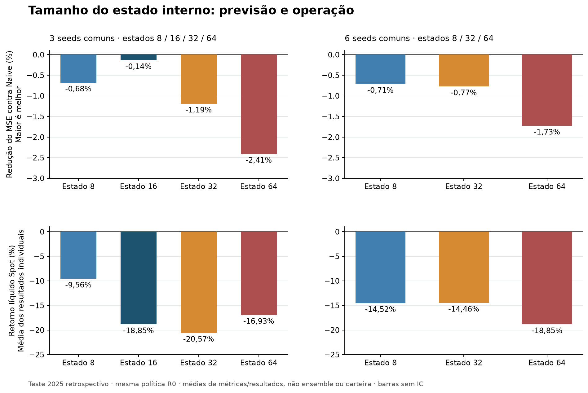

# Estados internos8/16/32/64 — fechamento e médias pareadas

Consolidação em29/10/2026, depois do encerramento de32 e64. Comparações exclusivamente de leitura, sem novo treino, escolha de seed ou alteração de política. O [relatório estado8](resultados_estado_mamba.md) permanece como fechamento daquela extensão; este documento fecha a sequência32→64 e consolida a investigação dos estados.

## Identidade e comparabilidade

| Estado | Execução | Seeds disponíveis | Parâmetros |
|---|---|---|---:|
| 8 | `dcf4b0ed9012f7247bce` | 17,42,2026,7,123,31415 | 17.185 |
| 16 | `ab5baf3eab3a2e66d8b2` | 17,42,2026 | 20.257 |
| 32 | `23c2ba54349bcc1b0ee1` | 17,42,2026,7,123,31415 | 26.401 |
| 64 | `42cb667ea43df563e3ac` | 17,42,2026,7,123,31415 | 38.689 |

Mesmos dados OHLCV transformados, scalers, origens, contexto168h, alvo24h, BTC/1h, divisão/purga, restante da arquitetura, AdamW e seleção por validação. A dimensão do estado é o fator arquitetural alterado e também modifica a quantidade de parâmetros. Mesma seed não significa tensores iniciais iguais em arquiteturas de dimensões diferentes.

Comparação dos quatro: média das seeds17/42/2026. Comparação de8/32/64: média das seis seeds. Não misturar a média de três do16 com seis das demais para atribuir diferença ao estado. As médias abaixo são aritméticas das métricas por seed, inclusive RMSE; não ensemble. Isso pode diferir ligeiramente da raiz do MSE médio usada em tabelas anteriores, sem mudar a média primária de MSE.

A sequência32→64 terminou às19:01:21UTC (16:01:21 de Brasília), após auditorias automáticas por rodada. A configuração64 foi congelada antes do primeiro treino32. São12 ajustes reais novos. As referências16/8/LSTM/Naive/ARIMA foram herdadas, sem novo ajuste. Protocolos, configurações, fontes, pesos e publicações permanecem separados; o dataset compartilhado é intencional.

## Média de três seeds: quatro estados

Habilidade =1−MSE_modelo/MSE_Naive. Valores positivos melhoram a referência; negativos pioram. MAE/RMSE×100 são pontos de log-retorno, aproximadamente pontos percentuais para pequenas variações, não probabilidade ou faixa garantida.

| Estado | MSE validação ↓ | MSE teste ↓ | Habilidade validação | Habilidade teste | MAE teste×100 ↓ | RMSE teste×100 ↓ |
|---|---:|---:|---:|---:|---:|---:|
| 8 | 0,000720855 | 0,000498582 | +0,140% | −0,679% | 1,5926 | 2,2329 |
| 16 | 0,000719164 | 0,000495890 | +0,374% | −0,135% | 1,5889 | 2,2268 |
| 32 | 0,000719675 | 0,000501114 | +0,303% | −1,190% | 1,5970 | 2,2386 |
| 64 | 0,000717444 | 0,000507149 | +0,612% | −2,409% | 1,6036 | 2,2519 |

Menor erro médio observado:16, seguido de8,32,64. O64 melhorou o ajuste selecionado na validação, mas teve o pior teste. Essa inversão é compatível com dificuldades de generalização; não prova que somente o estado cause todo sobreajuste. MSE bruto entre2024 e2025 não deve ser comparado como se os retornos tivessem a mesma variabilidade; o Naive também muda de erro entre anos.

| Estado | Acerto de direção | Acerto balanceado | Desvio do MSE entre seeds (×10⁻⁶) |
|---|---:|---:|---:|
| 8 | 51,08% | 49,88% | 1,69 |
| 16 | 51,58% | 50,62% | 6,13 |
| 32 | 51,40% | 50,07% | 2,85 |
| 64 | 50,53% | 49,70% | 11,18 |

Menor dispersão não implica menor erro:8 é mais consistente,16 tem menor MSE médio. A direção permanece perto de uma discriminação fraca; sempre prever alta daria51,42% de acurácia nessa população. Não foi calculada significância dos contrastes de direção.

## Média de seis seeds: três estados

| Estado | MSE validação ↓ | MSE teste ↓ | Habilidade validação | Habilidade teste | MAE teste×100 ↓ | RMSE teste×100 ↓ |
|---|---:|---:|---:|---:|---:|---:|
| 8 | 0,000720546 | 0,000498745 | +0,182% | −0,712% | 1,5922 | 2,2333 |
| 32 | 0,000721137 | 0,000499044 | +0,101% | −0,772% | 1,5927 | 2,2339 |
| 64 | 0,000719912 | 0,000503767 | +0,270% | −1,726% | 1,5994 | 2,2444 |

Estado32 teve0,060% mais MSE que8: diferença pequena e inconclusiva pelos intervalos. Estado64 teve1,007% mais MSE que8 e0,946% mais que32. Os intervalos temporais publicados/conferidos favorecem8 e32 frente a64 nas sensibilidades7/14/28 dias, sob o procedimento exploratório. O64 teve MSE maior que32 em cada uma das seis seeds; não selecionar um caso favorável para inverter a conclusão média.

| Estado | Acerto de direção | Acerto balanceado | Desvio do MSE entre seeds (×10⁻⁶) |
|---|---:|---:|---:|
| 8 | 51,10% | 49,88% | 1,75 |
| 32 | 51,16% | 50,02% | 3,07 |
| 64 | 50,74% | 49,74% | 8,49 |

O64 foi o mais variável entre seeds nesse grupo. O aumento de capacidade não gerou melhor discriminação direcional ou menor erro médio fora do treino.

## Incerteza pareada dos erros

A consolidação refez todos os pares solicitados com perdas alinhadas por origem e médias entre as mesmas seeds, bootstrap circular de dias7/14/28,2.000 réplicas. Contrastes adicionais são análises consolidadas exploratórias; não há correção global de multiplicidade ou garantia de confirmação independente.

| Grupo | Contraste | Variação observada do MSE | IC14 inclui zero? |
|---|---|---:|---|
| 3 | 16 contra8 | −0,540% | Sim |
| 3 | 32 contra8 | +0,508% | Sim |
| 3 | 32 contra16 | +1,053% | Não |
| 3 | 64 contra8 | +1,718% | Não |
| 3 | 64 contra16 | +2,270% | Não |
| 3 | 64 contra32 | +1,204% | Sim |
| 6 | 32 contra8 | +0,060% | Sim |
| 6 | 64 contra8 | +1,007% | Não |
| 6 | 64 contra32 | +0,946% | Não |

Variação positiva = mais erro no primeiro estado. O IC é calculado para a diferença de MSE, não para retorno financeiro. Em todos os casos cujo IC14 exclui zero nessa tabela, as sensibilidades7/28 mantiveram o sinal; isso continua condicionado aos modelos e amostra. Não interpretar inconclusão como prova de igualdade. As sementes não são séries de mercado independentes, e a avaliação2024/2025 permanece retrospectiva.

## Operação: médias de resultados individuais

Mesma política R0, taxas/slippage e contabilidade simplificada nas quatro configurações. Sem custos =mesmos sinais da regra base, sem buscar novo limiar. Drawdown médio é a média dos drawdowns por seed, não o risco de uma carteira combinada. Nenhuma nova sensibilidade Binance foi introduzida nesta consolidação.

| Três seeds | Retorno bruto | Retorno líquido base | Custos agravados | Drawdown médio | Operações médias |
|---|---:|---:|---:|---:|---:|
| Estado8 | −1,50% | −9,56% | −16,80% | 22,78% | 28,3 |
| Estado16 | −0,94% | −18,85% | −32,25% | 30,25% | 69,3 |
| Estado32 | +8,10% | −20,57% | −36,89% | 29,50% | 101,3 |
| Estado64 | −6,00% | −16,93% | −26,44% | 25,48% | 41,7 |

O menor erro médio do16 não se converteu no maior retorno líquido. O32 teve média bruta positiva, mas maior giro/custos e média líquida negativa. Nenhuma seed dessas três foi lucrativa no cenário base para qualquer estado. Não foi estimado IC de retorno; não declarar significância financeira.

| Seis seeds | Retorno bruto | Retorno líquido base | Custos agravados | Drawdown médio | Operações médias |
|---|---:|---:|---:|---:|---:|
| Estado8 | −2,06% | −14,52% | −24,62% | 25,50% | 45,7 |
| Estado32 | +1,15% | −14,46% | −23,80% | 21,09% | 55,7 |
| Estado64 | −5,89% | −18,85% | −27,90% | 27,29% | 57,5 |

As médias líquidas8/32 diferem somente0,067 ponto percentual. O desvio dos retornos entre seeds foi9,59/12,59/18,64 pontos percentuais em8/32/64. Não há vantagem operacional convincente a partir da pequena diferença das médias. Houve uma seed lucrativa em32 e uma em64, com somente2 e3 operações respectivamente; são casos com pouca exposição, não justificativa para selecionar a seed. Estado8 não teve seed lucrativa. As médias de todas as configurações ficaram negativas.

O ranking líquido depende do conjunto pareado: com três seeds,8 teve menor perda; com seis,32 ficou numericamente quase empatado com8. A mudança reforça a necessidade de manter o mesmo conjunto de seeds e mostrar dispersão. No capital inicial10.000USDT, as médias finais das seis seeds foram8.547,69/8.554,42/8.114,77USDT em8/32/64; não são carteiras executadas conjuntamente.

## Complexidade, custo do ajuste e períodos

| Estado | Parâmetros | Tempo médio ajuste3 seeds | Tempo médio ajuste6 seeds |
|---|---:|---:|---:|
| 8 | 17.185 | 125s | 154s |
| 16 | 20.257 | 218s | — |
| 32 | 26.401 | 170s | 155s |
| 64 | 38.689 | 196s | 178s |

Tempos incluem números diferentes de épocas devido à parada antecipada. Não constituem benchmark puro de velocidade do kernel nem demonstram que maior estado é mais rápido/lento por unidade de trabalho. Nas seis seeds, as épocas médias executadas foram17,5/16,5/19,2 em8/32/64. Maior número de parâmetros não trouxe ganho médio de previsão neste orçamento.

Na média das seis, habilidade trimestral contra Naive:8 =−0,52%,+0,83%,−0,07%,−2,35%;32 =−0,70%,+1,11%,−0,31%,−2,41%;64 =−1,23%,+0,06%,−0,67%,−4,12%. Não escolher somente trimestres favoráveis: a dificuldade de fim de2025 foi comum e mais acentuada no64.

## Conclusão e evidências

Nos três treinamentos comuns,16 teve o menor MSE médio observado. Nas seis seeds disponíveis,8/32 ficaram próximos e64 apresentou pior desempenho e maior dispersão. Todas as médias ficaram abaixo do Naive no MSE de teste e negativas na política Spot líquida. A evidência não sustenta a hipótese simples de que aumentar o estado melhora a previsão; também não estabelece um estado ótimo universal. É um resultado sob estas entradas, dados, otimização e orçamento.

As qualificações/checkpoints/publicações/auditorias das duas novas rodadas são separadas. As fontes e dados de16/8 foram preservados. A [consolidação verificável](../registros/estados_ampliados/comparacao_atual.json) aponta métricas por grupo, todos os contrastes, tentativas e hashes. Não houve nova execução de modelos. [Protocolo](protocolo_estados32_64.md), [catálogo](../registros/catalogo_estudos.json) e [andamento](andamento.md) distinguem proposto/autorizado/executado/conferido.

2024/2025 já eram conhecidos ao decidir estes experimentos. Os ICs são exploratórios e condicionais, sem ajuste global de seleção/multiplicidade; seis seeds não eliminam a limitação de uma divisão fixa. Revisão de representação/normalização e política de posição permanece para hipóteses separadas. Não há autorização automática para novos estados ou ajuste de parâmetros até obter lucro.
